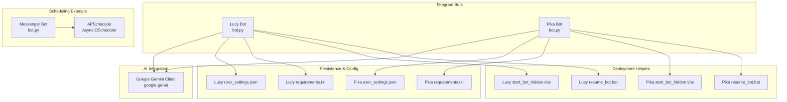
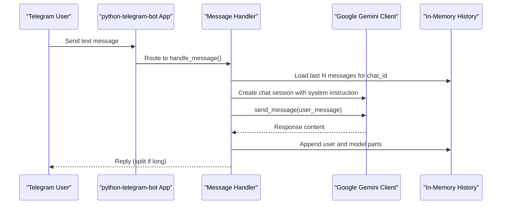
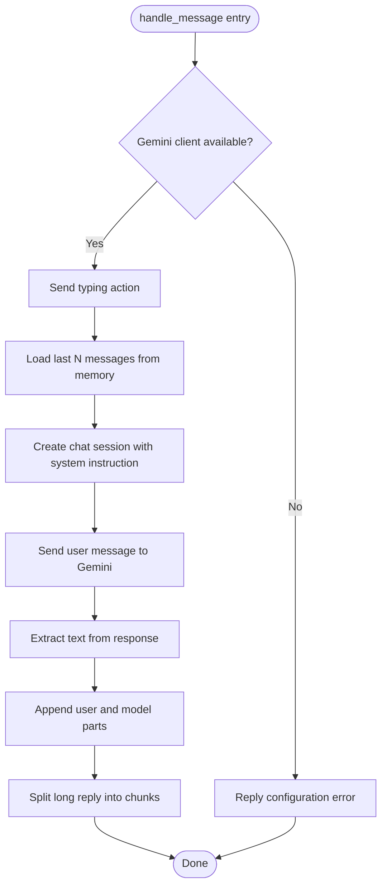
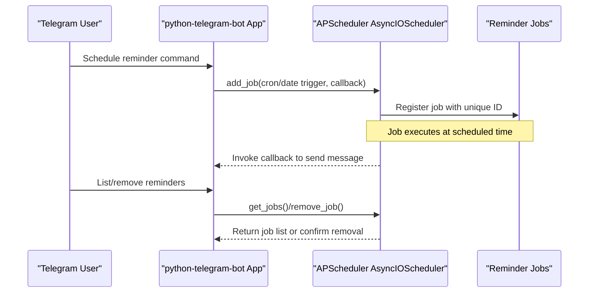
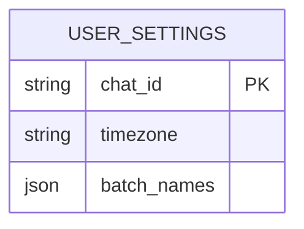
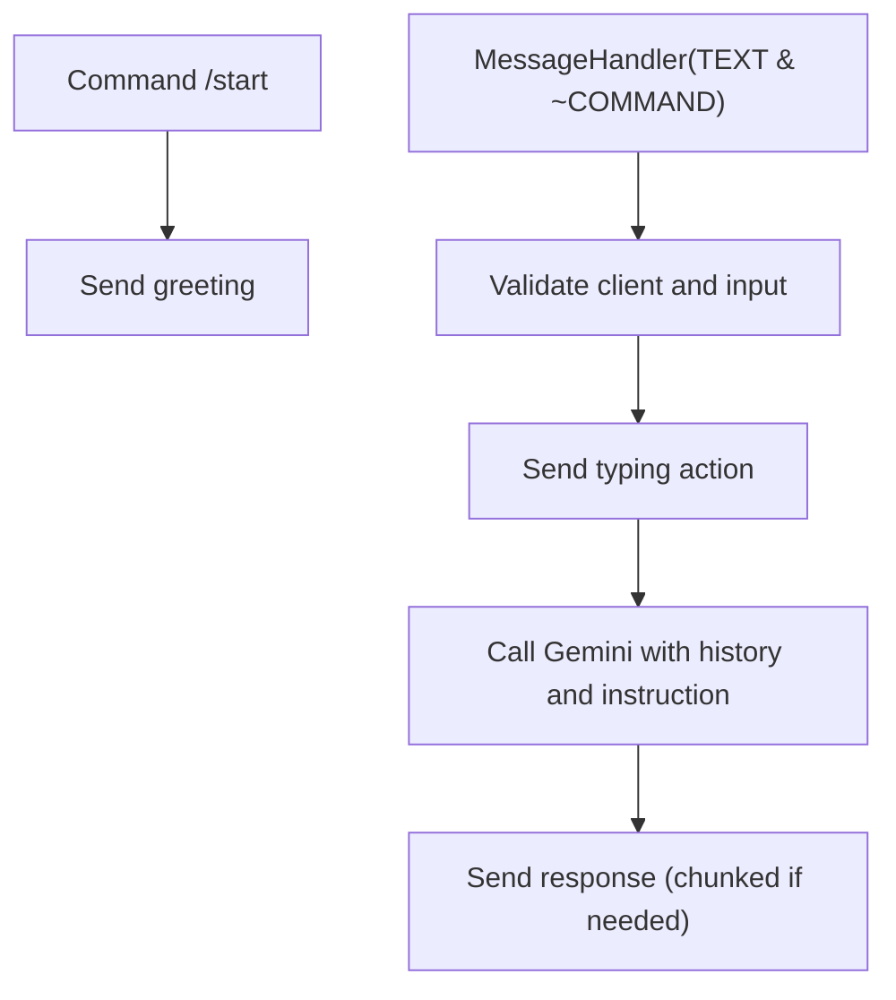
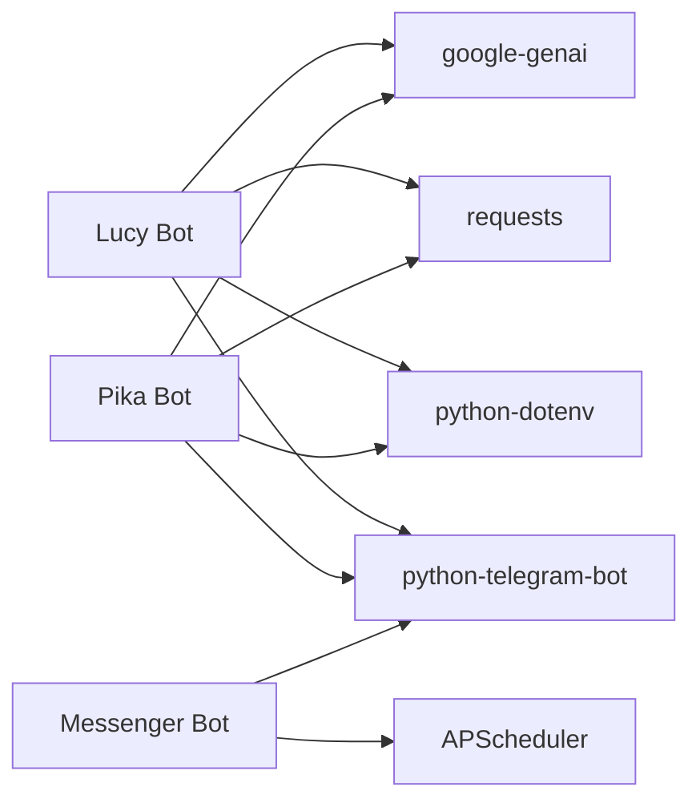

# Automation Bots

<cite>
**Referenced Files in This Document**
- [bot.py](file://python/telegram_bot/Lucy_bot/bot.py)
- [bot.py](file://python/telegram_bot/Pika_bot/bot.py)
- [requirements.txt](file://python/telegram_bot/Lucy_bot/requirements.txt)
- [requirements.txt](file://python/telegram_bot/Pika_bot/requirements.txt)
- [user_settings.json](file://python/telegram_bot/Lucy_bot/user_settings.json)
- [user_settings.json](file://python/telegram_bot/Pika_bot/user_settings.json)
- [test_models.py](file://python/telegram_bot/Lucy_bot/test_models.py)
- [test_models.py](file://python/telegram_bot/Pika_bot/test_models.py)
- [start_bot_hidden.vbs](file://python/telegram_bot/Lucy_bot/start_bot_hidden.vbs)
- [start_bot_hidden.vbs](file://python/telegram_bot/Pika_bot/start_bot_hidden.vbs)
- [resume_bot.bat](file://python/telegram_bot/Lucy_bot/resume_bot.bat)
- [resume_bot.bat](file://python/telegram_bot/Pika_bot/resume_bot.bat)
- [bot.py](file://python/messenger_bot/bot.py)
</cite>

## Table of Contents
1. [Introduction](#introduction)
2. [Project Structure](#project-structure)
3. [Core Components](#core-components)
4. [Architecture Overview](#architecture-overview)
5. [Detailed Component Analysis](#detailed-component-analysis)
6. [Dependency Analysis](#dependency-analysis)
7. [Performance Considerations](#performance-considerations)
8. [Troubleshooting Guide](#troubleshooting-guide)
9. [Conclusion](#conclusion)
10. [Appendices](#appendices)

## Introduction
This document explains the AI-powered Telegram bot automation systems implemented in Python. It covers two chatbots (Lucy and Pika) that integrate with Google Gemini for natural language processing, and a separate messenger bot that demonstrates time-aware scheduling using APScheduler. The guide also documents user state persistence, timezone handling, command processing patterns, message handling workflows, deployment practices, extension strategies, and security considerations for API keys and user data protection.

## Project Structure
The repository contains multiple Python projects. For this documentation, we focus on:
- Two Telegram bots (Lucy and Pika) built with python-telegram-bot and integrated with Google Gemini via google-genai.
- A messenger bot demonstrating APScheduler-based scheduling and reminders.
- Supporting scripts for environment setup and Windows startup helpers.

**Diagram sources**
- [bot.py:1-150](file://python/telegram_bot/Lucy_bot/bot.py#L1-L150)
- [bot.py:1-150](file://python/telegram_bot/Pika_bot/bot.py#L1-L150)
- [bot.py:1-600](file://python/messenger_bot/bot.py#L1-L600)
- [user_settings.json:1-23](file://python/telegram_bot/Lucy_bot/user_settings.json#L1-L23)
- [user_settings.json:1-23](file://python/telegram_bot/Pika_bot/user_settings.json#L1-L23)
- [requirements.txt:1-5](file://python/telegram_bot/Lucy_bot/requirements.txt#L1-L5)
- [requirements.txt:1-5](file://python/telegram_bot/Pika_bot/requirements.txt#L1-L5)
- [start_bot_hidden.vbs:1-29](file://python/telegram_bot/Lucy_bot/start_bot_hidden.vbs#L1-L29)
- [start_bot_hidden.vbs:1-29](file://python/telegram_bot/Pika_bot/start_bot_hidden.vbs#L1-L29)
- [resume_bot.bat:1-27](file://python/telegram_bot/Lucy_bot/resume_bot.bat#L1-L27)
- [resume_bot.bat:1-27](file://python/telegram_bot/Pika_bot/resume_bot.bat#L1-L27)

**Section sources**
- [bot.py:1-150](file://python/telegram_bot/Lucy_bot/bot.py#L1-L150)
- [bot.py:1-150](file://python/telegram_bot/Pika_bot/bot.py#L1-L150)
- [bot.py:1-600](file://python/messenger_bot/bot.py#L1-L600)
- [user_settings.json:1-23](file://python/telegram_bot/Lucy_bot/user_settings.json#L1-L23)
- [user_settings.json:1-23](file://python/telegram_bot/Pika_bot/user_settings.json#L1-L23)
- [requirements.txt:1-5](file://python/telegram_bot/Lucy_bot/requirements.txt#L1-L5)
- [requirements.txt:1-5](file://python/telegram_bot/Pika_bot/requirements.txt#L1-L5)
- [start_bot_hidden.vbs:1-29](file://python/telegram_bot/Lucy_bot/start_bot_hidden.vbs#L1-L29)
- [start_bot_hidden.vbs:1-29](file://python/telegram_bot/Pika_bot/start_bot_hidden.vbs#L1-L29)
- [resume_bot.bat:1-27](file://python/telegram_bot/Lucy_bot/resume_bot.bat#L1-L27)
- [resume_bot.bat:1-27](file://python/telegram_bot/Pika_bot/resume_bot.bat#L1-L27)

## Core Components
- Telegram Bot Framework: Both Lucy and Pika use python-telegram-bot ApplicationBuilder to register command and message handlers and run polling.
- AI Integration: Both bots initialize a Google Gemini client and create chat sessions with system instructions to shape personality and behavior.
- Message Handling: Text messages are processed, sent to Gemini, and streamed back; long responses are split into Telegram-compatible chunks.
- State Management: In-memory conversation histories per chat_id are maintained to preserve context across turns.
- Configuration: Environment variables for bot token and Gemini API key; optional .env loading.
- User Settings: Per-user JSON files store timezone and batch names for future features.
- Scheduling Example: A separate messenger bot demonstrates APScheduler integration for cron/date-triggered tasks and reminder management.

**Section sources**
- [bot.py:1-150](file://python/telegram_bot/Lucy_bot/bot.py#L1-L150)
- [bot.py:1-150](file://python/telegram_bot/Pika_bot/bot.py#L1-L150)
- [bot.py:1-600](file://python/messenger_bot/bot.py#L1-L600)
- [user_settings.json:1-23](file://python/telegram_bot/Lucy_bot/user_settings.json#L1-L23)
- [user_settings.json:1-23](file://python/telegram_bot/Pika_bot/user_settings.json#L1-L23)

## Architecture Overview
The architecture centers around an event-driven Telegram bot that routes incoming messages to handlers. Handlers interact with Google Gemini to generate responses while maintaining per-chat conversation history. A separate scheduler-based bot shows how to schedule recurring or one-off tasks asynchronously within the same event loop.

**Diagram sources**
- [bot.py:69-108](file://python/telegram_bot/Lucy_bot/bot.py#L69-L108)
- [bot.py:69-108](file://python/telegram_bot/Pika_bot/bot.py#L69-L108)

## Detailed Component Analysis

### Lucy Bot
- Entry point: Initializes environment, loads tokens, creates Gemini client, builds application, registers handlers, and runs polling.
- Command handler: Responds to /start with a greeting.
- Message handler: Validates client availability, sends typing action, constructs system instruction, retrieves recent history, creates chat session, sends message, extracts text, updates history, and replies.
- Helpers: Long message splitter and response extractor.
- Error handling: Catches exceptions and informs the user.

**Diagram sources**
- [bot.py:69-108](file://python/telegram_bot/Lucy_bot/bot.py#L69-L108)

**Section sources**
- [bot.py:1-150](file://python/telegram_bot/Lucy_bot/bot.py#L1-L150)

### Pika Bot
- Mirrors Lucy’s structure with a different personality instruction and greeting.
- Same message flow: validate client, type indicator, history retrieval, chat session creation, message sending, extraction, history update, and chunked reply.

**Diagram sources**
- [bot.py:69-108](file://python/telegram_bot/Pika_bot/bot.py#L69-L108)

**Section sources**
- [bot.py:1-150](file://python/telegram_bot/Pika_bot/bot.py#L1-L150)

### Messenger Bot with APScheduler
- Demonstrates asynchronous scheduling using AsyncIOScheduler with CronTrigger and DateTrigger.
- Manages reminders per chat, including adding, modifying, listing, and removing jobs.
- Provides functions to parse target times, detect overlaps, and reschedule when conflicts occur.
- Integrates with the Telegram bot lifecycle by running the scheduler alongside message handlers.

**Diagram sources**
- [bot.py:1-600](file://python/messenger_bot/bot.py#L1-L600)

**Section sources**
- [bot.py:1-600](file://python/messenger_bot/bot.py#L1-L600)

### User State Persistence and Timezone Handling
- In-memory conversation histories are stored per chat_id to maintain context across turns.
- Per-user settings files include timezone identifiers and batch name mappings for future scheduling or personalization features.
- Timezone values are stored as IANA timezone strings, enabling consistent scheduling and display formatting once integrated with scheduler callbacks.

**Diagram sources**
- [user_settings.json:1-23](file://python/telegram_bot/Lucy_bot/user_settings.json#L1-L23)
- [user_settings.json:1-23](file://python/telegram_bot/Pika_bot/user_settings.json#L1-L23)

**Section sources**
- [user_settings.json:1-23](file://python/telegram_bot/Lucy_bot/user_settings.json#L1-L23)
- [user_settings.json:1-23](file://python/telegram_bot/Pika_bot/user_settings.json#L1-L23)

### Command Processing Patterns and Message Handling Workflows
- Commands: Minimal /start handler provides onboarding messages.
- Messages: Non-command text is routed to a unified handler that interacts with Gemini and maintains conversation history.
- Filters: Only TEXT messages not starting with commands are processed.
- Streaming UX: Typing action is sent before calling Gemini to improve perceived responsiveness.

**Diagram sources**
- [bot.py:60-131](file://python/telegram_bot/Lucy_bot/bot.py#L60-L131)
- [bot.py:60-131](file://python/telegram_bot/Pika_bot/bot.py#L60-L131)

**Section sources**
- [bot.py:60-131](file://python/telegram_bot/Lucy_bot/bot.py#L60-L131)
- [bot.py:60-131](file://python/telegram_bot/Pika_bot/bot.py#L60-L131)

### Deployment Guides
- Environment Setup: Use the provided resume script to create/activate a virtual environment and install dependencies from requirements.txt.
- Windows Startup: Use the hidden start script to launch the bot without a visible console window; it checks for existing processes to avoid duplicates.
- Production Notes:
  - Ensure TELEGRAM_BOT_TOKEN and GEMINI_API_KEY are set securely in environment variables or .env.
  - Pin dependency versions in requirements.txt for reproducibility.
  - Run the bot under a service manager (e.g., systemd, Task Scheduler) for reliability and auto-restart.
  - Monitor logs and configure structured logging for production observability.

**Section sources**
- [resume_bot.bat:1-27](file://python/telegram_bot/Lucy_bot/resume_bot.bat#L1-L27)
- [resume_bot.bat:1-27](file://python/telegram_bot/Pika_bot/resume_bot.bat#L1-L27)
- [start_bot_hidden.vbs:1-29](file://python/telegram_bot/Lucy_bot/start_bot_hidden.vbs#L1-L29)
- [start_bot_hidden.vbs:1-29](file://python/telegram_bot/Pika_bot/start_bot_hidden.vbs#L1-L29)
- [requirements.txt:1-5](file://python/telegram_bot/Lucy_bot/requirements.txt#L1-L5)
- [requirements.txt:1-5](file://python/telegram_bot/Pika_bot/requirements.txt#L1-L5)

### Extending Bot Functionality and Integrating External APIs
- Add new commands: Register additional CommandHandler instances in the main setup section.
- Integrate external APIs: Use requests or async HTTP clients within message handlers to fetch or post data, then format results for Telegram replies.
- Persist user preferences: Read/write user_settings.json to support per-user configurations such as timezone, language, or feature toggles.
- Schedule tasks: Adopt APScheduler patterns from the messenger bot to add cron-based or date-triggered actions (e.g., daily summaries).

[No sources needed since this section provides general guidance]

### Security Considerations for API Keys and User Data Protection
- Secrets Management: Store TELEGRAM_BOT_TOKEN and GEMINI_API_KEY in environment variables or secure secret stores; do not hardcode them.
- Input Validation: Sanitize and validate user inputs before passing to external APIs or executing scheduled tasks.
- Rate Limiting and Quotas: Implement retry/backoff and quota checks when calling Gemini or other services.
- Data Minimization: Keep only necessary conversation history in memory; consider rotating or truncating older entries.
- Logging Safety: Avoid logging sensitive data (tokens, user messages containing PII).

[No sources needed since this section provides general guidance]

## Dependency Analysis
Key dependencies for the Telegram bots:
- python-telegram-bot for bot framework and handlers.
- python-dotenv for optional .env loading.
- requests for HTTP calls (if used).
- google-genai for Gemini integration.

**Diagram sources**
- [requirements.txt:1-5](file://python/telegram_bot/Lucy_bot/requirements.txt#L1-L5)
- [requirements.txt:1-5](file://python/telegram_bot/Pika_bot/requirements.txt#L1-L5)
- [bot.py:1-600](file://python/messenger_bot/bot.py#L1-L600)

**Section sources**
- [requirements.txt:1-5](file://python/telegram_bot/Lucy_bot/requirements.txt#L1-L5)
- [requirements.txt:1-5](file://python/telegram_bot/Pika_bot/requirements.txt#L1-L5)
- [bot.py:1-600](file://python/messenger_bot/bot.py#L1-L600)

## Performance Considerations
- Conversation History Size: Truncate to recent messages to reduce payload size and latency.
- Response Chunking: Split long replies to comply with Telegram message limits and improve streaming UX.
- Concurrency: Use async handlers and avoid blocking operations; leverage asyncio-friendly libraries.
- Scheduler Efficiency: Deduplicate jobs and remove overlapping schedules to prevent redundant executions.
- Resource Usage: Periodically reset or persist state to avoid unbounded memory growth.

[No sources needed since this section provides general guidance]

## Troubleshooting Guide
- Missing Tokens: If TELEGRAM_BOT_TOKEN or GEMINI_API_KEY are not set, the bot prints errors and exits early.
- Gemini Errors: Exceptions during API calls are caught and reported to the user; check logs for details.
- Event Loop Issues: Explicitly creating an event loop can help on newer Python versions; ensure compatibility with your runtime.
- Duplicate Processes: Windows start scripts check for existing processes to prevent multiple instances.
- Model Availability: Use test scripts to enumerate supported models and verify API access.

**Section sources**
- [bot.py:113-149](file://python/telegram_bot/Lucy_bot/bot.py#L113-L149)
- [bot.py:113-149](file://python/telegram_bot/Pika_bot/bot.py#L113-L149)
- [test_models.py:1-14](file://python/telegram_bot/Lucy_bot/test_models.py#L1-L14)
- [test_models.py:1-14](file://python/telegram_bot/Pika_bot/test_models.py#L1-L14)
- [start_bot_hidden.vbs:6-25](file://python/telegram_bot/Lucy_bot/start_bot_hidden.vbs#L6-L25)
- [start_bot_hidden.vbs:6-25](file://python/telegram_bot/Pika_bot/start_bot_hidden.vbs#L6-L25)

## Conclusion
The Telegram bots demonstrate a clean, modular design integrating Google Gemini for conversational AI, with clear separation between command handling, message processing, and state management. The messenger bot showcases robust scheduling capabilities using APScheduler. Together, these components provide a solid foundation for building scalable, time-aware, and AI-enhanced Telegram automation systems.

[No sources needed since this section summarizes without analyzing specific files]

## Appendices
- Environment Variables:
  - TELEGRAM_BOT_TOKEN: Required for Telegram authentication.
  - GEMINI_API_KEY: Required for Google Gemini integration.
- File Locations:
  - Bot code: python/telegram_bot/Lucy_bot/bot.py, python/telegram_bot/Pika_bot/bot.py
  - Scheduling example: python/messenger_bot/bot.py
  - User settings: python/telegram_bot/Lucy_bot/user_settings.json, python/telegram_bot/Pika_bot/user_settings.json
  - Dependencies: python/telegram_bot/Lucy_bot/requirements.txt, python/telegram_bot/Pika_bot/requirements.txt
  - Deployment helpers: python/telegram_bot/Lucy_bot/start_bot_hidden.vbs, python/telegram_bot/Pika_bot/start_bot_hidden.vbs, python/telegram_bot/Lucy_bot/resume_bot.bat, python/telegram_bot/Pika_bot/resume_bot.bat

[No sources needed since this section lists references without analyzing specific files]