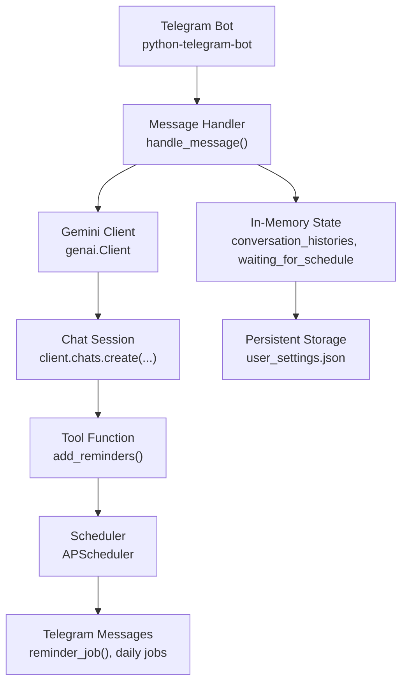
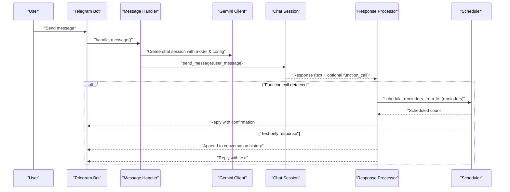
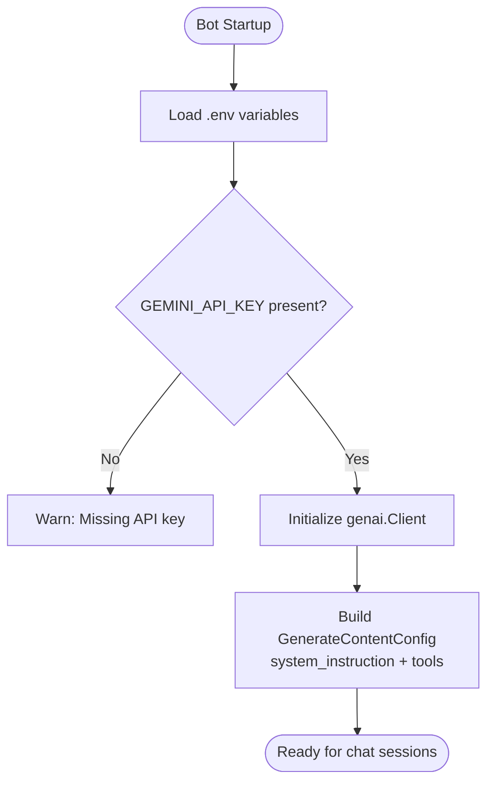
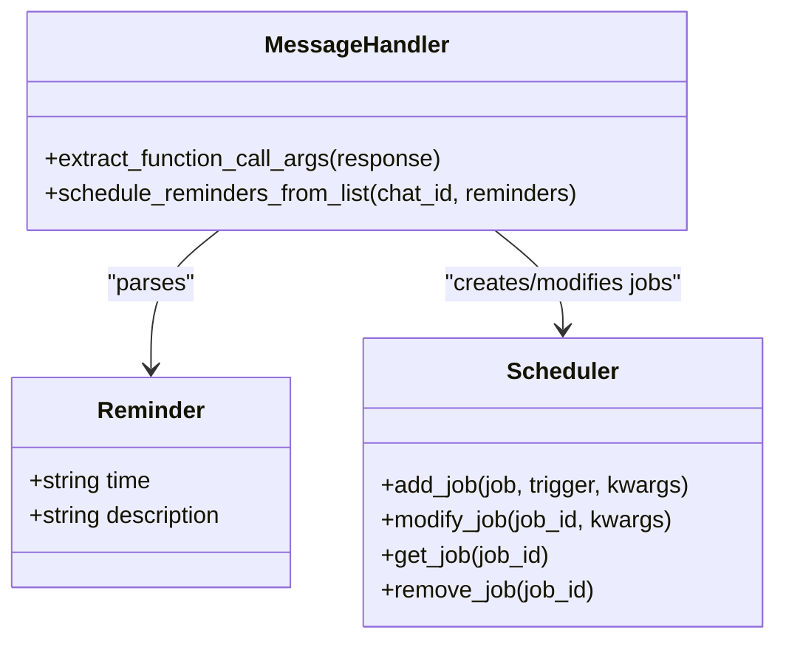
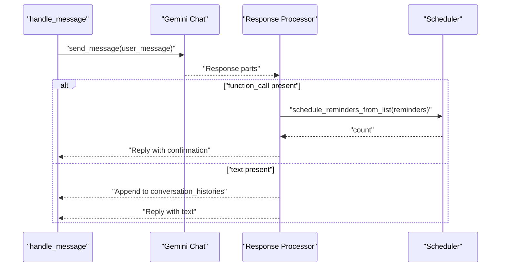
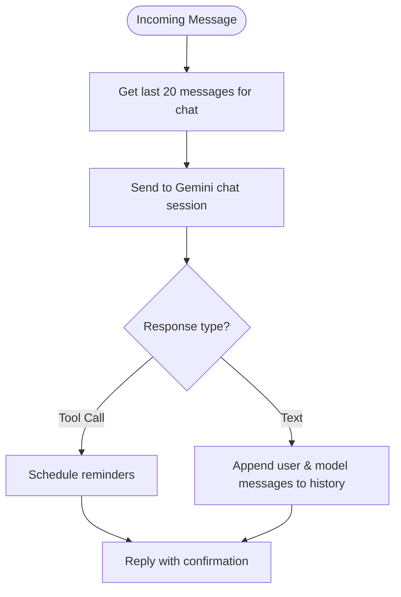
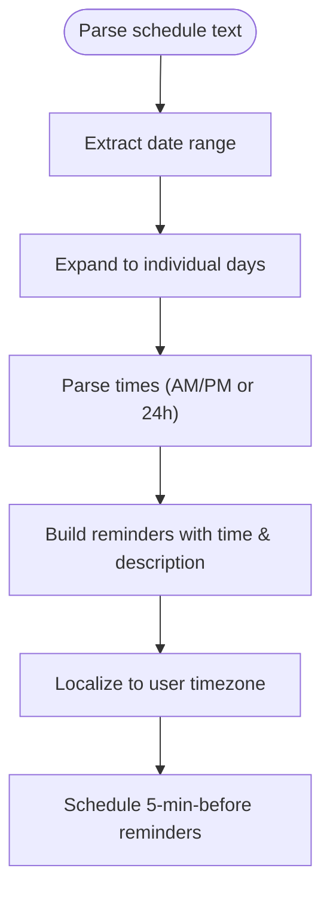
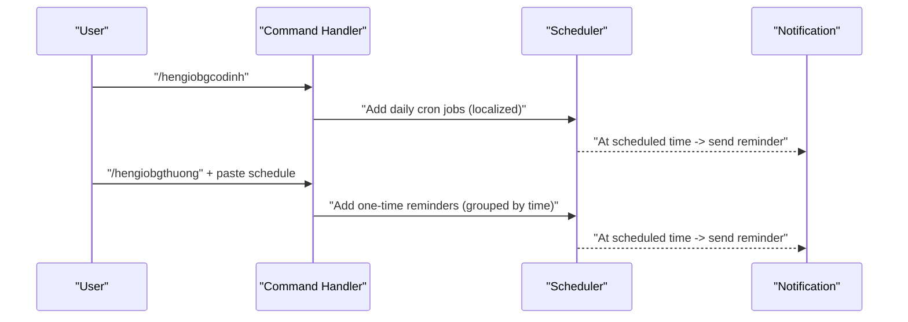
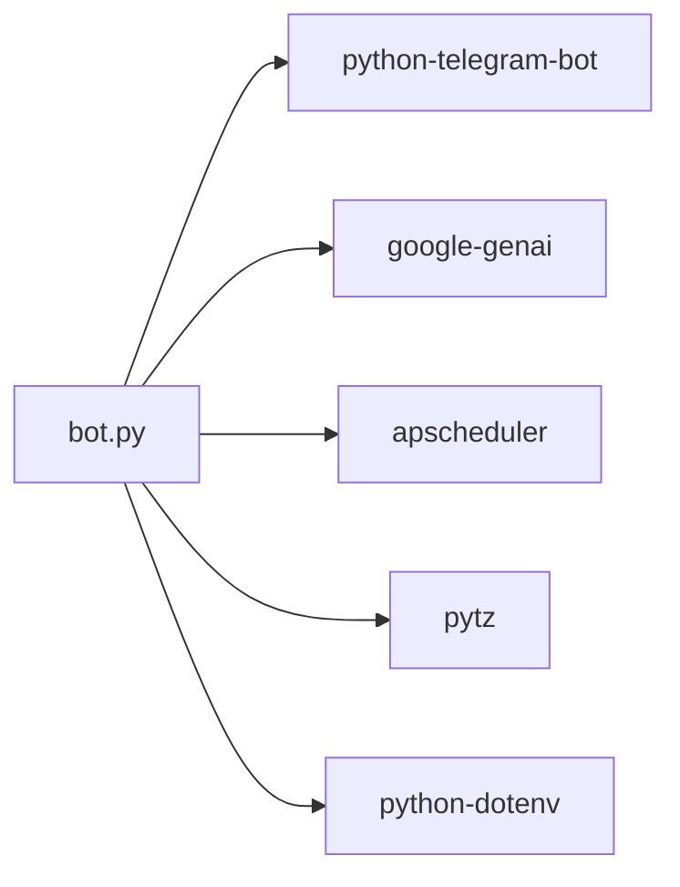

# AI Integration (Google Gemini)

<cite>
**Referenced Files in This Document**
- [bot.py](file://python/messenger_bot/bot.py)
- [requirements.txt](file://python/messenger_bot/requirements.txt)
- [test_models.py](file://python/messenger_bot/test_models.py)
</cite>

## Table of Contents
1. [Introduction](#introduction)
2. [Project Structure](#project-structure)
3. [Core Components](#core-components)
4. [Architecture Overview](#architecture-overview)
5. [Detailed Component Analysis](#detailed-component-analysis)
6. [Dependency Analysis](#dependency-analysis)
7. [Performance Considerations](#performance-considerations)
8. [Troubleshooting Guide](#troubleshooting-guide)
9. [Conclusion](#conclusion)

## Introduction
This document explains the Google Gemini AI integration used by the messenger bot to process natural language scheduling requests, manage persistent chat sessions, and coordinate reminders with timezone awareness. It covers:
- AI client initialization and model configuration using gemini-2.0-flash-lite
- Tool function system for extracting schedule information via add_reminders
- System instruction setup and response processing
- Conversation history management with message limits and context preservation
- Error handling for API failures
- Examples of how user messages are processed to extract scheduling information, parse timezone-aware dates, and generate culturally appropriate responses in Vietnamese

## Project Structure
The messenger bot is implemented as a single Python module that integrates Telegram messaging, Google Gemini AI, and an in-process scheduler for reminders. Key files:
- bot.py: Main application logic including AI integration, commands, scheduling, storage, and message handling
- requirements.txt: Dependencies for Telegram, Gemini, scheduling, and environment loading
- test_models.py: Utility script to list available models supporting generateContent

**Diagram sources**
- [bot.py:16-37](file://python/messenger_bot/bot.py#L16-L37)
- [bot.py:69-73](file://python/messenger_bot/bot.py#L69-L73)
- [bot.py:100-113](file://python/messenger_bot/bot.py#L100-L113)
- [bot.py:192-245](file://python/messenger_bot/bot.py#L192-L245)
- [bot.py:1102-1147](file://python/messenger_bot/bot.py#L1102-L1147)

**Section sources**
- [bot.py:1-37](file://python/messenger_bot/bot.py#L1-L37)
- [requirements.txt:1-7](file://python/messenger_bot/requirements.txt#L1-L7)

## Core Components
- AI Client Initialization: The Gemini client is created from an API key loaded from environment variables. The model is set to gemini-2.0-flash-lite.
- Model Configuration: GenerateContentConfig includes a system instruction tailored for the assistant persona and registers the tool function add_reminders.
- Tool Function System: add_reminders is declared as a tool; when the model returns a function call, the bot schedules reminders accordingly.
- Conversation Management: Per-chat conversation histories are maintained in memory with a limit of recent messages to preserve context while controlling token usage.
- Scheduling and Timezones: APScheduler manages one-time and daily reminder jobs with timezone-aware triggers based on user preferences stored in JSON.
- Storage: User settings (timezone, batch names, pending reminders) are persisted to user_settings.json for resilience across restarts.

**Section sources**
- [bot.py:29-33](file://python/messenger_bot/bot.py#L29-L33)
- [bot.py:100-113](file://python/messenger_bot/bot.py#L100-L113)
- [bot.py:69-73](file://python/messenger_bot/bot.py#L69-L73)
- [bot.py:192-245](file://python/messenger_bot/bot.py#L192-L245)
- [bot.py:44-64](file://python/messenger_bot/bot.py#L44-L64)

## Architecture Overview
The flow begins when a user sends a message to the Telegram bot. The handler constructs a Gemini chat session with a system instruction and tool definitions, sends the message, and processes the response. If the model calls add_reminders, the bot schedules reminders grouped by time slots and responds with confirmation. Conversation history is appended only when no tool call occurs, preserving context for subsequent interactions.

**Diagram sources**
- [bot.py:710-795](file://python/messenger_bot/bot.py#L710-L795)
- [bot.py:174-191](file://python/messenger_bot/bot.py#L174-L191)
- [bot.py:192-245](file://python/messenger_bot/bot.py#L192-L245)

## Detailed Component Analysis

### AI Client Initialization and Model Configuration
- Client creation uses the Gemini API key from environment variables. If missing, the bot informs the user about configuration issues.
- The model is fixed to gemini-2.0-flash-lite for fast, cost-effective inference suitable for conversational tasks and tool use.
- GenerateContentConfig sets a system instruction defining persona, tone, and behavior, and registers the add_reminders tool.

**Diagram sources**
- [bot.py:23-33](file://python/messenger_bot/bot.py#L23-L33)
- [bot.py:109-113](file://python/messenger_bot/bot.py#L109-L113)

**Section sources**
- [bot.py:23-33](file://python/messenger_bot/bot.py#L23-L33)
- [bot.py:109-113](file://python/messenger_bot/bot.py#L109-L113)

### Tool Function System: add_reminders
- The add_reminders tool is registered in the Gemini configuration. When invoked by the model, it receives a list of reminders with time and description fields.
- The bot groups reminders by target_time, merges duplicates into a single job per timeslot, and schedules them to fire 5 minutes before the event.
- Batch naming allows grouping multiple signals under a named pair (e.g., new user and referrer), improving display clarity in notifications.

**Diagram sources**
- [bot.py:100-113](file://python/messenger_bot/bot.py#L100-L113)
- [bot.py:174-191](file://python/messenger_bot/bot.py#L174-L191)
- [bot.py:192-245](file://python/messenger_bot/bot.py#L192-L245)

**Section sources**
- [bot.py:100-113](file://python/messenger_bot/bot.py#L100-L113)
- [bot.py:192-245](file://python/messenger_bot/bot.py#L192-L245)

### System Instruction Setup and Response Processing
- System instruction defines the assistant’s identity, tone, and rules for tool usage. It also injects the current local time based on the user’s timezone to improve temporal reasoning.
- Response processing extracts either text or function calls. If a function call occurs, reminders are scheduled and a confirmation message is sent. Otherwise, the exchange is added to conversation history.

**Diagram sources**
- [bot.py:757-795](file://python/messenger_bot/bot.py#L757-L795)
- [bot.py:174-191](file://python/messenger_bot/bot.py#L174-L191)
- [bot.py:192-245](file://python/messenger_bot/bot.py#L192-L245)

**Section sources**
- [bot.py:757-795](file://python/messenger_bot/bot.py#L757-L795)

### Conversation History Management and Context Preservation
- Each chat maintains a list of Content dicts representing recent messages. Only the last 20 exchanges are kept to balance context retention with efficiency.
- History is updated only when the response is text-only; tool-call flows skip appending to avoid redundant entries.
- Persistent storage supports timezone and batch names, enabling consistent behavior across restarts.

**Diagram sources**
- [bot.py:69-73](file://python/messenger_bot/bot.py#L69-L73)
- [bot.py:766-790](file://python/messenger_bot/bot.py#L766-L790)

**Section sources**
- [bot.py:69-73](file://python/messenger_bot/bot.py#L69-L73)
- [bot.py:766-790](file://python/messenger_bot/bot.py#L766-L790)

### Timezone-Aware Date Parsing and Cultural Context
- User timezone is stored per chat and defaults to Asia/Ho_Chi_Minh if invalid. All scheduled reminders are localized to the user’s timezone.
- Reminders are scheduled to fire 5 minutes before the target time, ensuring timely notifications.
- Responses use Vietnamese cultural conventions (e.g., respectful address “Sếp”, friendly tone, emojis).

**Diagram sources**
- [bot.py:917-1023](file://python/messenger_bot/bot.py#L917-L1023)
- [bot.py:192-245](file://python/messenger_bot/bot.py#L192-L245)
- [bot.py:57-64](file://python/messenger_bot/bot.py#L57-L64)

**Section sources**
- [bot.py:57-64](file://python/messenger_bot/bot.py#L57-L64)
- [bot.py:917-1023](file://python/messenger_bot/bot.py#L917-L1023)
- [bot.py:192-245](file://python/messenger_bot/bot.py#L192-L245)

### Scheduled Jobs and Daily Signals
- Fixed daily signals are configured at specific times (e.g., 1:30 PM, 7:30 PM, 10:30 PM) with optional IPO-specific notes.
- One-time reminders are grouped by target_time to minimize job duplication and allow merging updates.
- After restart, jobs are restored from storage to maintain continuity.

**Diagram sources**
- [bot.py:316-339](file://python/messenger_bot/bot.py#L316-L339)
- [bot.py:387-423](file://python/messenger_bot/bot.py#L387-L423)
- [bot.py:424-429](file://python/messenger_bot/bot.py#L424-L429)
- [bot.py:1043-1097](file://python/messenger_bot/bot.py#L1043-L1097)

**Section sources**
- [bot.py:316-339](file://python/messenger_bot/bot.py#L316-L339)
- [bot.py:387-423](file://python/messenger_bot/bot.py#L387-L423)
- [bot.py:424-429](file://python/messenger_bot/bot.py#L424-L429)
- [bot.py:1043-1097](file://python/messenger_bot/bot.py#L1043-L1097)

## Dependency Analysis
The bot depends on:
- python-telegram-bot for message handling and sending
- google-genai for Gemini AI integration
- apscheduler for scheduling reminders
- pytz for timezone handling
- python-dotenv for environment variable loading

**Diagram sources**
- [requirements.txt:1-7](file://python/messenger_bot/requirements.txt#L1-L7)

**Section sources**
- [requirements.txt:1-7](file://python/messenger_bot/requirements.txt#L1-L7)

## Performance Considerations
- Conversation history is limited to the last 20 exchanges to reduce payload size and latency.
- Reminders are grouped by target_time to minimize the number of scheduled jobs and reduce overhead.
- Using gemini-2.0-flash-lite balances speed and cost for conversational tasks and tool invocation.
- Long messages are split into chunks to comply with platform limits.

[No sources needed since this section provides general guidance]

## Troubleshooting Guide
Common issues and resolutions:
- Missing API key: The bot checks for GEMINI_API_KEY and notifies the user if absent. Ensure .env contains the correct key.
- API errors: Exceptions during Gemini calls are caught and reported to the user with a friendly message.
- Schedule parsing failures: If no valid schedule is found, the bot prompts the user to re-paste clearer input.
- Job restoration: On startup, the bot restores daily signals and one-time reminders from storage; skipped past-due jobs are logged.

**Section sources**
- [bot.py:746-748](file://python/messenger_bot/bot.py#L746-L748)
- [bot.py:792-795](file://python/messenger_bot/bot.py#L792-L795)
- [bot.py:884-914](file://python/messenger_bot/bot.py#L884-L914)
- [bot.py:1043-1097](file://python/messenger_bot/bot.py#L1043-L1097)

## Conclusion
The messenger bot integrates Google Gemini AI to transform natural language scheduling inputs into actionable reminders with timezone awareness and culturally appropriate responses. The tool-based approach enables robust extraction of schedule details, while in-memory and persistent state management ensures reliable operation across interactions and restarts. The architecture balances performance, usability, and maintainability through careful design of conversation history limits, job grouping, and error handling.

[No sources needed since this section summarizes without analyzing specific files]