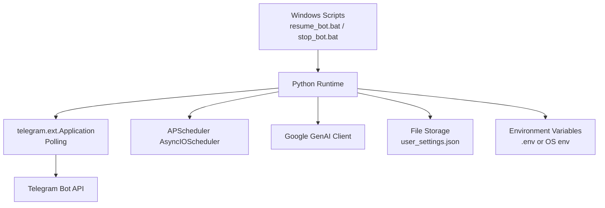
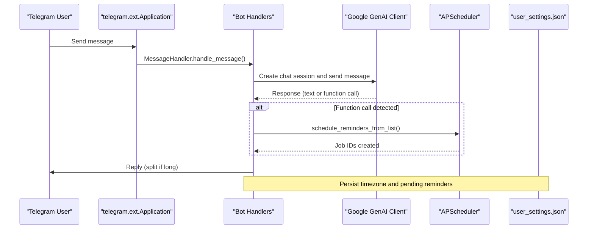
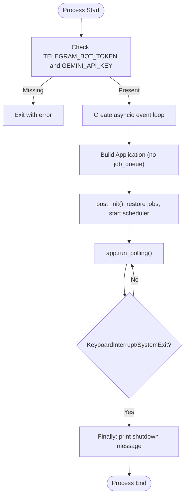
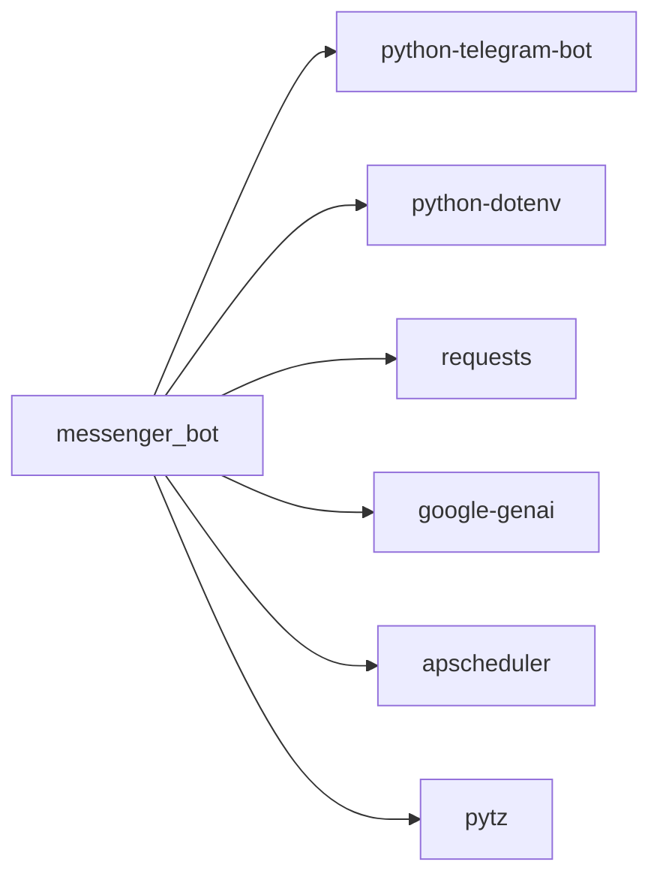

# Deployment & Configuration

<cite>
**Referenced Files in This Document**
- [bot.py](file://python/messenger_bot/bot.py)
- [requirements.txt](file://python/messenger_bot/requirements.txt)
- [test_models.py](file://python/messenger_bot/test_models.py)
- [resume_bot.bat](file://python/messenger_bot/resume_bot.bat)
- [stop_bot.bat](file://python/messenger_bot/stop_bot.bat)
</cite>

## Table of Contents
1. [Introduction](#introduction)
2. [Project Structure](#project-structure)
3. [Core Components](#core-components)
4. [Architecture Overview](#architecture-overview)
5. [Detailed Component Analysis](#detailed-component-analysis)
6. [Dependency Analysis](#dependency-analysis)
7. [Performance Considerations](#performance-considerations)
8. [Troubleshooting Guide](#troubleshooting-guide)
9. [Conclusion](#conclusion)
10. [Appendices](#appendices)

## Introduction
This document provides production-ready deployment and configuration guidance for the messenger bot. It covers environment variable setup, Python dependencies installation, process management for long-running execution, logging and error monitoring strategies, graceful shutdown handling, resource management, and deployment options including Docker containerization, systemd service setup, and cloud platform deployment. It also includes troubleshooting guides, security best practices for API key management, and performance optimization tips for high-volume messaging scenarios.

## Project Structure
The messenger bot is implemented as a single Python application with supporting scripts:
- Core bot logic and scheduling are in bot.py
- Dependencies are declared in requirements.txt
- A test utility to list available models is provided by test_models.py
- Windows helper scripts manage virtual environment creation, dependency installation, and process termination

**Diagram sources**
- [bot.py:1-37](file://python/messenger_bot/bot.py#L1-L37)
- [bot.py:1102-1161](file://python/messenger_bot/bot.py#L1102-L1161)
- [requirements.txt:1-7](file://python/messenger_bot/requirements.txt#L1-L7)
- [resume_bot.bat:1-27](file://python/messenger_bot/resume_bot.bat#L1-L27)
- [stop_bot.bat:1-13](file://python/messenger_bot/stop_bot.bat#L1-L13)

**Section sources**
- [bot.py:1-37](file://python/messenger_bot/bot.py#L1-L37)
- [bot.py:1102-1161](file://python/messenger_bot/bot.py#L1102-L1161)
- [requirements.txt:1-7](file://python/messenger_bot/requirements.txt#L1-L7)
- [resume_bot.bat:1-27](file://python/messenger_bot/resume_bot.bat#L1-L27)
- [stop_bot.bat:1-13](file://python/messenger_bot/stop_bot.bat#L1-L13)

## Core Components
- Environment variables: TELEGRAM_BOT_TOKEN and GEMINI_API_KEY are read at startup; missing values cause immediate exit or runtime errors.
- Telegram integration: Uses python-telegram-bot ApplicationBuilder with polling enabled.
- Scheduling: APScheduler AsyncIOScheduler manages daily fixed reminders and one-time scheduled reminders.
- AI integration: Google GenAI client is used for chat interactions and tool-based reminder extraction.
- Persistence: user_settings.json stores per-user timezone and pending reminders.

Key behaviors relevant to production:
- Startup validation ensures required tokens are present before starting.
- Scheduler starts after the event loop is ready via post_init hook.
- On restart, scheduler jobs are restored from storage for both daily and one-time reminders.
- Long messages are split into chunks to respect Telegram limits.

**Section sources**
- [bot.py:23-37](file://python/messenger_bot/bot.py#L23-L37)
- [bot.py:1102-1161](file://python/messenger_bot/bot.py#L1102-L1161)
- [bot.py:1040-1097](file://python/messenger_bot/bot.py#L1040-L1097)
- [bot.py:341-347](file://python/messenger_bot/bot.py#L341-L347)

## Architecture Overview
The bot runs as a long-lived process that polls Telegram for updates, processes messages using an AI model, schedules reminders via APScheduler, and persists state to a JSON file.

**Diagram sources**
- [bot.py:710-795](file://python/messenger_bot/bot.py#L710-L795)
- [bot.py:192-245](file://python/messenger_bot/bot.py#L192-L245)
- [bot.py:1102-1161](file://python/messenger_bot/bot.py#L1102-L1161)

## Detailed Component Analysis

### Environment Variables and Secrets Management
- Required variables:
  - TELEGRAM_BOT_TOKEN: Obtained from BotFather; used to authenticate with Telegram Bot API.
  - GEMINI_API_KEY: Used to initialize the Google GenAI client for chat and tools.
- Loading mechanism:
  - The bot attempts to load .env via python-dotenv if available; otherwise it reads from the OS environment.
  - Missing TELEGRAM_BOT_TOKEN causes startup failure with a clear message.
  - Missing GEMINI_API_KEY disables AI features and returns an error on message processing.
- Production recommendations:
  - Use a secure secrets manager or platform-provided environment injection (e.g., Docker secrets, Kubernetes Secrets, cloud provider secret managers).
  - Never commit secrets to version control; ensure .env is excluded.
  - Validate presence of both variables at process start.

**Section sources**
- [bot.py:23-32](file://python/messenger_bot/bot.py#L23-L32)
- [bot.py:746-748](file://python/messenger_bot/bot.py#L746-L748)
- [bot.py:1112-1118](file://python/messenger_bot/bot.py#L1112-L1118)
- [test_models.py:1-14](file://python/messenger_bot/test_models.py#L1-L14)

### Python Dependencies Installation
- Dependencies are defined in requirements.txt:
  - python-telegram-bot==21.1.1
  - python-dotenv==1.0.1
  - requests==2.31.0
  - google-genai
  - apscheduler==3.10.4
  - pytz
- Installation methods:
  - Automated script: resume_bot.bat creates a virtual environment, activates it, and installs dependencies from requirements.txt.
  - Manual method: Create a virtual environment and run pip install -r requirements.txt.
- Production considerations:
  - Pin versions for reproducibility.
  - Use isolated environments per deployment instance.
  - Verify dependency integrity and update periodically with security scanning.

**Section sources**
- [requirements.txt:1-7](file://python/messenger_bot/requirements.txt#L1-L7)
- [resume_bot.bat:7-20](file://python/messenger_bot/resume_bot.bat#L7-L20)

### Process Management and Long-Running Execution
- Startup flow:
  - Validates environment variables.
  - Creates an asyncio event loop explicitly for compatibility.
  - Builds telegram.ext.Application with job_queue disabled and uses APScheduler directly.
  - Starts scheduler in post_init after the event loop is running.
  - Enters polling loop until interrupted.
- Graceful shutdown:
  - KeyboardInterrupt and SystemExit are caught; additional exceptions related to event loop cleanup on Windows are suppressed to avoid noisy logs.
  - Finally block prints a shutdown message.
- Process supervision:
  - Windows helpers: resume_bot.bat to prepare environment and stop_bot.bat to terminate running bot processes.
  - For production, use a process supervisor (systemd, Docker, cloud managed services) to auto-restart on failure and manage lifecycle.

**Diagram sources**
- [bot.py:1112-1161](file://python/messenger_bot/bot.py#L1112-L1161)

**Section sources**
- [bot.py:1102-1161](file://python/messenger_bot/bot.py#L1102-L1161)
- [resume_bot.bat:1-27](file://python/messenger_bot/resume_bot.bat#L1-L27)
- [stop_bot.bat:1-13](file://python/messenger_bot/stop_bot.bat#L1-L13)

### Logging Configuration
- Current behavior:
  - Prints startup and shutdown messages.
  - Logs incoming messages and errors to stdout/stderr.
- Production recommendations:
  - Configure structured logging (JSON) to a centralized logging system.
  - Route logs to files or log aggregation services (e.g., CloudWatch, Stackdriver, ELK).
  - Include correlation IDs per request/chat to trace flows.
  - Avoid printing sensitive data in logs.

[No sources needed since this section provides general guidance]

### Error Monitoring
- Current behavior:
  - Catches and prints exceptions during message handling and schedule parsing.
  - Suppresses specific event loop cleanup errors on Windows to reduce noise.
- Production recommendations:
  - Integrate an error tracking service (e.g., Sentry) to capture stack traces and context.
  - Instrument metrics for message throughput, error rates, and scheduler job success/failure.
  - Add health checks and readiness probes for orchestration platforms.

[No sources needed since this section provides general guidance]

### Resource Management
- In-memory state:
  - Conversation histories are kept per chat_id with a bounded window to limit memory usage.
- File persistence:
  - user_settings.json stores timezone and pending reminders; operations include safe load/save with exception handling.
- Scheduler:
  - Jobs are identified by unique IDs per chat and time slot; duplicates are merged to avoid redundant jobs.
- Recommendations:
  - Periodically rotate or archive user_settings.json if it grows large.
  - Monitor memory usage and adjust history window size based on workload.
  - Ensure atomic writes to storage to prevent corruption.

**Section sources**
- [bot.py:44-55](file://python/messenger_bot/bot.py#L44-L55)
- [bot.py:192-245](file://python/messenger_bot/bot.py#L192-L245)
- [bot.py:1040-1097](file://python/messenger_bot/bot.py#L1040-L1097)

### Deployment Options

#### Docker Containerization
- Base image: Use a slim Python image matching your runtime version.
- Install dependencies: Copy requirements.txt and run pip install inside the container.
- Environment: Inject TELEGRAM_BOT_TOKEN and GEMINI_API_KEY via container environment variables or secrets.
- Health check: Implement a simple HTTP endpoint or command to verify bot connectivity and scheduler status.
- Restart policy: Set appropriate restart policies to ensure resilience.

[No sources needed since this section provides general guidance]

#### systemd Service Setup
- Service unit: Define a service that runs the bot under a dedicated user, sets working directory, and configures environment variables.
- Logging: Redirect stdout/stderr to journal or log files.
- Auto-restart: Enable Restart=on-failure and configure RestartSec.
- Security: Run as non-root user and restrict filesystem access.

[No sources needed since this section provides general guidance]

#### Cloud Platform Deployment
- Managed services: Deploy as a containerized app on platforms like AWS ECS, Google Cloud Run, Azure Container Apps, or Kubernetes.
- Secrets: Use platform-native secret management to inject TELEGRAM_BOT_TOKEN and GEMINI_API_KEY.
- Scaling: Scale horizontally if needed; note that APScheduler state is in-process and per-instance, so consider sticky sessions or shared state if necessary.
- Observability: Enable metrics, tracing, and centralized logging.

[No sources needed since this section provides general guidance]

## Dependency Analysis
The bot depends on external libraries for Telegram integration, scheduling, AI interaction, and environment loading.

**Diagram sources**
- [requirements.txt:1-7](file://python/messenger_bot/requirements.txt#L1-L7)

**Section sources**
- [requirements.txt:1-7](file://python/messenger_bot/requirements.txt#L1-L7)

## Performance Considerations
- High-volume messaging:
  - Use connection pooling and rate limiting where applicable.
  - Batch operations and minimize per-message overhead.
  - Consider caching frequently accessed data (e.g., timezone lookups).
- Scheduler efficiency:
  - Merge duplicate reminders to reduce job count.
  - Remove obsolete jobs promptly when users disable reminders.
- AI model usage:
  - Limit conversation history length to control token usage and latency.
  - Handle timeouts and retries gracefully.
- I/O:
  - Prefer async I/O patterns; avoid blocking calls in handlers.
  - Write logs asynchronously to reduce latency.

[No sources needed since this section provides general guidance]

## Troubleshooting Guide
Common issues and resolutions:
- Missing TELEGRAM_BOT_TOKEN:
  - Symptom: Bot exits immediately with an error indicating missing token.
  - Resolution: Provide TELEGRAM_BOT_TOKEN in environment or .env file.
- Missing GEMINI_API_KEY:
  - Symptom: AI features disabled; message handler returns an error instructing to configure the key.
  - Resolution: Provide GEMINI_API_KEY in environment or .env file.
- Scheduler not firing:
  - Symptom: Reminders do not trigger.
  - Resolution: Ensure scheduler is started in post_init and jobs are restored on restart; verify timezone settings and job IDs.
- Process not stopping cleanly:
  - Symptom: Event loop cleanup errors on Windows.
  - Resolution: Accept suppression of specific errors; use proper process supervisor to terminate.
- Dependencies not installed:
  - Symptom: Import errors when running the bot.
  - Resolution: Use resume_bot.bat or manually create a virtual environment and install requirements.txt.

**Section sources**
- [bot.py:1112-1118](file://python/messenger_bot/bot.py#L1112-L1118)
- [bot.py:746-748](file://python/messenger_bot/bot.py#L746-L748)
- [bot.py:1102-1109](file://python/messenger_bot/bot.py#L1102-L1109)
- [bot.py:1145-1155](file://python/messenger_bot/bot.py#L1145-L1155)
- [resume_bot.bat:7-20](file://python/messenger_bot/resume_bot.bat#L7-L20)

## Conclusion
For production deployment, ensure robust environment variable management, isolate dependencies, supervise the process, and implement comprehensive logging and error monitoring. Follow the recommended practices for Docker, systemd, and cloud platforms to achieve reliability and scalability. Regularly review performance and security posture, especially around API keys and resource usage.

[No sources needed since this section summarizes without analyzing specific files]

## Appendices

### Environment Variables Reference
- TELEGRAM_BOT_TOKEN: Required; authenticates with Telegram Bot API.
- GEMINI_API_KEY: Required for AI features; initializes Google GenAI client.

**Section sources**
- [bot.py:29-32](file://python/messenger_bot/bot.py#L29-L32)
- [test_models.py:5-6](file://python/messenger_bot/test_models.py#L5-L6)

### Security Best Practices
- Store secrets securely using platform-native secret managers.
- Restrict access to environment variables and files containing secrets.
- Rotate API keys regularly and audit usage.
- Avoid logging sensitive information.

[No sources needed since this section provides general guidance]