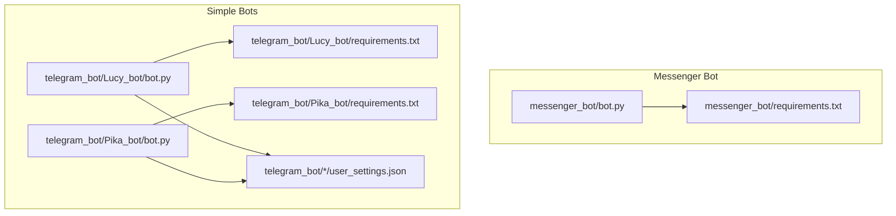
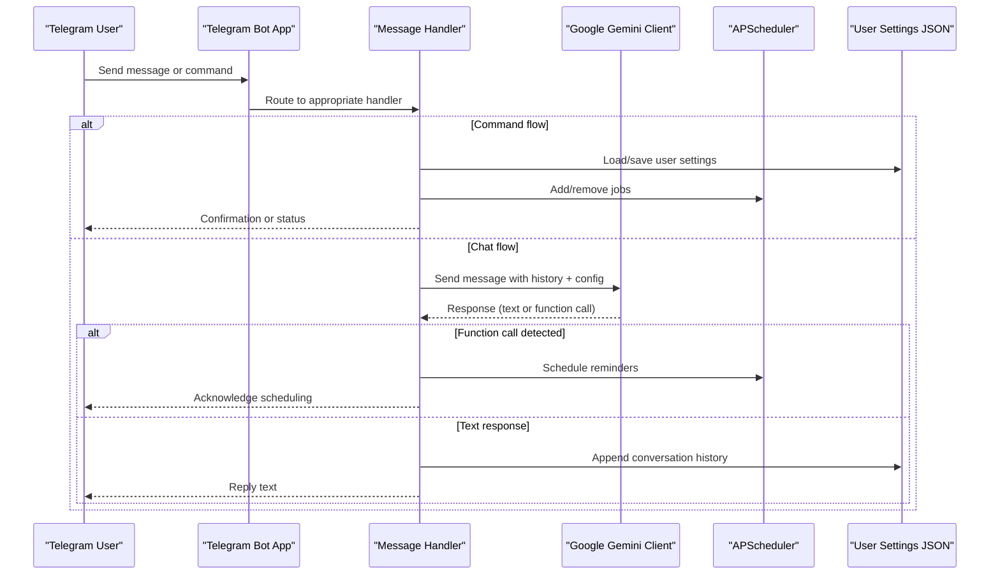
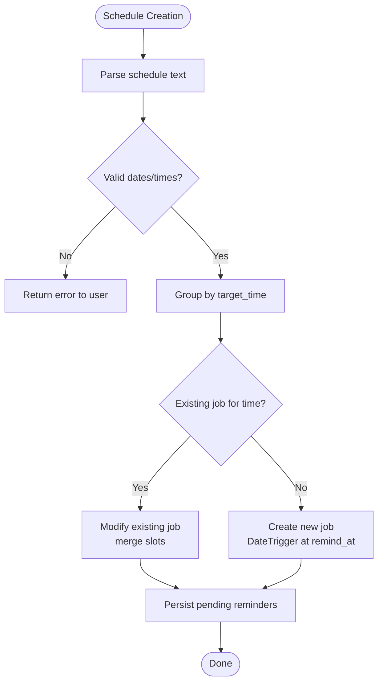
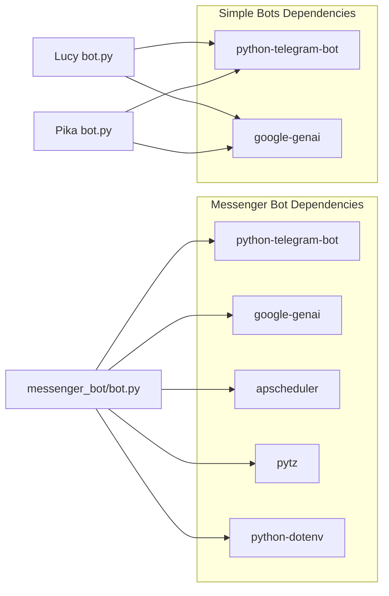

# Messenger Bot (AI-Powered)

<cite>
**Referenced Files in This Document**
- [bot.py](file://python/messenger_bot/bot.py)
- [requirements.txt](file://python/messenger_bot/requirements.txt)
- [Lucy bot.py](file://python/telegram_bot/Lucy_bot/bot.py)
- [Pika bot.py](file://python/telegram_bot/Pika_bot/bot.py)
- [Lucy requirements.txt](file://python/telegram_bot/Lucy_bot/requirements.txt)
- [Pika requirements.txt](file://python/telegram_bot/Pika_bot/requirements.txt)
- [user_settings.json](file://python/telegram_bot/Lucy_bot/user_settings.json)
</cite>

## Table of Contents
1. [Introduction](#introduction)
2. [Project Structure](#project-structure)
3. [Core Components](#core-components)
4. [Architecture Overview](#architecture-overview)
5. [Detailed Component Analysis](#detailed-component-analysis)
6. [Dependency Analysis](#dependency-analysis)
7. [Performance Considerations](#performance-considerations)
8. [Troubleshooting Guide](#troubleshooting-guide)
9. [Conclusion](#conclusion)
10. [Appendices](#appendices)

## Introduction
This document explains an AI-powered Telegram messenger bot system built with Python and the Telegram Bot API. It integrates Google Gemini for natural language processing, APScheduler for time-aware task execution, and a user state persistence mechanism to manage schedules, reminders, and conversation history. The system supports timezone-aware scheduling, command-driven schedule management, and conversational flows that can parse schedules from user messages and set reminders accordingly.

Key capabilities include:
- Natural language interaction via Google Gemini with tool use for scheduling
- Time-aware reminders using APScheduler with per-user timezone handling
- Persistent user settings and batch name associations stored in JSON
- Commands to enable/disable daily fixed signals and reward-based signals
- Conversation history management per chat session

## Project Structure
The repository contains multiple bot implementations:
- A feature-rich messenger bot with scheduling and Gemini integration
- Two simpler bots (Lucy and Pika) focused on conversational AI without scheduling

**Diagram sources**
- [bot.py:1-37](file://python/messenger_bot/bot.py#L1-L37)
- [requirements.txt:1-7](file://python/messenger_bot/requirements.txt#L1-L7)
- [Lucy bot.py:1-32](file://python/telegram_bot/Lucy_bot/bot.py#L1-L32)
- [Pika bot.py:1-32](file://python/telegram_bot/Pika_bot/bot.py#L1-L32)
- [Lucy requirements.txt:1-5](file://python/telegram_bot/Lucy_bot/requirements.txt#L1-L5)
- [Pika requirements.txt:1-5](file://python/telegram_bot/Pika_bot/requirements.txt#L1-L5)
- [user_settings.json:1-23](file://python/telegram_bot/Lucy_bot/user_settings.json#L1-L23)

**Section sources**
- [bot.py:1-37](file://python/messenger_bot/bot.py#L1-L37)
- [requirements.txt:1-7](file://python/messenger_bot/requirements.txt#L1-L7)
- [Lucy bot.py:1-32](file://python/telegram_bot/Lucy_bot/bot.py#L1-L32)
- [Pika bot.py:1-32](file://python/telegram_bot/Pika_bot/bot.py#L1-L32)
- [Lucy requirements.txt:1-5](file://python/telegram_bot/Lucy_bot/requirements.txt#L1-L5)
- [Pika requirements.txt:1-5](file://python/telegram_bot/Pika_bot/requirements.txt#L1-L5)
- [user_settings.json:1-23](file://python/telegram_bot/Lucy_bot/user_settings.json#L1-L23)

## Core Components
- Telegram Bot API integration: Handles commands, callbacks, and message routing
- Google Gemini client: Provides NLP capabilities and tool-use for scheduling
- APScheduler: Manages cron and one-time scheduled jobs per user timezone
- Storage layer: JSON-based user settings including timezone and batch names
- Command handlers: /timezone, /hengiobgcodinh, /hengiobgthuong, /kiemtrahengiobg, and others
- Message handler: Processes free-form text, extracts schedules, and interacts with Gemini

Key responsibilities:
- Parse and validate user inputs
- Maintain per-chat conversation histories
- Schedule reminders with timezone awareness
- Persist user preferences and pending reminders across restarts

**Section sources**
- [bot.py:10-37](file://python/messenger_bot/bot.py#L10-L37)
- [bot.py:44-73](file://python/messenger_bot/bot.py#L44-L73)
- [bot.py:351-385](file://python/messenger_bot/bot.py#L351-L385)
- [bot.py:710-795](file://python/messenger_bot/bot.py#L710-L795)

## Architecture Overview
The system combines Telegram event handling, Gemini AI interactions, and APScheduler job management. User settings are persisted to JSON, while conversation histories are kept in memory. Scheduled jobs are restored on startup based on stored data.

**Diagram sources**
- [bot.py:710-795](file://python/messenger_bot/bot.py#L710-L795)
- [bot.py:192-245](file://python/messenger_bot/bot.py#L192-L245)
- [bot.py:1102-1147](file://python/messenger_bot/bot.py#L1102-L1147)

## Detailed Component Analysis

### Command Processing System
The bot registers command handlers for scheduling and configuration:
- /start: Introduces available commands
- /timezone: Interactive timezone selection via inline keyboard
- /hengiobgcodinh: Enable daily fixed signal reminders at predefined times
- /hengiobgthuong: Prompt user to paste schedule; parse and schedule reminders
- /kiemtrahengiobg: Show current scheduled jobs and statuses
- /list: List active reminders
- /tathengiobgcodinh, /tathengiobgthuong, /tathengiobgtatca: Disable specific or all reminders

Command flow highlights:
- Timezone changes update persistent storage and affect future scheduling
- Fixed signals use cron triggers aligned to user timezone
- Reward signals parse pasted schedules and create date-triggered reminders
- Overlap detection allows replacing conflicting schedules with user confirmation

**Section sources**
- [bot.py:351-385](file://python/messenger_bot/bot.py#L351-L385)
- [bot.py:387-429](file://python/messenger_bot/bot.py#L387-L429)
- [bot.py:533-567](file://python/messenger_bot/bot.py#L533-L567)
- [bot.py:647-705](file://python/messenger_bot/bot.py#L647-L705)

### Schedule Management Features
Scheduling is implemented through two mechanisms:
- Daily fixed signals: Cron-based jobs at 1:30 PM, 7:30 PM, and 10:30 PM (with IPO-specific behavior)
- One-time reward signals: Date-triggered jobs created from parsed schedules

Key behaviors:
- Jobs are grouped by target time to merge multiple batches into a single reminder
- Reminders fire 5 minutes before the target time
- Job IDs are unique per chat and target time to support merging and updates
- Pending reminders are persisted and restored after restarts

**Diagram sources**
- [bot.py:192-245](file://python/messenger_bot/bot.py#L192-L245)
- [bot.py:292-313](file://python/messenger_bot/bot.py#L292-L313)
- [bot.py:1060-1096](file://python/messenger_bot/bot.py#L1060-L1096)

**Section sources**
- [bot.py:118-169](file://python/messenger_bot/bot.py#L118-L169)
- [bot.py:192-245](file://python/messenger_bot/bot.py#L192-L245)
- [bot.py:316-339](file://python/messenger_bot/bot.py#L316-L339)
- [bot.py:452-530](file://python/messenger_bot/bot.py#L452-L530)

### Timezone Handling Capabilities
Timezone management ensures reminders align with user preferences:
- Users select timezone via interactive keyboard
- Default timezone falls back to Asia/Ho_Chi_Minh if invalid
- All scheduled times are localized to user timezone before triggering
- Current local time displayed in conversation context

Implementation details:
- Timezone stored per chat_id in JSON
- pytz used for timezone conversions
- Cron triggers configured with user timezone
- DateTrigger uses aware datetimes converted to UTC internally

**Section sources**
- [bot.py:57-64](file://python/messenger_bot/bot.py#L57-L64)
- [bot.py:364-385](file://python/messenger_bot/bot.py#L364-L385)
- [bot.py:192-210](file://python/messenger_bot/bot.py#L192-L210)
- [bot.py:316-327](file://python/messenger_bot/bot.py#L316-L327)

### Conversation History Management
Conversation history is maintained per chat session:
- Last 20 messages retained for context
- Messages appended after successful responses
- Used to provide continuity in Gemini interactions
- In-memory storage only (not persisted)

Behavior:
- History truncated to prevent excessive memory usage
- Each message pair includes role and parts structure
- Empty responses are normalized to avoid blank replies

**Section sources**
- [bot.py:69-73](file://python/messenger_bot/bot.py#L69-L73)
- [bot.py:766-789](file://python/messenger_bot/bot.py#L766-L789)
- [Lucy bot.py:31-32](file://python/telegram_bot/Lucy_bot/bot.py#L31-L32)
- [Pika bot.py:31-32](file://python/telegram_bot/Pika_bot/bot.py#L31-L32)

### Google Gemini AI Integration
The bot integrates Google Gemini for natural language understanding and tool use:
- Client initialized with API key from environment variables
- Model specified for each bot variant
- System instructions define personality and behavior
- Tool functions enable automatic scheduling from conversation context

Integration patterns:
- Chat sessions created with history and configuration
- Function calls extracted from responses to trigger scheduling
- Text responses processed and sent to users
- Error handling provides user-friendly feedback

**Section sources**
- [bot.py:16-33](file://python/messenger_bot/bot.py#L16-L33)
- [bot.py:98-113](file://python/messenger_bot/bot.py#L98-L113)
- [bot.py:746-795](file://python/messenger_bot/bot.py#L746-L795)
- [Lucy bot.py:13-26](file://python/telegram_bot/Lucy_bot/bot.py#L13-L26)
- [Pika bot.py:13-26](file://python/telegram_bot/Pika_bot/bot.py#L13-L26)

### User State Persistence Mechanisms
User state is managed through JSON storage:
- Timezone preferences saved per chat_id
- Batch names associated with schedule batches for display
- Pending reminders tracked for restoration after restarts
- Daily signal flags maintained for reactivation

Storage operations:
- Load storage with error handling for corrupted files
- Save operations ensure proper encoding and formatting
- Batch name management supports CRUD operations
- Pending reminders cleaned up after execution

**Section sources**
- [bot.py:44-64](file://python/messenger_bot/bot.py#L44-L64)
- [bot.py:247-313](file://python/messenger_bot/bot.py#L247-L313)
- [user_settings.json:1-23](file://python/telegram_bot/Lucy_bot/user_settings.json#L1-L23)

## Dependency Analysis
The system depends on several key libraries:
- python-telegram-bot for Telegram API integration
- google-genai for Gemini AI functionality
- apscheduler for job scheduling
- pytz for timezone handling
- python-dotenv for environment variable loading

**Diagram sources**
- [requirements.txt:1-7](file://python/messenger_bot/requirements.txt#L1-L7)
- [Lucy requirements.txt:1-5](file://python/telegram_bot/Lucy_bot/requirements.txt#L1-L5)
- [Pika requirements.txt:1-5](file://python/telegram_bot/Pika_bot/requirements.txt#L1-L5)

**Section sources**
- [requirements.txt:1-7](file://python/messenger_bot/requirements.txt#L1-L7)
- [Lucy requirements.txt:1-5](file://python/telegram_bot/Lucy_bot/requirements.txt#L1-L5)
- [Pika requirements.txt:1-5](file://python/telegram_bot/Pika_bot/requirements.txt#L1-L5)

## Performance Considerations
- Conversation history limited to last 20 messages to control memory usage
- Long messages split into chunks to respect Telegram's message size limits
- Scheduled jobs merged by target time to reduce redundancy
- Storage operations optimized with minimal file I/O
- Error handling prevents bot crashes during external service failures

Optimization opportunities:
- Implement database backend for large-scale deployments
- Add caching layer for frequently accessed user settings
- Consider async job processing for high-volume scenarios
- Implement rate limiting for Gemini API calls

## Troubleshooting Guide
Common issues and solutions:
- Missing API keys: Ensure TELEGRAM_BOT_TOKEN and GEMINI_API_KEY are set in environment
- Timezone errors: Verify timezone names are valid and fall back to default
- Schedule parsing failures: Check format consistency in pasted schedules
- Job conflicts: Use overlap detection to replace conflicting schedules
- Restart recovery: Verify pending reminders are restored correctly

Debugging steps:
- Check console output for error messages
- Verify user_settings.json integrity
- Test timezone conversion with sample dates
- Validate schedule parsing with known formats
- Monitor scheduler job list for unexpected entries

**Section sources**
- [bot.py:746-748](file://python/messenger_bot/bot.py#L746-L748)
- [bot.py:792-795](file://python/messenger_bot/bot.py#L792-L795)
- [bot.py:1113-1118](file://python/messenger_bot/bot.py#L1113-L1118)

## Conclusion
The AI-powered messenger bot system provides a comprehensive solution for Telegram-based automation with natural language processing and intelligent scheduling. The architecture effectively combines real-time messaging, AI-driven understanding, and reliable time-based task execution. Key strengths include timezone-aware scheduling, flexible command interfaces, and robust error handling. The system scales well for individual users while maintaining simplicity through JSON-based persistence.

Future enhancements could include database integration, advanced analytics, multi-language support, and enhanced security measures for production deployments.

## Appendices

### Environment Variables Setup
Required environment variables:
- TELEGRAM_BOT_TOKEN: Telegram bot authentication token
- GEMINI_API_KEY: Google Gemini API access key

Optional configuration:
- .env file for development environments
- System-level environment variables for production

### Deployment Configuration
Production considerations:
- Use process managers like systemd or Docker containers
- Configure proper logging and monitoring
- Implement backup strategies for user_settings.json
- Set up SSL/TLS for secure communications
- Configure resource limits and health checks

### Security Aspects
API key management:
- Store sensitive credentials in environment variables
- Never commit API keys to version control
- Use secret management services in production
- Rotate keys regularly

User data protection:
- Encrypt sensitive user information at rest
- Implement access controls for user data
- Regular security audits and vulnerability scanning
- Comply with data protection regulations

**Section sources**
- [bot.py:29-33](file://python/messenger_bot/bot.py#L29-L33)
- [Lucy bot.py:22-26](file://python/telegram_bot/Lucy_bot/bot.py#L22-L26)
- [Pika bot.py:22-26](file://python/telegram_bot/Pika_bot/bot.py#L22-L26)