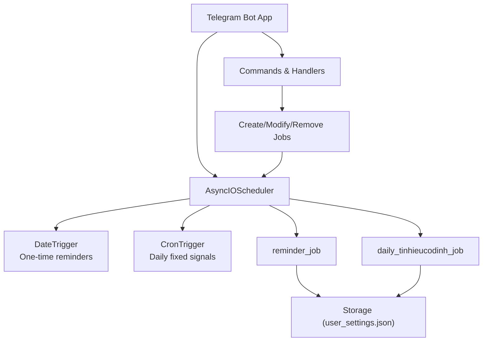
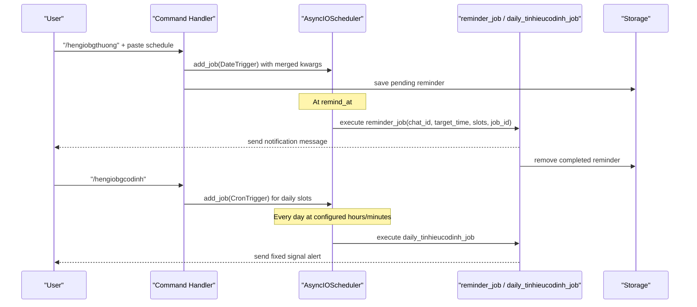
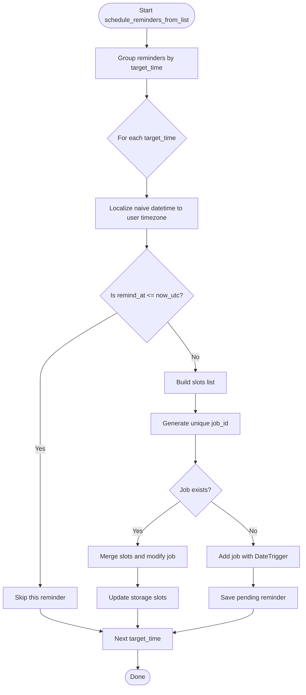
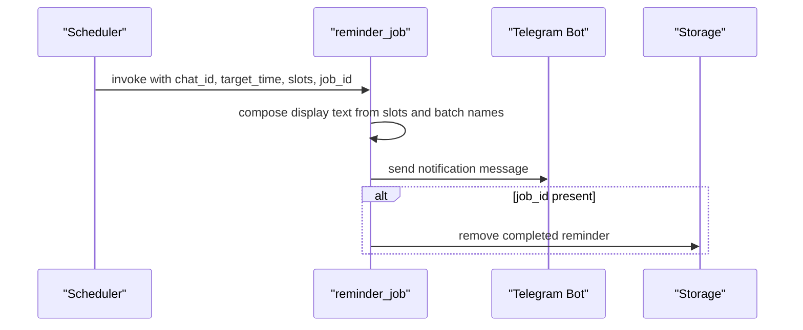
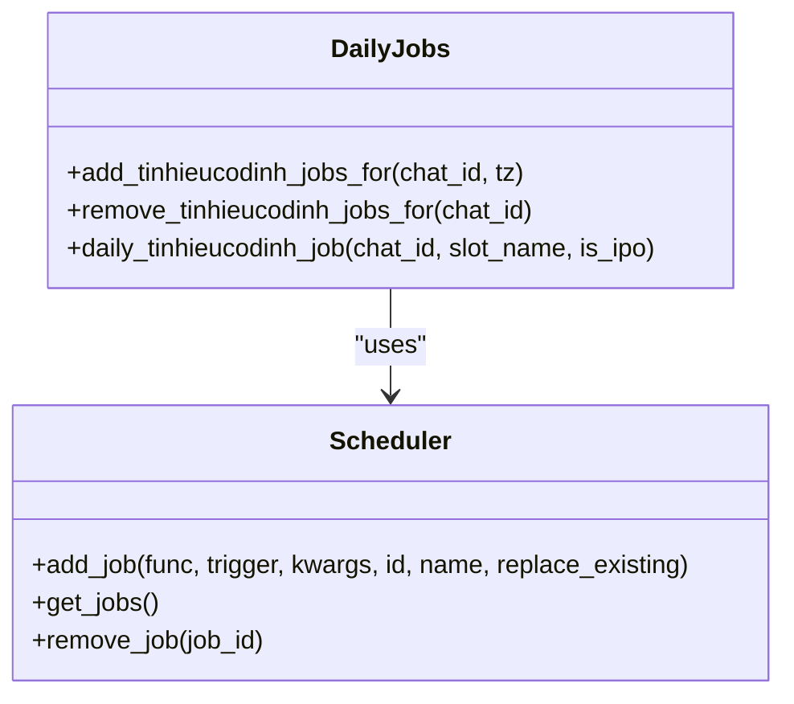
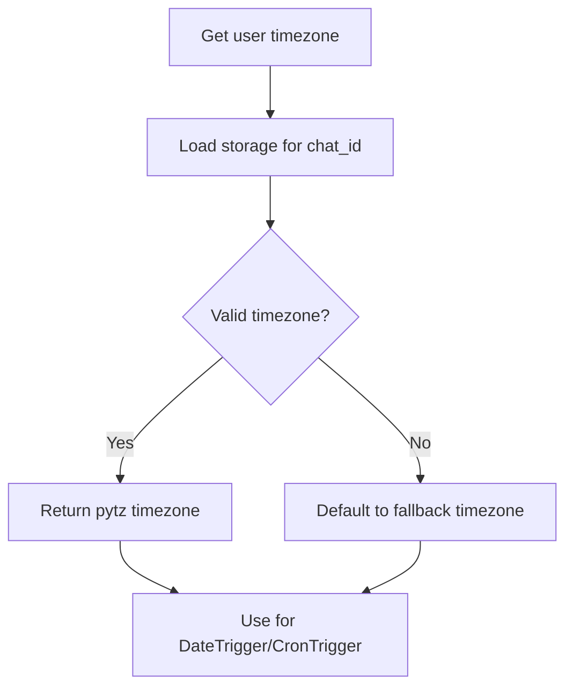
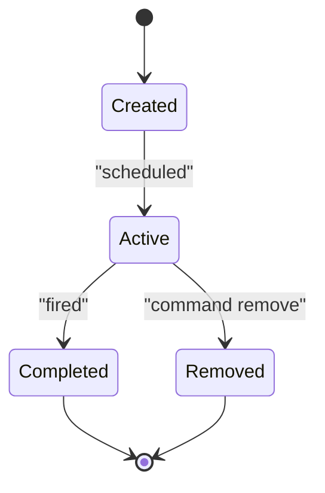
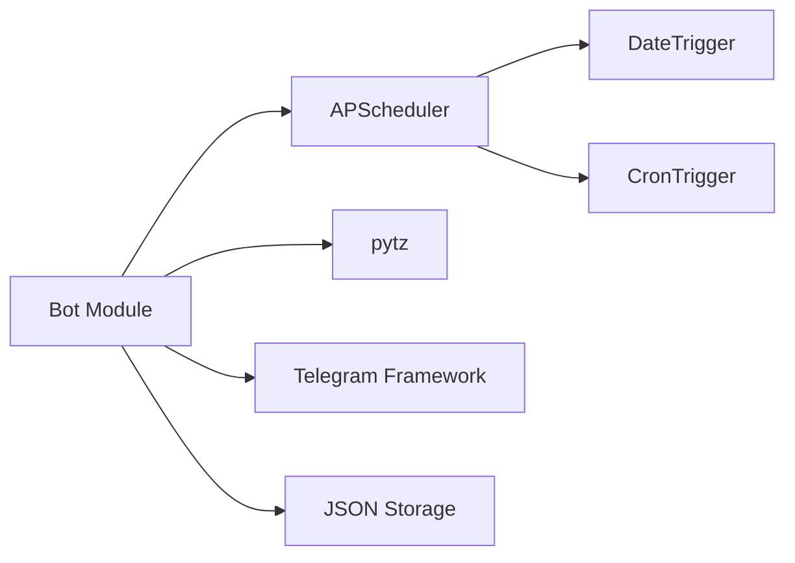

# Scheduling System (APScheduler)

<cite>
**Referenced Files in This Document**
- [bot.py](file://python/messenger_bot/bot.py)
</cite>

## Table of Contents
1. [Introduction](#introduction)
2. [Project Structure](#project-structure)
3. [Core Components](#core-components)
4. [Architecture Overview](#architecture-overview)
5. [Detailed Component Analysis](#detailed-component-analysis)
6. [Dependency Analysis](#dependency-analysis)
7. [Performance Considerations](#performance-considerations)
8. [Troubleshooting Guide](#troubleshooting-guide)
9. [Conclusion](#conclusion)

## Introduction
This document explains the APScheduler-based scheduling system implemented in the Telegram bot codebase. It covers:
- One-time reminder jobs and recurring daily schedule jobs
- Timezone handling with pytz integration
- Job ID management for unique identification and merging overlapping schedules
- The reminder_job function that sends scheduled notifications
- The daily_tinhieucodinh_job for fixed signal alerts
- Job lifecycle management: creation, modification, removal, and status tracking
- Examples of cron triggers for daily schedules and date triggers for specific times
- Job persistence through storage mechanisms to survive restarts

## Project Structure
The scheduling logic is centralized in a single Python module that integrates with a Telegram bot framework and uses APScheduler for job execution. Key responsibilities include:
- Initializing and starting the scheduler after the application event loop is ready
- Creating one-time reminders grouped by target time and merged into a single job per timeslot
- Creating recurring daily jobs using cron triggers with user-specific timezones
- Persisting pending jobs to disk so they can be restored on startup
- Managing job IDs to avoid duplicates and support merging

**Diagram sources**
- [bot.py:19-37](file://python/messenger_bot/bot.py#L19-L37)
- [bot.py:118-169](file://python/messenger_bot/bot.py#L118-L169)
- [bot.py:192-245](file://python/messenger_bot/bot.py#L192-L245)
- [bot.py:316-339](file://python/messenger_bot/bot.py#L316-L339)
- [bot.py:1102-1109](file://python/messenger_bot/bot.py#L1102-L1109)

**Section sources**
- [bot.py:19-37](file://python/messenger_bot/bot.py#L19-L37)
- [bot.py:1102-1109](file://python/messenger_bot/bot.py#L1102-L1109)

## Core Components
- Scheduler initialization and lifecycle:
  - An AsyncIOScheduler instance is created and started after the application’s post_init hook ensures the event loop is running.
- One-time reminders:
  - Grouped by target_time and scheduled with DateTrigger at a time offset before the target.
  - Merging mechanism updates existing jobs when multiple batches target the same timeslot.
- Recurring daily signals:
  - Three fixed daily slots are scheduled via CronTrigger with user timezone.
- Storage and restoration:
  - Pending reminders are persisted to a JSON file and restored on startup; expired jobs are skipped.
- Timezone handling:
  - User timezone is read from storage and used to localize naive datetimes and configure triggers.

**Section sources**
- [bot.py:19-37](file://python/messenger_bot/bot.py#L19-L37)
- [bot.py:44-64](file://python/messenger_bot/bot.py#L44-L64)
- [bot.py:192-245](file://python/messenger_bot/bot.py#L192-L245)
- [bot.py:316-339](file://python/messenger_bot/bot.py#L316-L339)
- [bot.py:1043-1096](file://python/messenger_bot/bot.py#L1043-L1096)

## Architecture Overview
The system combines Telegram command handlers with APScheduler to manage both one-time and recurring tasks. Commands trigger job creation or removal, while the scheduler executes jobs at configured times. Persistence ensures resilience across restarts.

**Diagram sources**
- [bot.py:192-245](file://python/messenger_bot/bot.py#L192-L245)
- [bot.py:118-169](file://python/messenger_bot/bot.py#L118-L169)
- [bot.py:316-339](file://python/messenger_bot/bot.py#L316-L339)
- [bot.py:1043-1096](file://python/messenger_bot/bot.py#L1043-L1096)

## Detailed Component Analysis

### Reminder Job Creation and Merging
- Grouping and scheduling:
  - Reminders are grouped by target_time to create one job per timeslot.
  - Each job is scheduled with a DateTrigger at five minutes before the target time.
- Merging overlapping schedules:
  - If a job already exists for the same timeslot, new slots are appended and the job is modified in place.
  - Storage is updated to reflect the merged slots.
- Unique job IDs:
  - Job IDs are derived from chat_id and target_time to ensure uniqueness and enable merging.

**Diagram sources**
- [bot.py:192-245](file://python/messenger_bot/bot.py#L192-L245)
- [bot.py:276-289](file://python/messenger_bot/bot.py#L276-L289)

**Section sources**
- [bot.py:192-245](file://python/messenger_bot/bot.py#L192-L245)
- [bot.py:276-289](file://python/messenger_bot/bot.py#L276-L289)

### Reminder Job Execution
- When triggered, the job composes a notification message based on slot descriptions and optional batch names.
- After sending the message, it removes the completed reminder from storage if a job_id was provided.

**Diagram sources**
- [bot.py:118-160](file://python/messenger_bot/bot.py#L118-L160)
- [bot.py:300-306](file://python/messenger_bot/bot.py#L300-L306)

**Section sources**
- [bot.py:118-160](file://python/messenger_bot/bot.py#L118-L160)
- [bot.py:300-306](file://python/messenger_bot/bot.py#L300-L306)

### Daily Fixed Signal Jobs
- Three fixed daily slots are scheduled using CronTrigger with the user’s timezone.
- Each job sends a tailored message depending on whether it is an IPO-only signal.

**Diagram sources**
- [bot.py:316-339](file://python/messenger_bot/bot.py#L316-L339)
- [bot.py:161-169](file://python/messenger_bot/bot.py#L161-L169)

**Section sources**
- [bot.py:316-339](file://python/messenger_bot/bot.py#L316-L339)
- [bot.py:161-169](file://python/messenger_bot/bot.py#L161-L169)

### Timezone Handling with pytz
- User timezone is stored per chat and retrieved when localizing naive datetimes or configuring CronTrigger.
- Defaults to a regional timezone if parsing fails.

**Diagram sources**
- [bot.py:57-64](file://python/messenger_bot/bot.py#L57-L64)
- [bot.py:192-210](file://python/messenger_bot/bot.py#L192-L210)
- [bot.py:316-327](file://python/messenger_bot/bot.py#L316-L327)

**Section sources**
- [bot.py:57-64](file://python/messenger_bot/bot.py#L57-L64)
- [bot.py:192-210](file://python/messenger_bot/bot.py#L192-L210)
- [bot.py:316-327](file://python/messenger_bot/bot.py#L316-L327)

### Job ID Management
- Unique identifiers are generated by combining chat_id and target_time for one-time reminders.
- For daily jobs, IDs embed chat_id and slot time to allow targeted removal.
- Utilities exist to compute overlap counts and generate consistent IDs.

**Section sources**
- [bot.py:265-279](file://python/messenger_bot/bot.py#L265-L279)
- [bot.py:316-339](file://python/messenger_bot/bot.py#L316-L339)

### Job Lifecycle Management
- Creation:
  - One-time reminders via DateTrigger; recurring daily via CronTrigger.
- Modification:
  - Existing jobs are modified to merge additional slots for the same timeslot.
- Removal:
  - Commands remove all jobs for a chat_id or specific types; completed reminders are removed from storage after firing.
- Status tracking:
  - Listing functions query active jobs and compute remaining time labels for display.

**Diagram sources**
- [bot.py:192-245](file://python/messenger_bot/bot.py#L192-L245)
- [bot.py:300-313](file://python/messenger_bot/bot.py#L300-L313)
- [bot.py:647-705](file://python/messenger_bot/bot.py#L647-L705)

**Section sources**
- [bot.py:192-245](file://python/messenger_bot/bot.py#L192-L245)
- [bot.py:300-313](file://python/messenger_bot/bot.py#L300-L313)
- [bot.py:647-705](file://python/messenger_bot/bot.py#L647-L705)

### Persistence Through Storage
- Pending reminders are saved to a JSON file with fields including job_id, job_prefix, target_time, remind_at, and slots.
- On startup, the system restores non-expired reminders and re-schedules them.
- Daily fixed signal jobs are restored based on user settings.

**Section sources**
- [bot.py:44-55](file://python/messenger_bot/bot.py#L44-L55)
- [bot.py:292-306](file://python/messenger_bot/bot.py#L292-L306)
- [bot.py:1043-1096](file://python/messenger_bot/bot.py#L1043-L1096)

### Examples of Triggers
- DateTrigger for one-time reminders:
  - Used to schedule a job at a specific run_date computed from user timezone and target time minus a buffer.
- CronTrigger for daily schedules:
  - Used to schedule three fixed daily slots with hour and minute values and user timezone.

**Section sources**
- [bot.py:192-245](file://python/messenger_bot/bot.py#L192-L245)
- [bot.py:316-327](file://python/messenger_bot/bot.py#L316-L327)

## Dependency Analysis
The scheduling system depends on:
- APScheduler for job scheduling and execution
- pytz for timezone-aware datetime operations
- Telegram bot framework for command handling and messaging
- File-based JSON storage for persistence

**Diagram sources**
- [bot.py:19-21](file://python/messenger_bot/bot.py#L19-L21)
- [bot.py:5](file://python/messenger_bot/bot.py#L5)
- [bot.py:10-14](file://python/messenger_bot/bot.py#L10-L14)
- [bot.py:44-55](file://python/messenger_bot/bot.py#L44-L55)

**Section sources**
- [bot.py:19-21](file://python/messenger_bot/bot.py#L19-L21)
- [bot.py:5](file://python/messenger_bot/bot.py#L5)
- [bot.py:10-14](file://python/messenger_bot/bot.py#L10-L14)
- [bot.py:44-55](file://python/messenger_bot/bot.py#L44-L55)

## Performance Considerations
- Grouping reminders by target_time reduces the number of jobs and avoids duplicate triggers.
- Using replace_existing for daily jobs prevents accumulation of redundant jobs.
- Filtering out past reminders during creation minimizes unnecessary scheduling.
- Efficient storage reads/writes keep overhead low; consider batching updates if needed.

[No sources needed since this section provides general guidance]

## Troubleshooting Guide
Common issues and resolutions:
- No reminders scheduled:
  - Ensure the input contains valid date ranges and times; check parsing functions and error logs.
- Timezone mismatch:
  - Verify user timezone setting; default fallback applies if invalid.
- Duplicate jobs:
  - Confirm job IDs are unique per chat_id and target_time; use merging logic to update instead of creating duplicates.
- Jobs not restored after restart:
  - Check storage file integrity and ensure restore functions run during post_init.

**Section sources**
- [bot.py:966-1023](file://python/messenger_bot/bot.py#L966-L1023)
- [bot.py:57-64](file://python/messenger_bot/bot.py#L57-L64)
- [bot.py:1043-1096](file://python/messenger_bot/bot.py#L1043-L1096)

## Conclusion
The APScheduler-based system provides robust scheduling for both one-time reminders and recurring daily signals. It leverages timezone-aware triggers, unique job IDs, and a merging strategy to handle overlapping schedules efficiently. Persistence ensures reliability across restarts, and comprehensive commands allow users to manage their schedules seamlessly.

[No sources needed since this section summarizes without analyzing specific files]