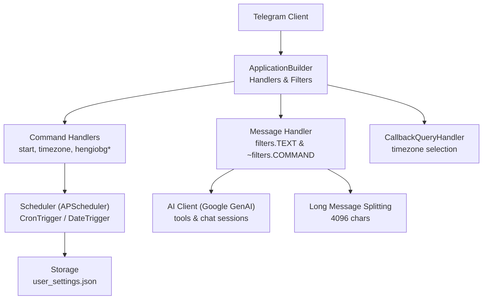
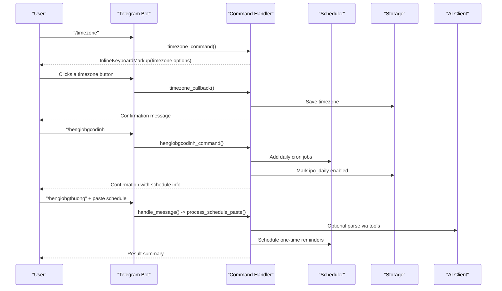
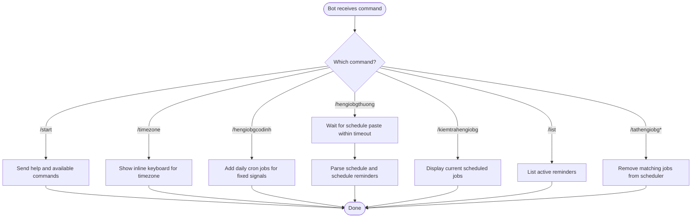
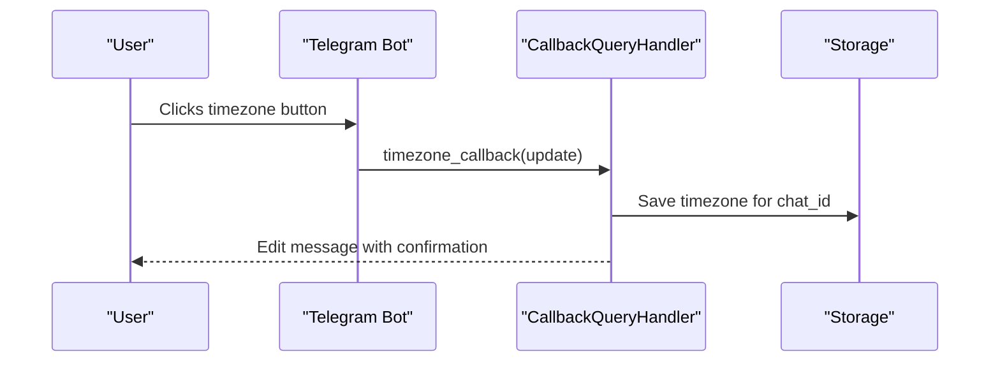
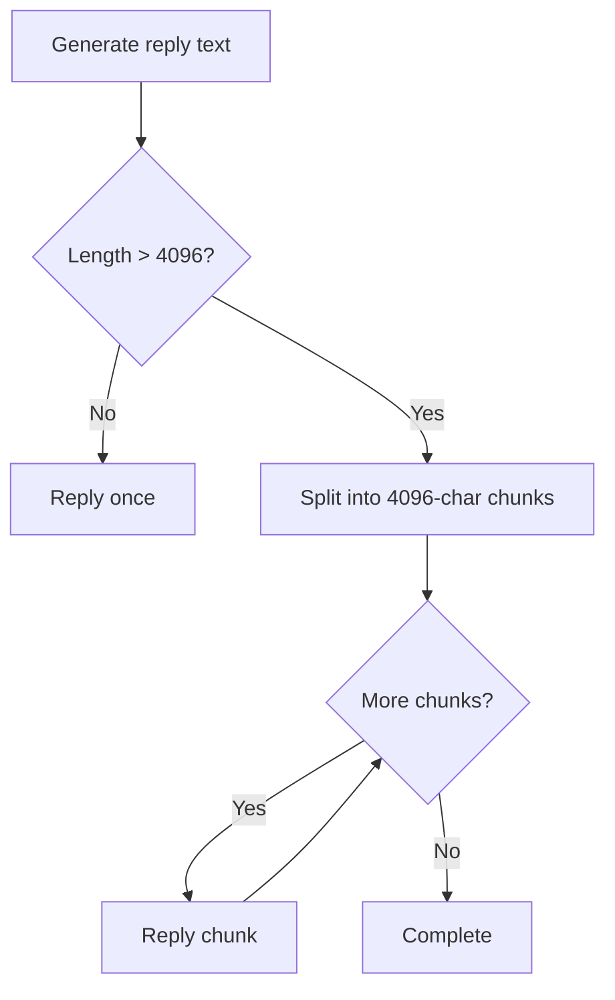
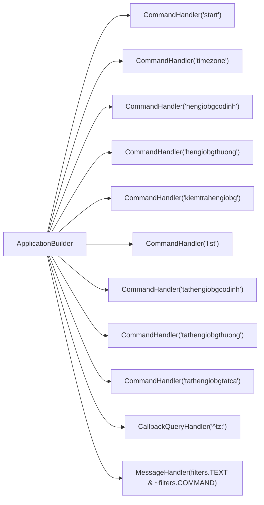
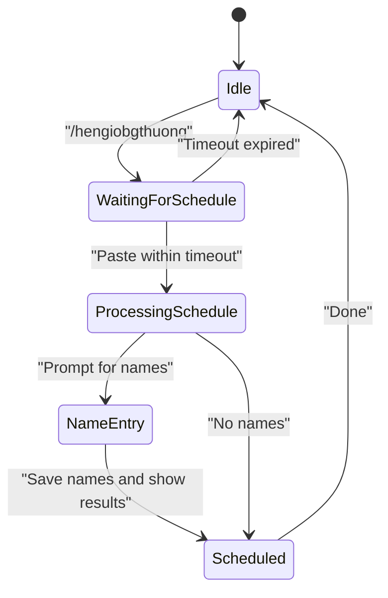
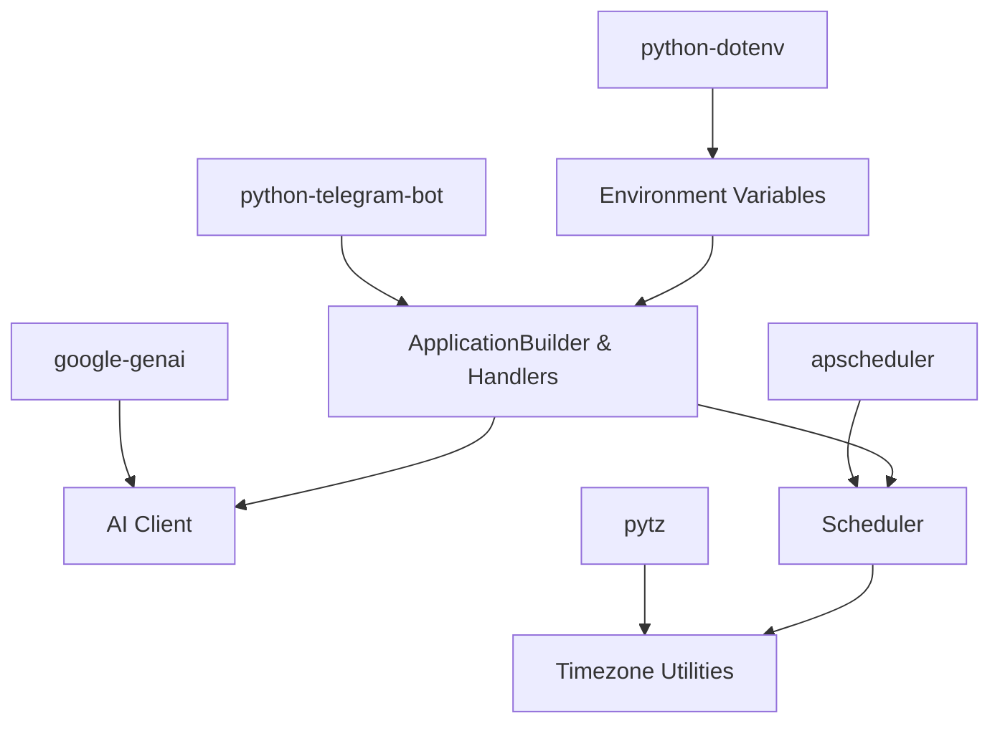

# Telegram Bot Integration

<cite>
**Referenced Files in This Document**
- [bot.py](file://python/messenger_bot/bot.py)
- [requirements.txt](file://python/telegram_bot/Lucy_bot/requirements.txt)
- [requirements.txt](file://python/telegram_bot/Pika_bot/requirements.txt)
- [user_settings.json](file://python/telegram_bot/Lucy_bot/user_settings.json)
- [user_settings.json](file://python/telegram_bot/Pika_bot/user_settings.json)
</cite>

## Table of Contents
1. Introduction
2. Project Structure
3. Core Components
4. Architecture Overview
5. Detailed Component Analysis
6. Dependency Analysis
7. Performance Considerations
8. Troubleshooting Guide
9. Conclusion

## Introduction
This document explains the Telegram Bot API integration layer implemented in the repository, focusing on command handling, inline keyboard interactions, callback query processing, message formatting and encoding, application builder configuration, filters for routing messages, context management across conversations, scheduling reminders, and robust error handling. It covers both lightweight bots (Lucy and Pika) and the comprehensive assistant bot that implements timezone selection, scheduled notifications, and AI-assisted schedule parsing.

## Project Structure
The relevant implementation is primarily in a single Python file that wires up the Telegram Bot API with an asynchronous scheduler and an AI client. Supporting files include requirements and user settings used by the simpler bots.

**Diagram sources**
- [bot.py:1102-1141](file://python/messenger_bot/bot.py#L1102-L1141)
- [bot.py:341-346](file://python/messenger_bot/bot.py#L341-L346)
- [bot.py:364-385](file://python/messenger_bot/bot.py#L364-L385)
- [bot.py:387-422](file://python/messenger_bot/bot.py#L387-L422)
- [bot.py:424-429](file://python/messenger_bot/bot.py#L424-L429)
- [bot.py:710-794](file://python/messenger_bot/bot.py#L710-L794)

**Section sources**
- [bot.py:1102-1141](file://python/messenger_bot/bot.py#L1102-L1141)
- [requirements.txt:1-5](file://python/telegram_bot/Lucy_bot/requirements.txt#L1-L5)
- [requirements.txt:1-5](file://python/telegram_bot/Pika_bot/requirements.txt#L1-L5)
- [user_settings.json:1-23](file://python/telegram_bot/Lucy_bot/user_settings.json#L1-L23)
- [user_settings.json:1-23](file://python/telegram_bot/Pika_bot/user_settings.json#L1-L23)

## Core Components
- Application Builder and handlers:
  - Command handlers for start, timezone, and BG reminder commands.
  - Callback query handler for interactive timezone selection.
  - Message handler using filters to process only text messages that are not commands.
- Scheduler integration:
  - APScheduler manages daily fixed signals and one-time reminders triggered at precise times.
- Storage:
  - JSON-based user settings persist timezones and batch names per chat.
- AI integration:
  - Google GenAI client used for conversational responses and optional tool usage to schedule reminders.
- Long message splitting:
  - Ensures replies respect Telegram’s character limits.

**Section sources**
- [bot.py:1102-1141](file://python/messenger_bot/bot.py#L1102-L1141)
- [bot.py:341-346](file://python/messenger_bot/bot.py#L341-L346)
- [bot.py:364-385](file://python/messenger_bot/bot.py#L364-L385)
- [bot.py:387-422](file://python/messenger_bot/bot.py#L387-L422)
- [bot.py:424-429](file://python/messenger_bot/bot.py#L424-L429)
- [bot.py:710-794](file://python/messenger_bot/bot.py#L710-L794)
- [bot.py:1043-1096](file://python/messenger_bot/bot.py#L1043-L1096)

## Architecture Overview
The system uses python-telegram-bot’s ApplicationBuilder to register handlers and filters. Commands trigger specific flows:
- /start provides help and lists available commands.
- /timezone opens an inline keyboard to select a timezone; selection updates persistent storage.
- /hengiobgcodinh enables daily fixed signal reminders via cron jobs.
- /hengiobgthuong starts a flow to parse schedules and set one-time reminders.
- Other commands manage or list scheduled jobs.

A central message handler integrates with the AI client for general conversation and can invoke tools to schedule reminders when it detects schedule content.

**Diagram sources**
- [bot.py:351-362](file://python/messenger_bot/bot.py#L351-L362)
- [bot.py:364-385](file://python/messenger_bot/bot.py#L364-L385)
- [bot.py:387-422](file://python/messenger_bot/bot.py#L387-L422)
- [bot.py:424-429](file://python/messenger_bot/bot.py#L424-L429)
- [bot.py:710-794](file://python/messenger_bot/bot.py#L710-L794)
- [bot.py:879-914](file://python/messenger_bot/bot.py#L879-L914)

## Detailed Component Analysis

### Command Handler System
- /start: Provides a greeting and lists available commands including timezone and BG reminder controls.
- /timezone: Displays an inline keyboard with timezone options; selection persists to storage.
- /hengiobgcodinh: Enables daily fixed signal reminders at predefined times using cron triggers.
- /hengiobgthuong: Starts a workflow to accept a pasted schedule, parse it, and schedule one-time reminders.
- Additional commands:
  - /kiemtrahengiobg: Shows current scheduled jobs and status.
  - /list: Lists active reminders.
  - /tathengiobgcodinh, /tathengiobgthuong, /tathengiobgtatca: Disable specific or all reminders.

**Diagram sources**
- [bot.py:351-362](file://python/messenger_bot/bot.py#L351-L362)
- [bot.py:364-385](file://python/messenger_bot/bot.py#L364-L385)
- [bot.py:387-422](file://python/messenger_bot/bot.py#L387-L422)
- [bot.py:424-429](file://python/messenger_bot/bot.py#L424-L429)
- [bot.py:533-567](file://python/messenger_bot/bot.py#L533-L567)
- [bot.py:647-705](file://python/messenger_bot/bot.py#L647-L705)

**Section sources**
- [bot.py:351-362](file://python/messenger_bot/bot.py#L351-L362)
- [bot.py:364-385](file://python/messenger_bot/bot.py#L364-L385)
- [bot.py:387-422](file://python/messenger_bot/bot.py#L387-L422)
- [bot.py:424-429](file://python/messenger_bot/bot.py#L424-L429)
- [bot.py:533-567](file://python/messenger_bot/bot.py#L533-L567)
- [bot.py:647-705](file://python/messenger_bot/bot.py#L647-L705)

### Inline Keyboard Implementation and Callback Query Handling
- The /timezone command builds an inline keyboard with timezone labels and callback data prefixed by a namespace.
- The callback handler extracts the selected timezone, saves it to storage, and edits the message to confirm the change.
- Additional callbacks support duplicate detection and name assignment for batch reminders.

**Diagram sources**
- [bot.py:364-385](file://python/messenger_bot/bot.py#L364-L385)

**Section sources**
- [bot.py:364-385](file://python/messenger_bot/bot.py#L364-L385)

### Message Formatting and Encoding
- Output encoding is configured to UTF-8 to ensure proper display of emojis and international characters.
- Long messages are split into chunks of 4096 characters before replying to comply with Telegram’s limits.

**Diagram sources**
- [bot.py:341-346](file://python/messenger_bot/bot.py#L341-L346)

**Section sources**
- [bot.py:341-346](file://python/messenger_bot/bot.py#L341-L346)

### Application Builder Configuration and Filters
- The application is built with ApplicationBuilder, disabling the default job queue to use APScheduler directly.
- Handlers are registered for commands, callback queries, and text messages excluding commands.
- Filters ensure only non-command text messages are routed to the general message handler.

**Diagram sources**
- [bot.py:1129-1141](file://python/messenger_bot/bot.py#L1129-L1141)

**Section sources**
- [bot.py:1129-1141](file://python/messenger_bot/bot.py#L1129-L1141)

### Context Management Throughout Conversation Flow
- In-memory state tracks:
  - Conversation histories per chat to maintain context for AI responses.
  - Pending schedule input with a timeout window.
  - Pending name entry for batch reminders.
  - Pending update state for duplicate check decisions.
- Storage persists user preferences like timezone and batch names.

**Diagram sources**
- [bot.py:69-72](file://python/messenger_bot/bot.py#L69-L72)
- [bot.py:710-794](file://python/messenger_bot/bot.py#L710-L794)
- [bot.py:879-914](file://python/messenger_bot/bot.py#L879-L914)

**Section sources**
- [bot.py:69-72](file://python/messenger_bot/bot.py#L69-L72)
- [bot.py:710-794](file://python/messenger_bot/bot.py#L710-L794)
- [bot.py:879-914](file://python/messenger_bot/bot.py#L879-L914)

### Command Registration Examples
- Commands are registered using CommandHandler with their respective functions.
- Callback queries are matched by pattern to route interactions correctly.
- Text messages are filtered to exclude commands and routed to the general handler.

**Section sources**
- [bot.py:1131-1141](file://python/messenger_bot/bot.py#L1131-L1141)

### Message Routing
- The message handler processes:
  - Pending name entries after scheduling.
  - Schedule paste inputs within a short timeout.
  - General conversation with AI, optionally invoking tools to schedule reminders.

**Section sources**
- [bot.py:710-794](file://python/messenger_bot/bot.py#L710-L794)

### Error Handling for Bot API Failures
- Exceptions during AI calls are caught and reported back to users with friendly messages.
- Startup checks ensure required environment variables are present before running.
- Scheduler restoration handles restart scenarios gracefully, skipping past due reminders.

**Section sources**
- [bot.py:746-794](file://python/messenger_bot/bot.py#L746-L794)
- [bot.py:1112-1118](file://python/messenger_bot/bot.py#L1112-L1118)
- [bot.py:1043-1096](file://python/messenger_bot/bot.py#L1043-L1096)

### Long Message Splitting for Telegram’s Character Limits
- Replies are split into 4096-character segments to avoid exceeding Telegram’s message length constraints.

**Section sources**
- [bot.py:341-346](file://python/messenger_bot/bot.py#L341-L346)

## Dependency Analysis
External dependencies and their roles:
- python-telegram-bot: Provides the bot framework, handlers, filters, and UI components.
- google-genai: Supplies the AI client for conversational responses and tool invocation.
- apscheduler: Manages scheduled tasks with CronTrigger and DateTrigger.
- pytz: Handles timezone conversions for accurate scheduling.
- python-dotenv: Loads environment variables for tokens and keys.

**Diagram sources**
- [bot.py:1-21](file://python/messenger_bot/bot.py#L1-L21)
- [requirements.txt:1-5](file://python/telegram_bot/Lucy_bot/requirements.txt#L1-L5)

**Section sources**
- [bot.py:1-21](file://python/messenger_bot/bot.py#L1-L21)
- [requirements.txt:1-5](file://python/telegram_bot/Lucy_bot/requirements.txt#L1-L5)
- [requirements.txt:1-5](file://python/telegram_bot/Pika_bot/requirements.txt#L1-L5)

## Performance Considerations
- Use APScheduler instead of the built-in job queue for more flexible and reliable scheduling.
- Group reminders by target time to merge multiple events into a single job, reducing overhead.
- Limit conversation history to recent messages to control memory usage.
- Avoid unnecessary AI calls when handling simple commands or direct scheduling workflows.
- Ensure efficient storage reads/writes by batching updates where possible.

## Troubleshooting Guide
Common issues and resolutions:
- Missing environment variables:
  - Ensure TELEGRAM_BOT_TOKEN and GEMINI_API_KEY are set in .env.
- Timezone misconfiguration:
  - Verify stored timezone values; fallback defaults to Asia/Ho_Chi_Minh if invalid.
- Duplicate schedules:
  - Use duplicate check callbacks to remove overlapping jobs and reschedule.
- Past reminders:
  - On restart, past due reminders are skipped; re-run commands to reschedule future events.
- Long messages truncated:
  - Confirm long message splitting is applied; verify output formatting.

**Section sources**
- [bot.py:1112-1118](file://python/messenger_bot/bot.py#L1112-L1118)
- [bot.py:569-617](file://python/messenger_bot/bot.py#L569-L617)
- [bot.py:1043-1096](file://python/messenger_bot/bot.py#L1043-L1096)
- [bot.py:341-346](file://python/messenger_bot/bot.py#L341-L346)

## Conclusion
The Telegram Bot integration layer provides a robust command handler system, interactive inline keyboards, callback-driven user flows, and resilient scheduling powered by APScheduler. It supports timezone-aware reminders, AI-assisted conversation and scheduling, and careful message formatting to meet platform constraints. With clear error handling and persistence, the system ensures reliable operation across restarts and varying user inputs.