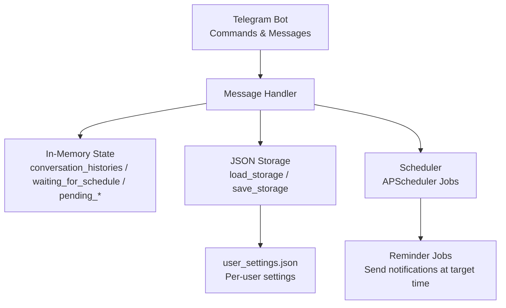
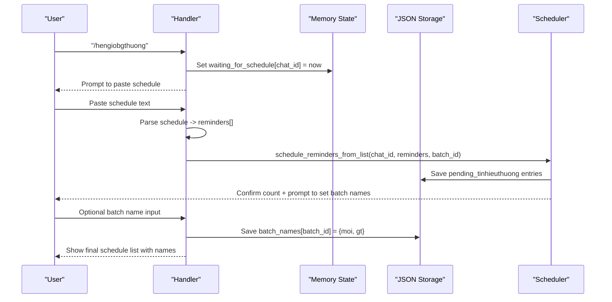
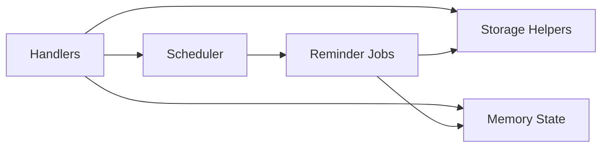

# User Management & State Persistence

<cite>
**Referenced Files in This Document**
- [bot.py](file://python/messenger_bot/bot.py)
- [user_settings.json (Lucy bot)](file://python/telegram_bot/Lucy_bot/user_settings.json)
- [user_settings.json (Pika bot)](file://python/telegram_bot/Pika_bot/user_settings.json)
</cite>

## Table of Contents
1. Introduction
2. Project Structure
3. Core Components
4. Architecture Overview
5. Detailed Component Analysis
6. Dependency Analysis
7. Performance Considerations
8. Troubleshooting Guide
9. Conclusion

## Introduction
This document explains the user management and state persistence system implemented for the Telegram assistant. It covers:
- JSON-based storage for user settings, timezone preferences, and batch name associations
- In-memory state for conversation histories, waiting states during schedule input, and pending operations
- User-specific data isolation keyed by chat_id
- Timezone resolution with fallback mechanisms
- Data migration strategies to restore scheduled jobs after restarts
- Examples of storing user preferences, managing conversation context, handling temporary multi-step interactions, and persisting batch information for signal tracking

## Project Structure
The implementation is primarily contained within a single Python module that manages:
- Persistent JSON storage per user (chat_id)
- In-memory dictionaries for transient state
- Scheduled reminders using APScheduler
- Telegram command handlers and message processing

**Diagram sources**
- [bot.py:44-64](file://python/messenger_bot/bot.py#L44-L64)
- [bot.py:69-72](file://python/messenger_bot/bot.py#L69-L72)
- [bot.py:192-245](file://python/messenger_bot/bot.py#L192-L245)
- [bot.py:1102-1109](file://python/messenger_bot/bot.py#L1102-L1109)

**Section sources**
- [bot.py:44-72](file://python/messenger_bot/bot.py#L44-L72)
- [bot.py:1102-1109](file://python/messenger_bot/bot.py#L1102-L1109)

## Core Components
- JSON storage layer: load/save functions for user_settings.json
- Timezone resolution: get_user_tz_name/get_user_tz with fallback
- In-memory state: conversation_histories, waiting_for_schedule, pending_name_batch, pending_update
- Batch name associations: store/retrieve/delete per chat_id
- Pending reminders: persistent list per user with job metadata
- Scheduler integration: add/modify/remove jobs; restore on startup

Key responsibilities:
- Isolate all user data by chat_id string keys
- Persist long-lived settings and pending jobs across restarts
- Maintain short-lived interaction states in memory for UX flows

**Section sources**
- [bot.py:44-64](file://python/messenger_bot/bot.py#L44-L64)
- [bot.py:69-72](file://python/messenger_bot/bot.py#L69-L72)
- [bot.py:247-263](file://python/messenger_bot/bot.py#L247-L263)
- [bot.py:281-313](file://python/messenger_bot/bot.py#L281-L313)

## Architecture Overview
The system combines three layers:
- UI/Command Layer: Telegram commands and callbacks route to handlers
- State Layer: In-memory dicts manage ephemeral flows; JSON file persists durable state
- Scheduling Layer: APScheduler runs reminder jobs at precise times, coordinated with stored slots and batch names

**Diagram sources**
- [bot.py:424-429](file://python/messenger_bot/bot.py#L424-L429)
- [bot.py:710-745](file://python/messenger_bot/bot.py#L710-L745)
- [bot.py:879-914](file://python/messenger_bot/bot.py#L879-L914)
- [bot.py:192-245](file://python/messenger_bot/bot.py#L192-L245)
- [bot.py:247-263](file://python/messenger_bot/bot.py#L247-L263)

## Detailed Component Analysis

### JSON-Based Storage for User Settings
- File: user_settings.json
- Structure: top-level map from chat_id string to user object
- User object fields:
  - timezone: string (IANA timezone), used for scheduling
  - ipo_daily: boolean flag enabling daily fixed signals
  - batch_names: map from batch_id to {moi, gt}
  - pending_tinhieuthuong: array of pending reminder records with job metadata

Persistence helpers:
- load_storage(): reads JSON or returns empty dict on error
- save_storage(data): writes JSON with UTF-8 encoding and indentation

Timezone resolution:
- get_user_tz_name(chat_id): returns stored timezone or default
- get_user_tz(chat_id): resolves pytz timezone with fallback to default on errors

Examples of usage:
- Storing timezone via callback handler
- Enabling/disabling daily fixed signals
- Saving and retrieving batch names for signal tracking

**Section sources**
- [bot.py:44-64](file://python/messenger_bot/bot.py#L44-L64)
- [bot.py:374-385](file://python/messenger_bot/bot.py#L374-L385)
- [bot.py:388-399](file://python/messenger_bot/bot.py#L388-L399)
- [bot.py:647-664](file://python/messenger_bot/bot.py#L647-L664)
- [user_settings.json (Lucy bot):1-23](file://python/telegram_bot/Lucy_bot/user_settings.json#L1-L23)
- [user_settings.json (Pika bot):1-23](file://python/telegram_bot/Pika_bot/user_settings.json#L1-L23)

### In-Memory State Management
- conversation_histories: chat_id -> list of content dicts for AI session context
- waiting_for_schedule: chat_id -> timestamp when user started paste flow
- pending_name_batch: chat_id -> {batch_id, count, awaiting_name?} for multi-step naming
- pending_update: chat_id -> {reminders, batch_id} for conflict resolution workflow

Flow behaviors:
- On /hengiobgthuong, set waiting_for_schedule[chat_id] to current time
- On next message, if within timeout, process schedule paste; else reset
- After scheduling, optionally prompt for batch names; track state in pending_name_batch
- For conflicts, use pending_update to coordinate delete-and-reschedule

**Section sources**
- [bot.py:69-72](file://python/messenger_bot/bot.py#L69-L72)
- [bot.py:424-429](file://python/messenger_bot/bot.py#L424-L429)
- [bot.py:710-745](file://python/messenger_bot/bot.py#L710-L745)
- [bot.py:569-617](file://python/messenger_bot/bot.py#L569-L617)
- [bot.py:619-644](file://python/messenger_bot/bot.py#L619-L644)

### Conversation History and Context
- Maintains last N messages per chat_id to provide context to AI model
- Appends user and model parts only when no function call was made
- Used when creating chat sessions for Gemini responses

**Section sources**
- [bot.py:766-790](file://python/messenger_bot/bot.py#L766-L790)

### Timezone Resolution with Fallback
- get_user_tz_name(chat_id) reads from storage or defaults to Asia/Ho_Chi_Minh
- get_user_tz(chat_id) wraps pytz.timezone with try/except to ensure valid timezone
- All schedules are localized to user timezone before computing trigger times

**Section sources**
- [bot.py:57-64](file://python/messenger_bot/bot.py#L57-L64)
- [bot.py:192-210](file://python/messenger_bot/bot.py#L192-L210)

### Batch Name Associations for Signal Tracking
- _save_batch_name(chat_id, batch_id, moi, gt): stores mapping under user.batch_names
- _get_batch_name(chat_id, batch_id): retrieves association for display and notification
- _delete_batch_name(chat_id, batch_id): removes association when needed

Usage:
- After scheduling reward signals, users can optionally assign names to pairs
- Names are merged into display strings for reminders and lists

**Section sources**
- [bot.py:247-263](file://python/messenger_bot/bot.py#L247-L263)
- [bot.py:716-735](file://python/messenger_bot/bot.py#L716-L735)
- [bot.py:796-829](file://python/messenger_bot/bot.py#L796-L829)

### Pending Operations and Multi-Step Interactions
- pending_name_batch: tracks batch_id and count while awaiting user input for names
- pending_update: holds reminders and batch_id during duplicate-check confirmation
- Flow ensures state is cleared after completion or timeout

**Section sources**
- [bot.py:569-617](file://python/messenger_bot/bot.py#L569-L617)
- [bot.py:619-644](file://python/messenger_bot/bot.py#L619-L644)
- [bot.py:710-745](file://python/messenger_bot/bot.py#L710-L745)

### Scheduled Reminders and Job Metadata
- schedule_reminders_from_list groups reminders by target_time, merges into one job per timeslot
- Stores slots with optional batch_id for later name enrichment
- Persists pending_tinhieuthuong entries with job_id, remind_at, target_time, slots
- Uses unique job IDs per (chat_id, target_time) to support merging multiple batches

**Section sources**
- [bot.py:192-245](file://python/messenger_bot/bot.py#L192-L245)
- [bot.py:276-289](file://python/messenger_bot/bot.py#L276-L289)

### Data Migration Strategies (Restart Recovery)
- restore_tinhieucodinh_jobs(): re-adds daily fixed signal jobs based on stored ipo_daily flags
- restore_tinhieuthuong_jobs(): rebuilds one-time reminder jobs from pending_tinhieuthuong, skipping past times
- Updates storage to remove expired pending entries after restoration

**Section sources**
- [bot.py:1043-1096](file://python/messenger_bot/bot.py#L1043-L1096)
- [bot.py:1102-1109](file://python/messenger_bot/bot.py#L1102-L1109)

## Dependency Analysis
- The module depends on:
  - telegram.ext for command/callback/message handling
  - apscheduler for scheduling
  - pytz for timezone handling
  - google.genai for AI chat sessions
- Internal dependencies:
  - Handlers rely on storage helpers and scheduler utilities
  - Reminder jobs depend on persisted slot metadata and batch names

**Diagram sources**
- [bot.py:10-21](file://python/messenger_bot/bot.py#L10-L21)
- [bot.py:44-64](file://python/messenger_bot/bot.py#L44-L64)
- [bot.py:192-245](file://python/messenger_bot/bot.py#L192-L245)
- [bot.py:118-169](file://python/messenger_bot/bot.py#L118-L169)

**Section sources**
- [bot.py:10-21](file://python/messenger_bot/bot.py#L10-L21)
- [bot.py:118-169](file://python/messenger_bot/bot.py#L118-L169)
- [bot.py:192-245](file://python/messenger_bot/bot.py#L192-L245)

## Performance Considerations
- JSON I/O occurs per operation; consider batching writes for high-frequency updates
- In-memory state is lightweight but not resilient to process restarts; rely on JSON for durability
- Scheduler job merging reduces redundant triggers for overlapping timeslots
- Timezone localization is performed once per scheduling pass

[No sources needed since this section provides general guidance]

## Troubleshooting Guide
Common issues and resolutions:
- Missing TELEGRAM_BOT_TOKEN or GEMINI_API_KEY: bot will print an error and exit early
- Invalid timezone: get_user_tz falls back to default; verify stored timezone value
- Past reminders skipped on restart: restore logic intentionally ignores expired pending jobs
- Duplicate schedules: dupcheck_callback removes conflicting jobs and reschedules; confirm choice to proceed

Operational checks:
- Use /kiemtrahengiobg to view active jobs and their status
- Use /list to see scheduled reminders
- Use /tathengiobgtatca to clear all jobs and related storage entries

**Section sources**
- [bot.py:1112-1118](file://python/messenger_bot/bot.py#L1112-L1118)
- [bot.py:569-617](file://python/messenger_bot/bot.py#L569-L617)
- [bot.py:1060-1096](file://python/messenger_bot/bot.py#L1060-L1096)

## Conclusion
The system provides robust user management and state persistence through:
- Clear separation of durable JSON storage and ephemeral in-memory state
- Per-user isolation via chat_id keys
- Reliable timezone handling with safe fallbacks
- Comprehensive scheduling with merge-aware job management
- Restart-safe recovery of both daily and one-time reminders
- Flexible multi-step workflows for batch naming and conflict resolution

These patterns enable scalable, maintainable behavior for interactive Telegram assistants requiring persistent configuration and reliable timing.

[No sources needed since this section summarizes without analyzing specific files]