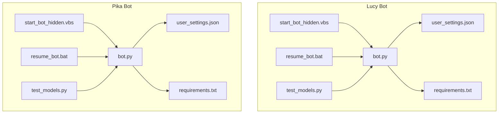
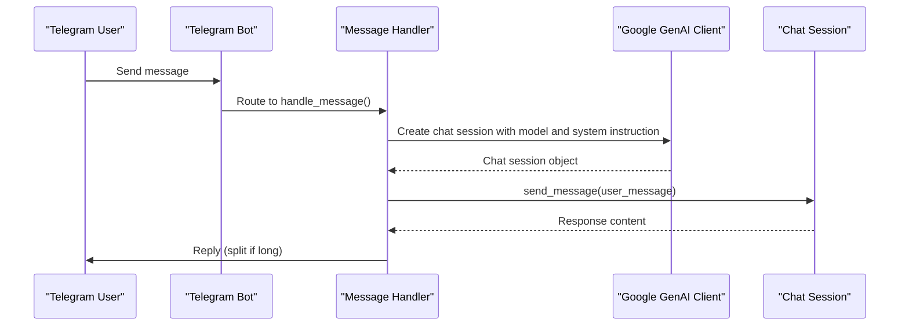
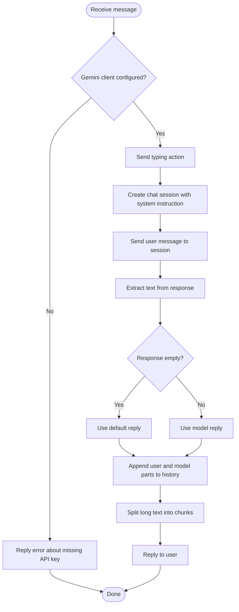
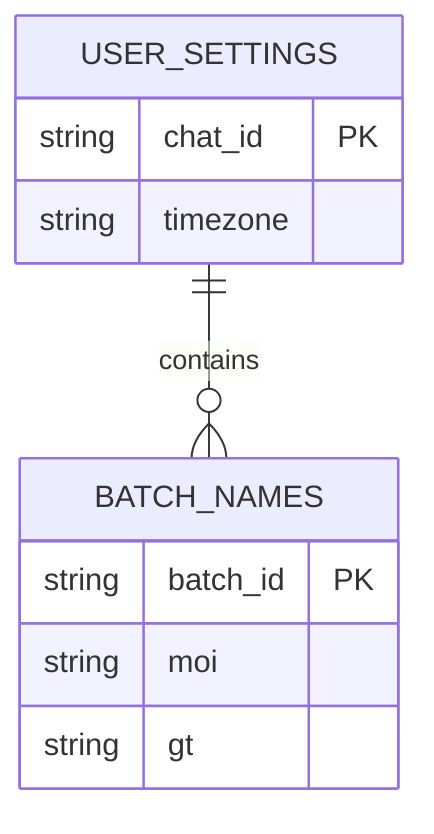
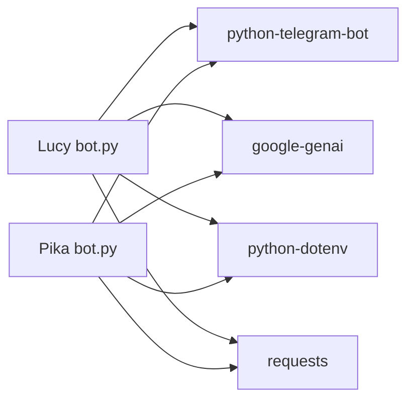

# Specialized Telegram Bots

<cite>
**Referenced Files in This Document**
- [Lucy bot.py](file://python/telegram_bot/Lucy_bot/bot.py)
- [Pika bot.py](file://python/telegram_bot/Pika_bot/bot.py)
- [Lucy user_settings.json](file://python/telegram_bot/Lucy_bot/user_settings.json)
- [Pika user_settings.json](file://python/telegram_bot/Pika_bot/user_settings.json)
- [Lucy requirements.txt](file://python/telegram_bot/Lucy_bot/requirements.txt)
- [Pika requirements.txt](file://python/telegram_bot/Pika_bot/requirements.txt)
- [Lucy start_bot_hidden.vbs](file://python/telegram_bot/Lucy_bot/start_bot_hidden.vbs)
- [Pika start_bot_hidden.vbs](file://python/telegram_bot/Pika_bot/start_bot_hidden.vbs)
- [Lucy resume_bot.bat](file://python/telegram_bot/Lucy_bot/resume_bot.bat)
- [Pika resume_bot.bat](file://python/telegram_bot/Pika_bot/resume_bot.bat)
- [Lucy test_models.py](file://python/telegram_bot/Lucy_bot/test_models.py)
- [Pika test_models.py](file://python/telegram_bot/Pika_bot/test_models.py)
</cite>

## Table of Contents
1. [Introduction](#introduction)
2. [Project Structure](#project-structure)
3. [Core Components](#core-components)
4. [Architecture Overview](#architecture-overview)
5. [Detailed Component Analysis](#detailed-component-analysis)
6. [Dependency Analysis](#dependency-analysis)
7. [Performance Considerations](#performance-considerations)
8. [Troubleshooting Guide](#troubleshooting-guide)
9. [Conclusion](#conclusion)
10. [Appendices](#appendices)

## Introduction
This document explains the specialized Telegram bot implementations for Lucy Bot and Pika Bot. Both bots share a common architecture built on python-telegram-bot and Google GenAI, but differ in personality, system instructions, and deployment scripts. The documentation covers shared patterns, bot-specific customizations, user settings management, command sets, configuration, deployment of multiple instances, and scaling considerations.

## Project Structure
Each bot lives in its own directory with:
- A Python entrypoint that implements the Telegram bot logic
- A user settings file for per-user preferences
- A requirements file for dependencies
- Windows helper scripts to run the bot hidden and to prepare the environment
- A small utility script to list available models via the Gemini API

**Diagram sources**
- [Lucy bot.py:1-150](file://python/telegram_bot/Lucy_bot/bot.py#L1-L150)
- [Pika bot.py:1-150](file://python/telegram_bot/Pika_bot/bot.py#L1-L150)
- [Lucy user_settings.json:1-23](file://python/telegram_bot/Lucy_bot/user_settings.json#L1-L23)
- [Pika user_settings.json:1-23](file://python/telegram_bot/Pika_bot/user_settings.json#L1-L23)
- [Lucy requirements.txt:1-5](file://python/telegram_bot/Lucy_bot/requirements.txt#L1-L5)
- [Pika requirements.txt:1-5](file://python/telegram_bot/Pika_bot/requirements.txt#L1-L5)
- [Lucy start_bot_hidden.vbs:1-29](file://python/telegram_bot/Lucy_bot/start_bot_hidden.vbs#L1-L29)
- [Pika start_bot_hidden.vbs:1-29](file://python/telegram_bot/Pika_bot/start_bot_hidden.vbs#L1-L29)
- [Lucy resume_bot.bat:1-27](file://python/telegram_bot/Lucy_bot/resume_bot.bat#L1-L27)
- [Pika resume_bot.bat:1-27](file://python/telegram_bot/Pika_bot/resume_bot.bat#L1-L27)
- [Lucy test_models.py:1-14](file://python/telegram_bot/Lucy_bot/test_models.py#L1-L14)
- [Pika test_models.py:1-14](file://python/telegram_bot/Pika_bot/test_models.py#L1-L14)

**Section sources**
- [Lucy bot.py:1-150](file://python/telegram_bot/Lucy_bot/bot.py#L1-L150)
- [Pika bot.py:1-150](file://python/telegram_bot/Pika_bot/bot.py#L1-L150)

## Core Components
Both bots implement the same core components:
- Environment-based configuration for Telegram token and Gemini API key
- In-memory conversation history keyed by chat ID
- Message handler that builds a chat session with a system instruction defining bot personality
- Long message splitter to respect Telegram’s message length limits
- Command handler for /start greeting
- Main function that initializes the application, registers handlers, and runs polling

Key differences are primarily in:
- System instruction text (personality and tone)
- Startup messages
- Deployment scripts’ process detection strings and popup titles

**Section sources**
- [Lucy bot.py:22-26](file://python/telegram_bot/Lucy_bot/bot.py#L22-L26)
- [Lucy bot.py:60-64](file://python/telegram_bot/Lucy_bot/bot.py#L60-L64)
- [Lucy bot.py:69-108](file://python/telegram_bot/Lucy_bot/bot.py#L69-L108)
- [Lucy bot.py:113-149](file://python/telegram_bot/Lucy_bot/bot.py#L113-L149)
- [Pika bot.py:22-26](file://python/telegram_bot/Pika_bot/bot.py#L22-L26)
- [Pika bot.py:60-64](file://python/telegram_bot/Pika_bot/bot.py#L60-L64)
- [Pika bot.py:69-108](file://python/telegram_bot/Pika_bot/bot.py#L69-L108)
- [Pika bot.py:113-149](file://python/telegram_bot/Pika_bot/bot.py#L113-L149)

## Architecture Overview
The runtime architecture is consistent across both bots:
- Telegram client library receives updates and routes them to handlers
- Message handler constructs a chat session using Google GenAI with a system instruction
- Conversation history is maintained in memory per chat
- Responses are streamed back to Telegram, splitting long replies into multiple messages

**Diagram sources**
- [Lucy bot.py:69-108](file://python/telegram_bot/Lucy_bot/bot.py#L69-L108)
- [Pika bot.py:69-108](file://python/telegram_bot/Pika_bot/bot.py#L69-L108)

## Detailed Component Analysis

### Shared Architecture Patterns
- Configuration via environment variables for TELEGRAM_BOT_TOKEN and GEMINI_API_KEY
- ApplicationBuilder used to create the Telegram application with a disabled job queue
- Handlers registered for /start and text messages excluding commands
- In-memory conversation histories stored as lists of role-part dicts per chat_id
- Helper functions to split long responses and extract text from model responses
- Error handling that logs errors and returns friendly messages to users

**Section sources**
- [Lucy bot.py:22-26](file://python/telegram_bot/Lucy_bot/bot.py#L22-L26)
- [Lucy bot.py:36-55](file://python/telegram_bot/Lucy_bot/bot.py#L36-L55)
- [Lucy bot.py:113-149](file://python/telegram_bot/Lucy_bot/bot.py#L113-L149)
- [Pika bot.py:22-26](file://python/telegram_bot/Pika_bot/bot.py#L22-L26)
- [Pika bot.py:36-55](file://python/telegram_bot/Pika_bot/bot.py#L36-L55)
- [Pika bot.py:113-149](file://python/telegram_bot/Pika_bot/bot.py#L113-L149)

### Lucy Bot Customization
- Personality defined by a system instruction emphasizing a cool, confident persona with specific pronouns and tone
- Start command greets users with a themed message
- Uses gemini-2.5-flash-lite model
- Maintains last 20 messages in conversation history per chat

**Diagram sources**
- [Lucy bot.py:69-108](file://python/telegram_bot/Lucy_bot/bot.py#L69-L108)

**Section sources**
- [Lucy bot.py:60-64](file://python/telegram_bot/Lucy_bot/bot.py#L60-L64)
- [Lucy bot.py:81-92](file://python/telegram_bot/Lucy_bot/bot.py#L81-L92)
- [Lucy bot.py:87-102](file://python/telegram_bot/Lucy_bot/bot.py#L87-L102)

### Pika Bot Customization
- Personality defined by a system instruction emphasizing a cute, affectionate persona with emojis
- Start command greets users with a themed message
- Uses gemini-2.5-flash-lite model
- Maintains last 20 messages in conversation history per chat

**Diagram sources**
- [Pika bot.py:69-108](file://python/telegram_bot/Pika_bot/bot.py#L69-L108)

**Section sources**
- [Pika bot.py:60-64](file://python/telegram_bot/Pika_bot/bot.py#L60-L64)
- [Pika bot.py:81-92](file://python/telegram_bot/Pika_bot/bot.py#L81-L92)
- [Pika bot.py:87-102](file://python/telegram_bot/Pika_bot/bot.py#L87-L102)

### User Settings Management
- Each bot includes a user_settings.json file storing per-user preferences such as timezone and batch names
- The structure supports mapping chat IDs to settings and named batches with attributes
- While not actively loaded in the current bot code, this file provides a foundation for future features like personalized greetings or localized behavior

**Diagram sources**
- [Lucy user_settings.json:1-23](file://python/telegram_bot/Lucy_bot/user_settings.json#L1-L23)
- [Pika user_settings.json:1-23](file://python/telegram_bot/Pika_bot/user_settings.json#L1-L23)

**Section sources**
- [Lucy user_settings.json:1-23](file://python/telegram_bot/Lucy_bot/user_settings.json#L1-L23)
- [Pika user_settings.json:1-23](file://python/telegram_bot/Pika_bot/user_settings.json#L1-L23)

### Specialized Command Sets
- Both bots register a /start command that sends a personality-themed greeting
- Text messages are handled generically; no additional commands are implemented in the current code
- Filters ensure commands are not processed as regular messages

**Section sources**
- [Lucy bot.py:60-64](file://python/telegram_bot/Lucy_bot/bot.py#L60-L64)
- [Lucy bot.py:130-131](file://python/telegram_bot/Lucy_bot/bot.py#L130-L131)
- [Pika bot.py:60-64](file://python/telegram_bot/Pika_bot/bot.py#L60-L64)
- [Pika bot.py:130-131](file://python/telegram_bot/Pika_bot/bot.py#L130-L131)

### Deployment Guides for Multiple Instances
- Each bot has its own directory with independent requirements and environment
- Use the provided resume script to set up the virtual environment and install dependencies
- Use the hidden startup script to launch the bot without a console window; it checks for existing processes to avoid duplicates
- Ensure each instance uses a unique TELEGRAM_BOT_TOKEN and can share or separate GEMINI_API_KEY depending on your quota strategy

Steps:
1. Prepare environment: run the resume script in each bot folder
2. Configure environment variables: set TELEGRAM_BOT_TOKEN and GEMINI_API_KEY per instance
3. Launch hidden: double-click the start_bot_hidden.vbs in each bot folder
4. Verify: open Telegram and send /start to each bot

**Section sources**
- [Lucy resume_bot.bat:1-27](file://python/telegram_bot/Lucy_bot/resume_bot.bat#L1-L27)
- [Pika resume_bot.bat:1-27](file://python/telegram_bot/Pika_bot/resume_bot.bat#L1-L27)
- [Lucy start_bot_hidden.vbs:1-29](file://python/telegram_bot/Lucy_bot/start_bot_hidden.vbs#L1-L29)
- [Pika start_bot_hidden.vbs:1-29](file://python/telegram_bot/Pika_bot/start_bot_hidden.vbs#L1-L29)

### Scaling Considerations for Multiple Bots
- In-memory conversation history: since histories are stored in process memory, each bot instance maintains its own state; consider persistence if you need cross-session continuity
- Concurrency: python-telegram-bot handles concurrent updates internally; ensure sufficient CPU and memory per instance
- Rate limits: coordinate API usage across instances to stay within Gemini API quotas; consider sharing a single GEMINI_API_KEY with careful rate limiting or separate keys per bot
- Process isolation: keep each bot in its own virtual environment to avoid dependency conflicts
- Monitoring: add logging and health checks to detect failures and restarts automatically

[No sources needed since this section provides general guidance]

## Dependency Analysis
Both bots depend on:
- python-telegram-bot for Telegram integration
- python-dotenv for loading environment variables
- requests for HTTP operations (if used elsewhere)
- google-genai for interacting with Gemini models

**Diagram sources**
- [Lucy requirements.txt:1-5](file://python/telegram_bot/Lucy_bot/requirements.txt#L1-L5)
- [Pika requirements.txt:1-5](file://python/telegram_bot/Pika_bot/requirements.txt#L1-L5)

**Section sources**
- [Lucy requirements.txt:1-5](file://python/telegram_bot/Lucy_bot/requirements.txt#L1-L5)
- [Pika requirements.txt:1-5](file://python/telegram_bot/Pika_bot/requirements.txt#L1-L5)

## Performance Considerations
- Message splitting: long responses are chunked to comply with Telegram limits; tune chunk size if needed
- History window: limited to last 20 messages per chat to control context size and latency
- Event loop initialization: explicit event loop creation ensures compatibility with newer Python versions
- Error resilience: graceful handling of missing API keys and exceptions prevents crashes

**Section sources**
- [Lucy bot.py:36-41](file://python/telegram_bot/Lucy_bot/bot.py#L36-L41)
- [Lucy bot.py:87-102](file://python/telegram_bot/Lucy_bot/bot.py#L87-L102)
- [Lucy bot.py:123-126](file://python/telegram_bot/Lucy_bot/bot.py#L123-L126)
- [Lucy bot.py:135-144](file://python/telegram_bot/Lucy_bot/bot.py#L135-L144)
- [Pika bot.py:36-41](file://python/telegram_bot/Pika_bot/bot.py#L36-L41)
- [Pika bot.py:87-102](file://python/telegram_bot/Pika_bot/bot.py#L87-L102)
- [Pika bot.py:123-126](file://python/telegram_bot/Pika_bot/bot.py#L123-L126)
- [Pika bot.py:135-144](file://python/telegram_bot/Pika_bot/bot.py#L135-L144)

## Troubleshooting Guide
Common issues and resolutions:
- Missing TELEGRAM_BOT_TOKEN: the main function prints an error and exits; configure the environment variable before starting
- Missing GEMINI_API_KEY: the message handler replies with an error; configure the environment variable and restart
- Model availability: use the test script to list supported models and verify connectivity
- Duplicate processes: the hidden startup script checks for existing bot processes to prevent multiple instances

**Section sources**
- [Lucy bot.py:113-119](file://python/telegram_bot/Lucy_bot/bot.py#L113-L119)
- [Lucy bot.py:74-76](file://python/telegram_bot/Lucy_bot/bot.py#L74-L76)
- [Lucy test_models.py:1-14](file://python/telegram_bot/Lucy_bot/test_models.py#L1-L14)
- [Lucy start_bot_hidden.vbs:6-22](file://python/telegram_bot/Lucy_bot/start_bot_hidden.vbs#L6-L22)
- [Pika bot.py:113-119](file://python/telegram_bot/Pika_bot/bot.py#L113-L119)
- [Pika bot.py:74-76](file://python/telegram_bot/Pika_bot/bot.py#L74-L76)
- [Pika test_models.py:1-14](file://python/telegram_bot/Pika_bot/test_models.py#L1-L14)
- [Pika start_bot_hidden.vbs:6-22](file://python/telegram_bot/Pika_bot/start_bot_hidden.vbs#L6-L22)

## Conclusion
Lucy Bot and Pika Bot share a robust, minimal architecture centered on python-telegram-bot and Google GenAI, differing mainly in personality-driven system instructions and deployment scripts. They maintain per-chat conversation histories in memory and provide simple, reliable messaging with error handling. The included user settings files offer a foundation for personalization. With isolated environments and hidden startup scripts, running multiple bot instances is straightforward. For production, consider persisting conversations, adding metrics, and implementing rate-limiting strategies to scale effectively.

[No sources needed since this section summarizes without analyzing specific files]

## Appendices

### Environment Variables Reference
- TELEGRAM_BOT_TOKEN: Required for Telegram authentication
- GEMINI_API_KEY: Required for Gemini model access

**Section sources**
- [Lucy bot.py:22-23](file://python/telegram_bot/Lucy_bot/bot.py#L22-L23)
- [Pika bot.py:22-23](file://python/telegram_bot/Pika_bot/bot.py#L22-L23)

### Model Selection
- Default model: gemini-2.5-flash-lite
- Verification: use the test script to list available models

**Section sources**
- [Lucy bot.py:25-26](file://python/telegram_bot/Lucy_bot/bot.py#L25-L26)
- [Pika bot.py:25-26](file://python/telegram_bot/Pika_bot/bot.py#L25-L26)
- [Lucy test_models.py:1-14](file://python/telegram_bot/Lucy_bot/test_models.py#L1-L14)
- [Pika test_models.py:1-14](file://python/telegram_bot/Pika_bot/test_models.py#L1-L14)