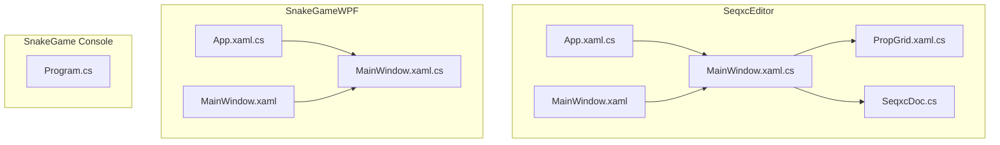
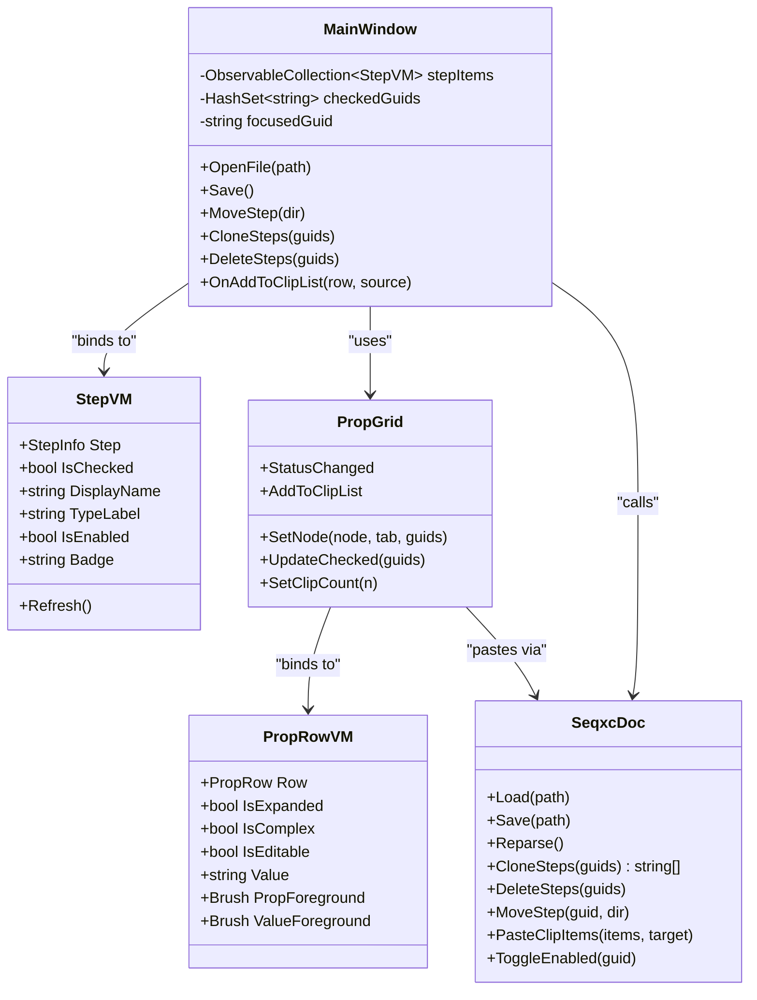
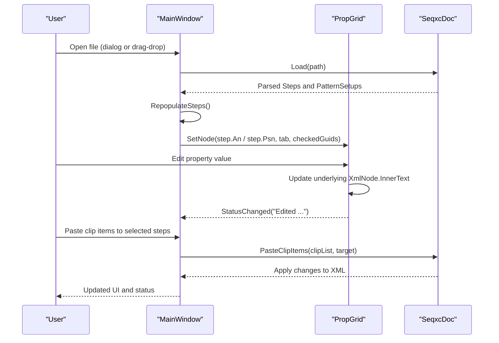
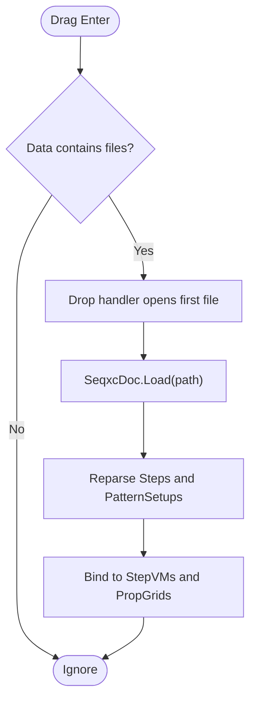
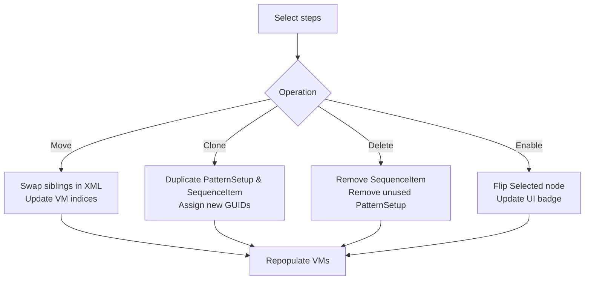
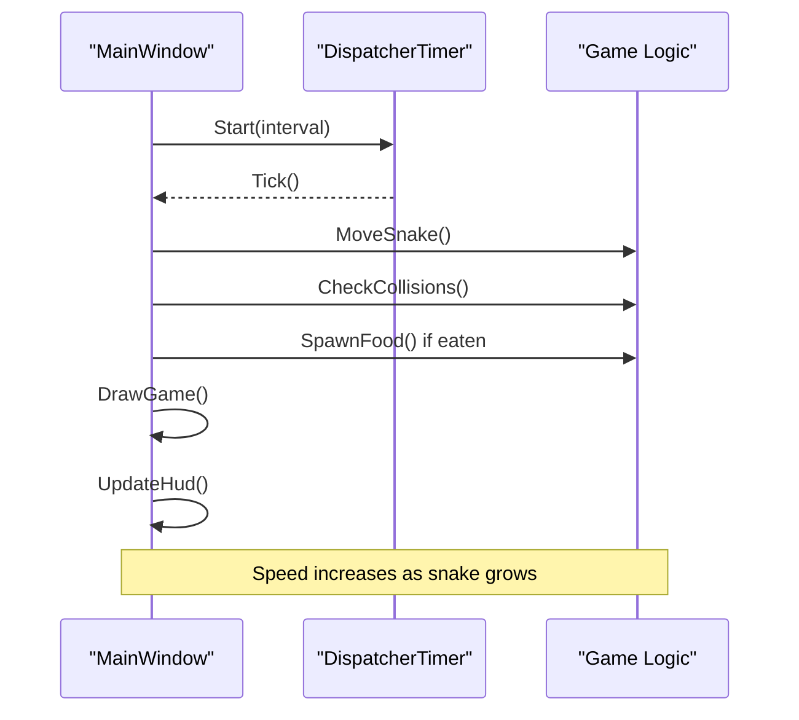
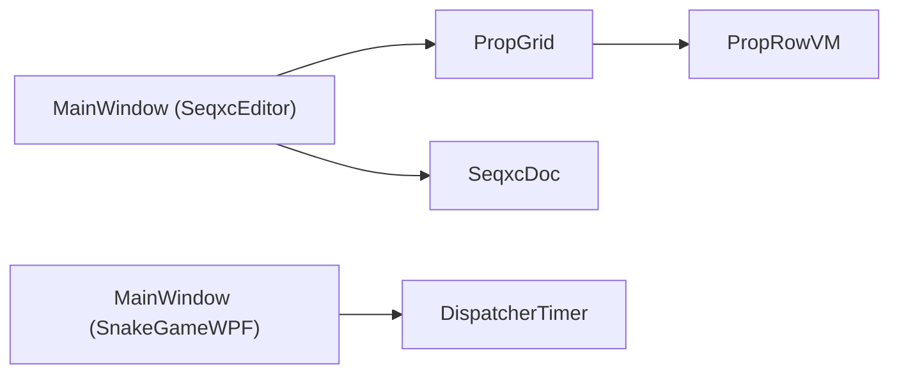

# Desktop Applications

<cite>
**Referenced Files in This Document**
- [App.xaml.cs](file://SeqxcEditor_wpf/App.xaml.cs)
- [MainWindow.xaml](file://SeqxcEditor_wpf/MainWindow.xaml)
- [MainWindow.xaml.cs](file://SeqxcEditor_wpf/MainWindow.xaml.cs)
- [PropGrid.xaml.cs](file://SeqxcEditor_wpf/PropGrid.xaml.cs)
- [SeqxcDoc.cs](file://SeqxcEditor_wpf/SeqxcDoc.cs)
- [App.xaml.cs (SnakeGameWPF)](file://c#/SnakeGameWPF/App.xaml.cs)
- [MainWindow.xaml (SnakeGameWPF)](file://c#/SnakeGameWPF/MainWindow.xaml)
- [MainWindow.xaml.cs (SnakeGameWPF)](file://c#/SnakeGameWPF/MainWindow.xaml.cs)
- [Program.cs (SnakeGame console)](file://c#/SnakeGame/Program.cs)
</cite>

## Table of Contents
1. [Introduction](#introduction)
2. [Project Structure](#project-structure)
3. [Core Components](#core-components)
4. [Architecture Overview](#architecture-overview)
5. [Detailed Component Analysis](#detailed-component-analysis)
6. [Dependency Analysis](#dependency-analysis)
7. [Performance Considerations](#performance-considerations)
8. [Troubleshooting Guide](#troubleshooting-guide)
9. [Conclusion](#conclusion)
10. [Appendices](#appendices)

## Introduction
This document explains the desktop applications in this repository with a focus on WPF-based projects and their MVVM-inspired architecture. It covers:
- The XML Editor (SeqxcEditor), including drag-and-drop file operations, real-time property editing, step manipulation, and clipboard-style property copying/pasting across steps.
- Snake Game implementations across platforms: a console version and a WPF version with a game loop, input handling, and rendering.
- MainWindow initialization, event handling, and UI composition patterns used throughout.
- Practical guidance for extending these applications and customizing the user interface.
- Best practices for WPF application development.

## Project Structure
The desktop applications are organized into two primary WPF projects and one console project:
- SeqxcEditor_wpf: A WPF application that edits sequence files (.seqxc/XML). It uses a lightweight MVVM-inspired pattern with ViewModels bound to XAML controls.
- c#\SnakeGameWPF: A WPF implementation of Snake using DispatcherTimer for the game loop and Canvas for rendering.
- c#\SnakeGame: A console-based Snake game demonstrating core game logic without UI dependencies.

**Diagram sources**
- [App.xaml.cs:1-6](file://SeqxcEditor_wpf/App.xaml.cs#L1-L6)
- [MainWindow.xaml:1-217](file://SeqxcEditor_wpf/MainWindow.xaml#L1-L217)
- [MainWindow.xaml.cs:1-434](file://SeqxcEditor_wpf/MainWindow.xaml.cs#L1-L434)
- [PropGrid.xaml.cs:1-227](file://SeqxcEditor_wpf/PropGrid.xaml.cs#L1-L227)
- [SeqxcDoc.cs:1-403](file://SeqxcEditor_wpf/SeqxcDoc.cs#L1-L403)
- [App.xaml.cs (SnakeGameWPF):1-14](file://c#/SnakeGameWPF/App.xaml.cs#L1-L14)
- [MainWindow.xaml (SnakeGameWPF):1-108](file://c#/SnakeGameWPF/MainWindow.xaml#L1-L108)
- [MainWindow.xaml.cs (SnakeGameWPF):1-393](file://c#/SnakeGameWPF/MainWindow.xaml.cs#L1-L393)
- [Program.cs (SnakeGame console):1-184](file://c#/SnakeGame/Program.cs#L1-L184)

**Section sources**
- [App.xaml.cs:1-6](file://SeqxcEditor_wpf/App.xaml.cs#L1-L6)
- [MainWindow.xaml:1-217](file://SeqxcEditor_wpf/MainWindow.xaml#L1-L217)
- [MainWindow.xaml.cs:1-434](file://SeqxcEditor_wpf/MainWindow.xaml.cs#L1-L434)
- [PropGrid.xaml.cs:1-227](file://SeqxcEditor_wpf/PropGrid.xaml.cs#L1-L227)
- [SeqxcDoc.cs:1-403](file://SeqxcEditor_wpf/SeqxcDoc.cs#L1-L403)
- [App.xaml.cs (SnakeGameWPF):1-14](file://c#/SnakeGameWPF/App.xaml.cs#L1-L14)
- [MainWindow.xaml (SnakeGameWPF):1-108](file://c#/SnakeGameWPF/MainWindow.xaml#L1-L108)
- [MainWindow.xaml.cs (SnakeGameWPF):1-393](file://c#/SnakeGameWPF/MainWindow.xaml.cs#L1-L393)
- [Program.cs (SnakeGame console):1-184](file://c#/SnakeGame/Program.cs#L1-L184)

## Core Components
- SeqxcEditor MVVM-inspired components:
  - StepVM: ViewModel wrapping a StepInfo with observable properties for selection state and display labels.
  - PropRowVM: ViewModel representing a property row with expand/collapse behavior and editable values.
  - MainWindow: Coordinates UI events, manages selected steps, handles drag-and-drop, and updates property grids.
  - PropGrid: UserControl providing a hierarchical property editor with filtering and clipboard integration.
  - SeqxcDoc: Static service layer for loading/saving XML, parsing steps, cloning/deleting/moving steps, and pasting properties with smart handling for complex structures like CameraSettings.

- SnakeGameWPF components:
  - MainWindow: Implements game state, input handling, game loop via DispatcherTimer, and Canvas-based rendering.
  - App: Minimal WPF application entry point.

- SnakeGame console:
  - Program/SnakeConsoleGame: Demonstrates core game mechanics without UI dependencies.

**Section sources**
- [MainWindow.xaml.cs:14-46](file://SeqxcEditor_wpf/MainWindow.xaml.cs#L14-L46)
- [PropGrid.xaml.cs:14-61](file://SeqxcEditor_wpf/PropGrid.xaml.cs#L14-L61)
- [SeqxcDoc.cs:18-120](file://SeqxcEditor_wpf/SeqxcDoc.cs#L18-L120)
- [MainWindow.xaml.cs:48-434](file://SeqxcEditor_wpf/MainWindow.xaml.cs#L48-L434)
- [MainWindow.xaml.cs (SnakeGameWPF):13-91](file://c#/SnakeGameWPF/MainWindow.xaml.cs#L13-L91)
- [Program.cs (SnakeGame console):8-55](file://c#/SnakeGame/Program.cs#L8-L55)

## Architecture Overview
The applications follow an MVVM-inspired pattern where:
- Views (XAML) define layout and bind to properties exposed by ViewModels.
- ViewModels encapsulate presentation logic and expose observable properties/events.
- Model/Service layers (e.g., SeqxcDoc) handle data persistence and domain operations.

**Diagram sources**
- [MainWindow.xaml.cs:14-46](file://SeqxcEditor_wpf/MainWindow.xaml.cs#L14-L46)
- [PropGrid.xaml.cs:14-61](file://SeqxcEditor_wpf/PropGrid.xaml.cs#L14-L61)
- [MainWindow.xaml.cs:48-434](file://SeqxcEditor_wpf/MainWindow.xaml.cs#L48-L434)
- [SeqxcDoc.cs:122-403](file://SeqxcEditor_wpf/SeqxcDoc.cs#L122-L403)

**Section sources**
- [MainWindow.xaml.cs:48-434](file://SeqxcEditor_wpf/MainWindow.xaml.cs#L48-L434)
- [PropGrid.xaml.cs:63-227](file://SeqxcEditor_wpf/PropGrid.xaml.cs#L63-L227)
- [SeqxcDoc.cs:122-403](file://SeqxcEditor_wpf/SeqxcDoc.cs#L122-L403)

## Detailed Component Analysis

### SeqxcEditor: MVVM Implementation and Data Flow
- StepVM wraps StepInfo and exposes observable properties for selection and display. It refreshes from the central document when needed.
- PropRowVM represents hierarchical XML properties with expand/collapse and inline editing. Changes propagate back to the underlying XML node.
- MainWindow coordinates:
  - File open/save via dialogs and drag-and-drop.
  - Step list management: selection, enable toggling, move up/down, clone/delete.
  - Property grid synchronization: switching tabs between Analysis and PatternSetup, updating checked sets, and managing a shared clipboard of property rows.
  - Keyboard shortcuts (Ctrl+O, Ctrl+S) and status updates.
- SeqxcDoc provides:
  - Load/Save of .seqxc/XML documents.
  - Parsing of SequenceItem nodes and PatternSetup references.
  - Operations: CloneSteps, DeleteSteps, MoveStep, ToggleEnabled, PasteClipItems with smart handling for CameraSettings blocks.

**Diagram sources**
- [MainWindow.xaml.cs:87-130](file://SeqxcEditor_wpf/MainWindow.xaml.cs#L87-L130)
- [MainWindow.xaml.cs:136-156](file://SeqxcEditor_wpf/MainWindow.xaml.cs#L136-L156)
- [MainWindow.xaml.cs:306-324](file://SeqxcEditor_wpf/MainWindow.xaml.cs#L306-L324)
- [SeqxcDoc.cs:134-145](file://SeqxcEditor_wpf/SeqxcDoc.cs#L134-L145)
- [SeqxcDoc.cs:385-395](file://SeqxcEditor_wpf/SeqxcDoc.cs#L385-L395)
- [PropGrid.xaml.cs:191-198](file://SeqxcEditor_wpf/PropGrid.xaml.cs#L191-L198)

**Section sources**
- [MainWindow.xaml.cs:87-130](file://SeqxcEditor_wpf/MainWindow.xaml.cs#L87-L130)
- [MainWindow.xaml.cs:136-156](file://SeqxcEditor_wpf/MainWindow.xaml.cs#L136-L156)
- [MainWindow.xaml.cs:232-285](file://SeqxcEditor_wpf/MainWindow.xaml.cs#L232-L285)
- [MainWindow.xaml.cs:306-324](file://SeqxcEditor_wpf/MainWindow.xaml.cs#L306-L324)
- [SeqxcDoc.cs:134-145](file://SeqxcEditor_wpf/SeqxcDoc.cs#L134-L145)
- [SeqxcDoc.cs:231-286](file://SeqxcEditor_wpf/SeqxcDoc.cs#L231-L286)
- [SeqxcDoc.cs:288-359](file://SeqxcEditor_wpf/SeqxcDoc.cs#L288-L359)
- [SeqxcDoc.cs:385-395](file://SeqxcEditor_wpf/SeqxcDoc.cs#L385-L395)
- [PropGrid.xaml.cs:191-198](file://SeqxcEditor_wpf/PropGrid.xaml.cs#L191-L198)

### Drag-and-Drop and Real-Time Validation
- Drag-and-drop: MainWindow enables AllowDrop and handles DragEnter/Drop to open files directly from the OS.
- Real-time validation/editing: PropRowVM updates the underlying XML node immediately upon edit; errors can be surfaced via status messages and exceptions during save.
- Filtering: PropGrid supports text filtering that flattens the tree and highlights matching leaves.

**Diagram sources**
- [MainWindow.xaml:9-10](file://SeqxcEditor_wpf/MainWindow.xaml#L9-L10)
- [MainWindow.xaml.cs:399-406](file://SeqxcEditor_wpf/MainWindow.xaml.cs#L399-L406)
- [MainWindow.xaml.cs:95-108](file://SeqxcEditor_wpf/MainWindow.xaml.cs#L95-L108)
- [SeqxcDoc.cs:134-145](file://SeqxcEditor_wpf/SeqxcDoc.cs#L134-L145)

**Section sources**
- [MainWindow.xaml:9-10](file://SeqxcEditor_wpf/MainWindow.xaml#L9-L10)
- [MainWindow.xaml.cs:399-406](file://SeqxcEditor_wpf/MainWindow.xaml.cs#L399-L406)
- [MainWindow.xaml.cs:95-108](file://SeqxcEditor_wpf/MainWindow.xaml.cs#L95-L108)
- [SeqxcDoc.cs:134-145](file://SeqxcEditor_wpf/SeqxcDoc.cs#L134-L145)

### Step Manipulation and Clipboard Integration
- Step operations:
  - Move up/down: Reorders XML elements and animates ObservableCollection movement for smooth UI transitions.
  - Clone/Delete: Creates new PatternSetup entries and SequenceItems with unique GUIDs; removes unused PatternSetups after deletion.
  - Enable toggle: Updates Selected node and reflects in UI badges and colors.
- Clipboard:
  - Copy list: Collects PropRow instances from right-click actions in PropGrid, grouped by source (Analysis vs PatternSetup).
  - Paste: Applies clips to selected steps with type matching for analysis nodes and smart handling for CameraSettings blocks.

**Diagram sources**
- [MainWindow.xaml.cs:246-285](file://SeqxcEditor_wpf/MainWindow.xaml.cs#L246-L285)
- [SeqxcDoc.cs:288-359](file://SeqxcEditor_wpf/SeqxcDoc.cs#L288-L359)

**Section sources**
- [MainWindow.xaml.cs:246-285](file://SeqxcEditor_wpf/MainWindow.xaml.cs#L246-L285)
- [SeqxcDoc.cs:288-359](file://SeqxcEditor_wpf/SeqxcDoc.cs#L288-L359)

### Snake Game: WPF Implementation
- Game loop: Uses DispatcherTimer to update snake position, check collisions, spawn food, and redraw at variable speed based on length.
- Input handling: Queues direction changes to prevent invalid turns; supports WASD and arrow keys; menu/game over states controlled by keyboard.
- Rendering: Draws checkerboard background via DrawingBrush; renders food with glow effect; draws snake body with gradient-like shading and head with eyes.

**Diagram sources**
- [MainWindow.xaml.cs (SnakeGameWPF):79-91](file://c#/SnakeGameWPF/MainWindow.xaml.cs#L79-L91)
- [MainWindow.xaml.cs (SnakeGameWPF):145-198](file://c#/SnakeGameWPF/MainWindow.xaml.cs#L145-L198)
- [MainWindow.xaml.cs (SnakeGameWPF):220-237](file://c#/SnakeGameWPF/MainWindow.xaml.cs#L220-L237)
- [MainWindow.xaml.cs (SnakeGameWPF):303-324](file://c#/SnakeGameWPF/MainWindow.xaml.cs#L303-L324)

**Section sources**
- [MainWindow.xaml.cs (SnakeGameWPF):79-91](file://c#/SnakeGameWPF/MainWindow.xaml.cs#L79-L91)
- [MainWindow.xaml.cs (SnakeGameWPF):145-198](file://c#/SnakeGameWPF/MainWindow.xaml.cs#L145-L198)
- [MainWindow.xaml.cs (SnakeGameWPF):220-237](file://c#/SnakeGameWPF/MainWindow.xaml.cs#L220-L237)
- [MainWindow.xaml.cs (SnakeGameWPF):303-324](file://c#/SnakeGameWPF/MainWindow.xaml.cs#L303-L324)
- [MainWindow.xaml (SnakeGameWPF):10-38](file://c#/SnakeGameWPF/MainWindow.xaml#L10-L38)

### Snake Game: Console Implementation
- Core logic: Maintains snake as a linked list, processes input, updates position, checks collisions, spawns food, and draws to console with color-coded elements.
- Loop: Runs until game over, sleeping between frames to control speed.

**Section sources**
- [Program.cs (SnakeGame console):8-55](file://c#/SnakeGame/Program.cs#L8-L55)
- [Program.cs (SnakeGame console):57-122](file://c#/SnakeGame/Program.cs#L57-L122)
- [Program.cs (SnakeGame console):124-181](file://c#/SnakeGame/Program.cs#L124-L181)

## Dependency Analysis
- SeqxcEditor:
  - MainWindow depends on PropGrid and SeqxcDoc for data binding and operations.
  - PropGrid depends on PropRowVM and emits events for editing and clipboard actions.
  - SeqxcDoc is a static service layer with no UI dependencies, enabling reuse and testability.
- SnakeGameWPF:
  - MainWindow depends on DispatcherTimer and WPF primitives for rendering and timing.
  - App is minimal and delegates to MainWindow.

**Diagram sources**
- [MainWindow.xaml.cs:48-434](file://SeqxcEditor_wpf/MainWindow.xaml.cs#L48-L434)
- [PropGrid.xaml.cs:63-227](file://SeqxcEditor_wpf/PropGrid.xaml.cs#L63-L227)
- [SeqxcDoc.cs:122-403](file://SeqxcEditor_wpf/SeqxcDoc.cs#L122-L403)
- [MainWindow.xaml.cs (SnakeGameWPF):79-91](file://c#/SnakeGameWPF/MainWindow.xaml.cs#L79-L91)

**Section sources**
- [MainWindow.xaml.cs:48-434](file://SeqxcEditor_wpf/MainWindow.xaml.cs#L48-L434)
- [PropGrid.xaml.cs:63-227](file://SeqxcEditor_wpf/PropGrid.xaml.cs#L63-L227)
- [SeqxcDoc.cs:122-403](file://SeqxcEditor_wpf/SeqxcDoc.cs#L122-L403)
- [MainWindow.xaml.cs (SnakeGameWPF):79-91](file://c#/SnakeGameWPF/MainWindow.xaml.cs#L79-L91)

## Performance Considerations
- Efficient UI updates:
  - Use ObservableCollection for step lists to leverage WPF’s change notifications and animations.
  - Flatten and diff property rows in PropGrid to minimize rebind overhead.
- Rendering optimizations:
  - Freeze brushes and gradients in SnakeGameWPF to reduce memory churn.
  - Use DrawingBrush for checkerboard background to avoid per-cell rectangles.
- Game loop pacing:
  - Adjust DispatcherTimer interval based on snake length to ramp speed smoothly.
- XML operations:
  - Preserve whitespace and use targeted XPath queries to minimize parsing overhead.

[No sources needed since this section provides general guidance]

## Troubleshooting Guide
- Opening files fails:
  - Ensure the file path exists and is a valid .seqxc/XML; catch and display exceptions in OpenFile.
- Save errors:
  - Validate write permissions and disk space; show error messages via MessageBox.
- Property edits not applied:
  - Confirm PropRowVM.Value setter updates XmlNode.InnerText; verify the element exists and is not complex.
- Clipboard paste mismatches:
  - Analysis-type mismatch skips paste; ensure target step’s AnalysisTypeName matches the copied item.
- Snake game input issues:
  - Direction queue prevents opposite turns; ensure key handlers enqueue valid directions and handle Escape/menu navigation.

**Section sources**
- [MainWindow.xaml.cs:95-130](file://SeqxcEditor_wpf/MainWindow.xaml.cs#L95-L130)
- [PropGrid.xaml.cs:39-50](file://SeqxcEditor_wpf/PropGrid.xaml.cs#L39-L50)
- [SeqxcDoc.cs:385-395](file://SeqxcEditor_wpf/SeqxcDoc.cs#L385-L395)
- [MainWindow.xaml.cs (SnakeGameWPF):343-390](file://c#/SnakeGameWPF/MainWindow.xaml.cs#L343-L390)

## Conclusion
The desktop applications demonstrate practical MVVM-inspired patterns in WPF:
- SeqxcEditor provides a robust XML editor with step manipulation, property editing, and clipboard integration, leveraging a clear separation between UI, ViewModels, and data services.
- SnakeGameWPF showcases a responsive game loop, efficient rendering, and clean input handling.
- The console Snake implementation offers a portable reference for core game logic.
These patterns support extensibility, maintainability, and performance best practices for WPF applications.

[No sources needed since this section summarizes without analyzing specific files]

## Appendices

### Extending SeqxcEditor
- Add new step types:
  - Extend BadgeFor and TypeLabelFor to recognize new analysis types.
  - Update PasteRow logic to handle new structures.
- Customize UI:
  - Modify MainWindow.xaml styles and templates for badges, columns, and tabs.
  - Add new toolbar buttons and commands bound to existing methods.

**Section sources**
- [SeqxcDoc.cs:193-218](file://SeqxcEditor_wpf/SeqxcDoc.cs#L193-L218)
- [SeqxcDoc.cs:231-286](file://SeqxcEditor_wpf/SeqxcDoc.cs#L231-L286)
- [MainWindow.xaml:18-44](file://SeqxcEditor_wpf/MainWindow.xaml#L18-L44)

### Customizing SnakeGameWPF
- Change grid size and cell dimensions:
  - Adjust GridWidth, GridHeight, CellSize constants and canvas size.
- Modify visuals:
  - Update brush definitions and shapes in DrawFood and DrawHead.
- Enhance gameplay:
  - Add power-ups, obstacles, or different food types by extending SpawnFood and collision checks.

**Section sources**
- [MainWindow.xaml.cs (SnakeGameWPF):15-23](file://c#/SnakeGameWPF/MainWindow.xaml.cs#L15-L23)
- [MainWindow.xaml.cs (SnakeGameWPF):246-324](file://c#/SnakeGameWPF/MainWindow.xaml.cs#L246-L324)
- [MainWindow.xaml (SnakeGameWPF):10-38](file://c#/SnakeGameWPF/MainWindow.xaml#L10-L38)

### Best Practices for WPF Application Development
- Prefer MVVM-inspired separation: keep UI logic in ViewModels and data access in services.
- Use data binding extensively to reduce code-behind complexity.
- Optimize rendering with frozen resources and efficient layouts.
- Handle errors gracefully with user-friendly messages and recovery options.
- Keep game loops decoupled from UI updates using timers and queues.

[No sources needed since this section provides general guidance]