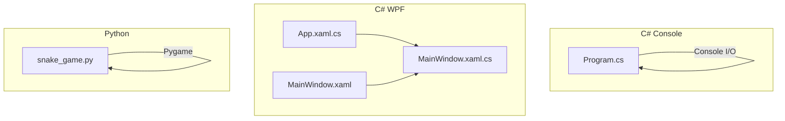
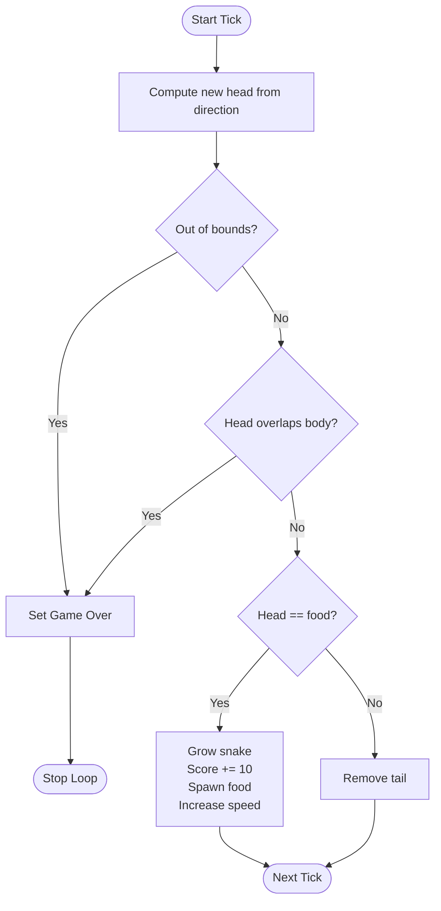
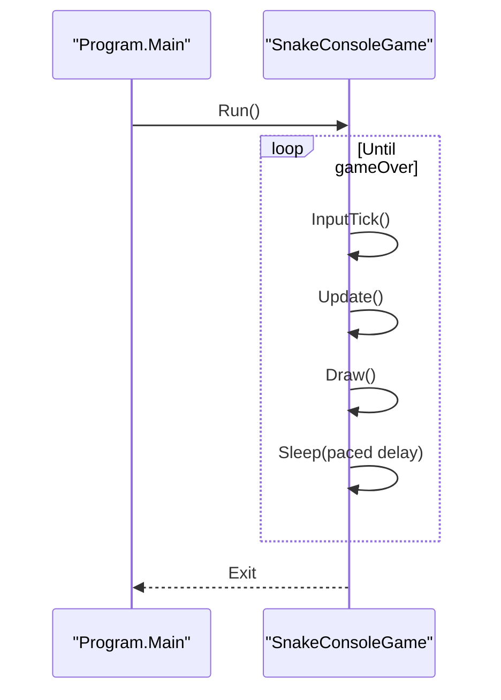
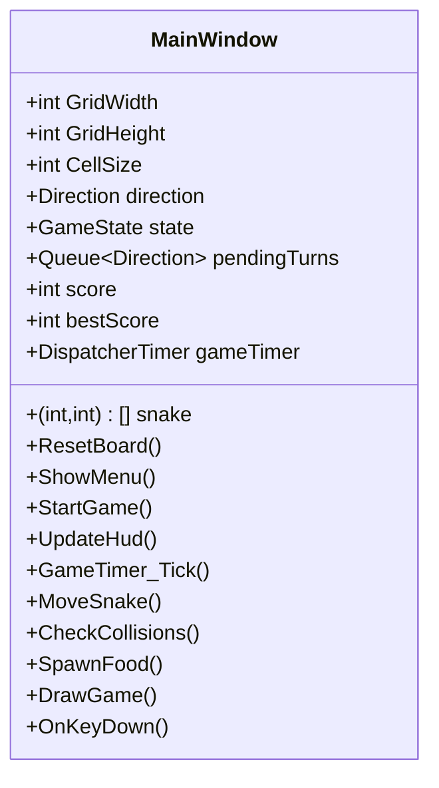
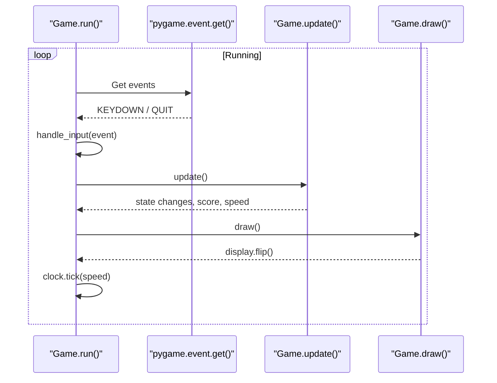
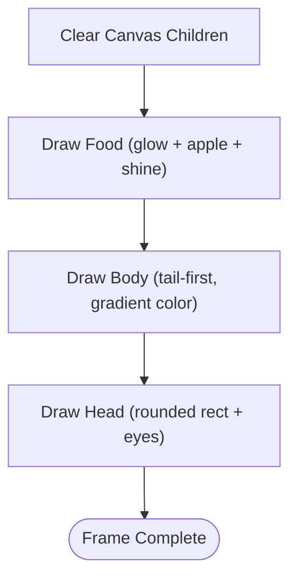
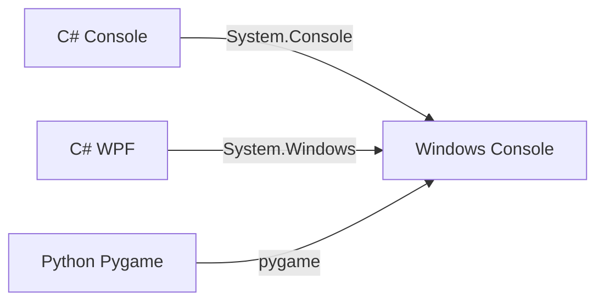

# Snake Games

<cite>
**Referenced Files in This Document**
- [Program.cs](file://c#/SnakeGame/Program.cs)
- [MainWindow.xaml.cs](file://c#/SnakeGameWPF/MainWindow.xaml.cs)
- [MainWindow.xaml](file://c#/SnakeGameWPF/MainWindow.xaml)
- [App.xaml.cs](file://c#/SnakeGameWPF/App.xaml.cs)
- [snake_game.py](file://python/Ran_San_Moi/snake_game.py)
- [build.ps1](file://c#/SnakeGame/build.ps1)
- [build.bat](file://c#/SnakeGameWPF/build.bat)
- [build.bat](file://python/Ran_San_Moi/build.bat)
- [run.bat](file://python/Ran_San_Moi/run.bat)
</cite>

## Table of Contents
1. [Introduction](#introduction)
2. [Project Structure](#project-structure)
3. [Core Components](#core-components)
4. [Architecture Overview](#architecture-overview)
5. [Detailed Component Analysis](#detailed-component-analysis)
6. [Dependency Analysis](#dependency-analysis)
7. [Performance Considerations](#performance-considerations)
8. [Troubleshooting Guide](#troubleshooting-guide)
9. [Conclusion](#conclusion)
10. [Appendices](#appendices)

## Introduction
This document explains the shared game logic and platform-specific adaptations across three Snake implementations:
- C# Console (Windows, .NET)
- C# WPF (Windows, .NET)
- Python with Pygame (cross-platform desktop)

It covers the common architecture (game loop, input handling, state management, collision detection, scoring, food spawning), graphics rendering differences, performance characteristics, build processes, and deployment strategies for each variant. It also provides guidance on extending features and porting logic between platforms.

## Project Structure
The repository contains three independent Snake implementations under different directories:
- c#/SnakeGame: A console-based implementation using System.Console.
- c#/SnakeGameWPF: A WPF application using XAML UI and DispatcherTimer-driven game loop.
- python/Ran_San_Moi: A Pygame-based implementation with a menu, HUD, and overlay screens.



**Diagram sources**
- [Program.cs:1-184](file://c#/SnakeGame/Program.cs#L1-L184)
- [MainWindow.xaml.cs:1-393](file://c#/SnakeGameWPF/MainWindow.xaml.cs#L1-L393)
- [MainWindow.xaml:1-108](file://c#/SnakeGameWPF/MainWindow.xaml#L1-L108)
- [App.xaml.cs:1-14](file://c#/SnakeGameWPF/App.xaml.cs#L1-L14)
- [snake_game.py:1-369](file://python/Ran_San_Moi/snake_game.py#L1-L369)

**Section sources**
- [Program.cs:1-184](file://c#/SnakeGame/Program.cs#L1-L184)
- [MainWindow.xaml.cs:1-393](file://c#/SnakeGameWPF/MainWindow.xaml.cs#L1-L393)
- [MainWindow.xaml:1-108](file://c#/SnakeGameWPF/MainWindow.xaml#L1-L108)
- [App.xaml.cs:1-14](file://c#/SnakeGameWPF/App.xaml.cs#L1-L14)
- [snake_game.py:1-369](file://python/Ran_San_Moi/snake_game.py#L1-L369)

## Core Components
Across all three implementations, the following core components are consistent:
- Game Loop: Drives updates and rendering at a controlled frame rate or tick interval.
- Input Handling: Captures directional inputs and queues turns to prevent invalid moves.
- State Management: Tracks Menu, Playing, and Game Over states.
- Collision Detection: Wall and self-collision checks.
- Scoring and Speed Ramp: Score increments and dynamic speed increase based on snake length.
- Food Spawning: Random placement avoiding occupied cells.

Key similarities:
- Directional movement with opposite-direction prevention.
- Turn queuing to avoid rapid double-turns causing self-collision.
- Speed ramp tied to snake length, capped at a maximum FPS.
- Grid-based movement with integer coordinates.

Platform differences:
- Console uses character drawing and Console color.
- WPF uses XAML Canvas with shapes and brushes; DispatcherTimer drives ticks.
- Pygame draws rectangles and circles via Pygame primitives; pygame.time.Clock controls frame pacing.

**Section sources**
- [Program.cs:32-55](file://c#/SnakeGame/Program.cs#L32-L55)
- [MainWindow.xaml.cs:145-157](file://c#/SnakeGameWPF/MainWindow.xaml.cs#L145-L157)
- [snake_game.py:350-363](file://python/Ran_San_Moi/snake_game.py#L350-L363)

## Architecture Overview
The shared architecture follows a classic game loop pattern:
- Initialize: Set up grid, snake, food, score, and state.
- Input: Read and queue direction changes.
- Update: Move snake, handle eating, check collisions, update speed.
- Render: Draw background, grid, food, snake, and HUD overlays.
- Frame pacing: Control tick rate or FPS to achieve desired speed ramp.

```mermaid
sequenceDiagram
participant App as "Application"
participant Loop as "Game Loop"
participant Input as "Input Handler"
participant Logic as "Game Logic"
participant Render as "Renderer"
App->>Loop : Start()
Loop->>Input : Read keys/events
Input-->>Loop : Queued direction(s)
Loop->>Logic : Update(snake, food, score, state)
Logic-->>Loop : New state, possible game over
Loop->>Render : Draw(game state)
Render-->>Loop : Frame complete
Loop->>Loop : Wait for next tick/FPS
Note over Loop : Repeat until exit or game over
```

[No sources needed since this diagram shows conceptual workflow, not actual code structure]

## Detailed Component Analysis

### Shared Game Logic
- Movement: Head advances in current direction; body follows by inserting head and optionally removing tail unless growing.
- Turning: Inputs are queued and validated against the last queued direction to prevent immediate reversals and to allow quick double-taps without folding into neck.
- Collision: Wall boundaries and self-intersection detected after move; triggers Game Over.
- Eating: When head equals food position, grow flag is set, score increases, food respawns, and speed ramps up.
- Speed Ramp: Target FPS increases with snake length, capped at a maximum.



**Section sources**
- [Program.cs:85-122](file://c#/SnakeGame/Program.cs#L85-L122)
- [MainWindow.xaml.cs:172-218](file://c#/SnakeGameWPF/MainWindow.xaml.cs#L172-L218)
- [snake_game.py:72-113](file://python/Ran_San_Moi/snake_game.py#L72-L113)

### C# Console Implementation
- Game Loop: Uses a while loop with Thread.Sleep to pace frames; sleep time decreases as score increases to simulate speed ramp.
- Rendering: Draws a bordered grid using Console characters; colors differentiate walls, food, and snake segments.
- Input: Polls Console.KeyAvailable to read WASD/Arrow keys and ESC; prevents reverse directions.
- State: Simple boolean gameOver; no menu overlay.



**Diagram sources**
- [Program.cs:32-55](file://c#/SnakeGame/Program.cs#L32-L55)

**Section sources**
- [Program.cs:17-182](file://c#/SnakeGame/Program.cs#L17-L182)

### C# WPF Implementation
- Game Loop: DispatcherTimer drives ticks; Interval adapts to snake length for speed ramp.
- Rendering: XAML Canvas with Shapes (Rectangles, Ellipses); reusable frozen Brushes optimize rendering; checkerboard DrawingBrush backgrounds the playfield.
- Input: Window KeyDown events route to TryQueueTurn; supports arrow keys and WASD; R restarts, ESC returns to menu.
- State: Enum GameState with Menu, Playing, Game Over; overlays control visibility for menus and final score.



**Diagram sources**
- [MainWindow.xaml.cs:13-43](file://c#/SnakeGameWPF/MainWindow.xaml.cs#L13-L43)
- [MainWindow.xaml.cs:101-118](file://c#/SnakeGameWPF/MainWindow.xaml.cs#L101-L118)
- [MainWindow.xaml.cs:145-157](file://c#/SnakeGameWPF/MainWindow.xaml.cs#L145-L157)
- [MainWindow.xaml.cs:172-218](file://c#/SnakeGameWPF/MainWindow.xaml.cs#L172-L218)
- [MainWindow.xaml.cs:220-237](file://c#/SnakeGameWPF/MainWindow.xaml.cs#L220-L237)
- [MainWindow.xaml.cs:303-324](file://c#/SnakeGameWPF/MainWindow.xaml.cs#L303-L324)
- [MainWindow.xaml.cs:343-390](file://c#/SnakeGameWPF/MainWindow.xaml.cs#L343-L390)

**Section sources**
- [MainWindow.xaml.cs:1-393](file://c#/SnakeGameWPF/MainWindow.xaml.cs#L1-L393)
- [MainWindow.xaml:1-108](file://c#/SnakeGameWPF/MainWindow.xaml#L1-L108)
- [App.xaml.cs:1-14](file://c#/SnakeGameWPF/App.xaml.cs#L1-L14)

### Python Pygame Implementation
- Game Loop: pygame.event.get handles input; pygame.time.Clock sets frame rate; update/draw cycle per frame.
- Rendering: Grid drawn with alternating colored rects; snake segments drawn with rounded rectangles; food drawn with glow circle and highlight; HUD text rendered with fonts.
- Input: KEYDOWN events map to directions; supports WASD and arrows; ESC toggles menu/gameover states.
- State: String-based state machine ("menu", "playing", "gameover"); high score tracking persists during session.



**Diagram sources**
- [snake_game.py:350-363](file://python/Ran_San_Moi/snake_game.py#L350-L363)
- [snake_game.py:262-300](file://python/Ran_San_Moi/snake_game.py#L262-L300)
- [snake_game.py:301-320](file://python/Ran_San_Moi/snake_game.py#L301-L320)
- [snake_game.py:321-348](file://python/Ran_San_Moi/snake_game.py#L321-L348)

**Section sources**
- [snake_game.py:1-369](file://python/Ran_San_Moi/snake_game.py#L1-L369)

### Graphics Rendering Pipeline (WPF)
- Background: Checkerboard DrawingBrush tiled across Canvas to avoid per-cell rectangles.
- Food: Glow ellipse behind main apple ellipse; small highlight ellipse for shine effect.
- Snake: Tail-first rendering ensures head and eyes overlap body; gradient-like body color computed from index; head has rounded corners and direction-aware eyes.
- Performance: Reuse frozen SolidColorBrush instances; minimize allocations per frame; clear Canvas children each tick.



**Diagram sources**
- [MainWindow.xaml.cs:246-324](file://c#/SnakeGameWPF/MainWindow.xaml.cs#L246-L324)
- [MainWindow.xaml:10-38](file://c#/SnakeGameWPF/MainWindow.xaml#L10-L38)

**Section sources**
- [MainWindow.xaml.cs:246-324](file://c#/SnakeGameWPF/MainWindow.xaml.cs#L246-L324)
- [MainWindow.xaml:10-38](file://c#/SnakeGameWPF/MainWindow.xaml#L10-L38)

### Input Handling Mechanisms
- Console: Polls available keys; maps WASD/arrows to direction; ESC exits.
- WPF: KeyDown event handler routes to TryQueueTurn; supports Space/Enter to start/restart; ESC to menu; R to restart.
- Pygame: KEYDOWN events mapped to directions; ESC toggles states; Space/Enter to start/restart.

Common safeguards:
- Prevent opposite-direction moves.
- Queue turns to avoid rapid double-turns causing self-collision.

**Section sources**
- [Program.cs:69-83](file://c#/SnakeGame/Program.cs#L69-L83)
- [MainWindow.xaml.cs:165-170](file://c#/SnakeGameWPF/MainWindow.xaml.cs#L165-L170)
- [MainWindow.xaml.cs:343-390](file://c#/SnakeGameWPF/MainWindow.xaml.cs#L343-L390)
- [snake_game.py:87-98](file://python/Ran_San_Moi/snake_game.py#L87-L98)
- [snake_game.py:262-300](file://python/Ran_San_Moi/snake_game.py#L262-L300)

### Game State Management
- States: Menu, Playing, Game Over.
- Transitions:
  - Menu -> Playing: On Space/Enter.
  - Playing -> Game Over: On collision.
  - Game Over -> Playing: On Space/Enter/R.
  - Any -> Menu: On ESC (where applicable).
- Persistence: Best score tracked in WPF; high score tracked in Pygame during session.

**Section sources**
- [MainWindow.xaml.cs:120-137](file://c#/SnakeGameWPF/MainWindow.xaml.cs#L120-L137)
- [MainWindow.xaml.cs:326-341](file://c#/SnakeGameWPF/MainWindow.xaml.cs#L326-L341)
- [snake_game.py:141-159](file://python/Ran_San_Moi/snake_game.py#L141-L159)
- [snake_game.py:219-260](file://python/Ran_San_Moi/snake_game.py#L219-L260)

### Collision Detection Algorithms
- Wall Collision: Checks if head coordinates exceed grid boundaries.
- Self Collision: Checks if head overlaps any other segment.
- Optimization: In WPF, iterate from index 1 onward; in Console, use LINQ Any; in Pygame, check membership in list slice.

**Section sources**
- [Program.cs:97-109](file://c#/SnakeGame/Program.cs#L97-L109)
- [MainWindow.xaml.cs:200-218](file://c#/SnakeGameWPF/MainWindow.xaml.cs#L200-L218)
- [snake_game.py:99-109](file://python/Ran_San_Moi/snake_game.py#L99-L109)

### Score Tracking Systems
- Increment: +10 points per food eaten.
- Speed Ramp: FPS increases with snake length, capped at maximum.
- Best/High Score: WPF tracks best score across sessions within process; Pygame tracks high score during session.

**Section sources**
- [Program.cs:113-117](file://c#/SnakeGame/Program.cs#L113-L117)
- [MainWindow.xaml.cs:187-193](file://c#/SnakeGameWPF/MainWindow.xaml.cs#L187-L193)
- [snake_game.py:307-314](file://python/Ran_San_Moi/snake_game.py#L307-L314)

### Game Loop Implementations
- Console: While loop with Thread.Sleep; sleep time reduces as score increases.
- WPF: DispatcherTimer.Tick invokes MoveSnake, CheckCollisions, DrawGame; Interval adjusted on eat.
- Pygame: Event loop with update/draw; clock.tick controls frame rate.

**Section sources**
- [Program.cs:32-55](file://c#/SnakeGame/Program.cs#L32-L55)
- [MainWindow.xaml.cs:145-157](file://c#/SnakeGameWPF/MainWindow.xaml.cs#L145-L157)
- [snake_game.py:350-363](file://python/Ran_San_Moi/snake_game.py#L350-L363)

## Dependency Analysis
- Console depends on System.Console and basic collections.
- WPF depends on System.Windows, XAML layout, and DispatcherTimer.
- Pygame depends on pygame-ce (or pygame) and standard libraries.



[No sources needed since this diagram shows conceptual dependencies, not specific code structure]

**Section sources**
- [Program.cs:1-5](file://c#/SnakeGame/Program.cs#L1-L5)
- [MainWindow.xaml.cs:1-10](file://c#/SnakeGameWPF/MainWindow.xaml.cs#L1-L10)
- [snake_game.py:6-9](file://python/Ran_San_Moi/snake_game.py#L6-L9)

## Performance Considerations
- Console:
  - Avoid excessive Console writes; batch updates where possible.
  - Use efficient data structures; LinkedList for snake allows O(1) prepend/remove.
- WPF:
  - Freeze Brushes to reduce memory churn.
  - Use DrawingBrush for background tiling instead of per-cell rectangles.
  - Clear Canvas children each frame; reuse shapes when feasible.
- Pygame:
  - Minimize surface creation per frame; reuse surfaces where possible.
  - Use efficient drawing calls; avoid unnecessary blits.
  - Keep frame rate capped to target FPS to balance CPU usage and responsiveness.

[No sources needed since this section provides general guidance]

## Troubleshooting Guide
- Build Issues:
  - Ensure .NET SDK is installed for C# projects; scripts will fail if missing.
  - For Pygame, ensure pygame-ce is installed; run script installs it if missing.
- Runtime Issues:
  - Console: If keys do not register, ensure focus is on console window.
  - WPF: If input does not respond, verify KeyDown handler is attached and e.Handled is set appropriately.
  - Pygame: If window closes immediately, check for unhandled exceptions; ensure pygame.init succeeds.
- Common Bugs:
  - Rapid key presses causing self-collision: Ensure turn queuing is implemented and validated against last queued direction.
  - Food spawning on snake: Validate candidates exclude occupied positions before random selection.

**Section sources**
- [build.ps1:12-14](file://c#/SnakeGame/build.ps1#L12-L14)
- [build.bat:19-24](file://c#/SnakeGameWPF/build.bat#L19-L24)
- [build.bat:10-17](file://python/Ran_San_Moi/build.bat#L10-L17)
- [run.bat:1-6](file://python/Ran_San_Moi/run.bat#L1-L6)
- [MainWindow.xaml.cs:343-390](file://c#/SnakeGameWPF/MainWindow.xaml.cs#L343-L390)
- [snake_game.py:262-300](file://python/Ran_San_Moi/snake_game.py#L262-L300)

## Conclusion
All three Snake implementations share a robust, extensible core: a game loop, input handling with turn queuing, collision detection, scoring with speed ramp, and food spawning. Platform-specific adaptations address rendering and input mechanisms:
- Console prioritizes simplicity and low overhead.
- WPF leverages XAML and GPU-accelerated drawing for polished visuals.
- Pygame offers cross-platform flexibility with rich graphics primitives.

Porting logic between platforms involves mapping core algorithms to platform APIs while preserving behavior such as turn queuing, collision rules, and speed ramping.

[No sources needed since this section summarizes without analyzing specific files]

## Appendices

### Build Processes and Deployment Strategies
- C# Console:
  - Use PowerShell script to restore, build, and publish self-contained or framework-dependent binaries.
  - Output executable runs on Windows x64 machines; self-contained includes runtime.
- C# WPF:
  - Use batch script to publish single-file self-contained executable; copies output to dist folder.
  - Suitable for distribution without requiring .NET runtime installation.
- Python:
  - Use batch script to install dependencies, build one-file executable with PyInstaller, and clean artifacts.
  - Produces standalone exe that bundles Pygame and dependencies.

**Section sources**
- [build.ps1:16-43](file://c#/SnakeGame/build.ps1#L16-L43)
- [build.bat:26-61](file://c#/SnakeGameWPF/build.bat#L26-L61)
- [build.bat:16-45](file://python/Ran_San_Moi/build.bat#L16-L45)
- [run.bat:1-6](file://python/Ran_San_Moi/run.bat#L1-L6)

### Extending Features and Customizing Gameplay
- Add power-ups: Introduce special items that modify speed, size, or invincibility; extend food spawning logic and update collision/eating handlers.
- Customize visuals: In WPF, adjust Brush colors and shapes; in Pygame, change colors and drawing primitives; in Console, change characters and colors.
- Adjust difficulty: Modify speed ramp formula, grid size, or initial snake length.
- Porting tips:
  - Keep core algorithms abstracted (move, collide, spawn, render) to ease porting.
  - Map platform-specific input events to unified direction changes.
  - Preserve turn queuing and validation to maintain consistent gameplay across platforms.

[No sources needed since this section provides general guidance]