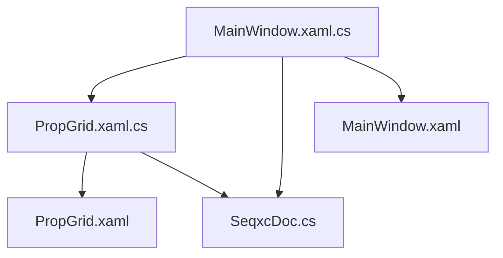
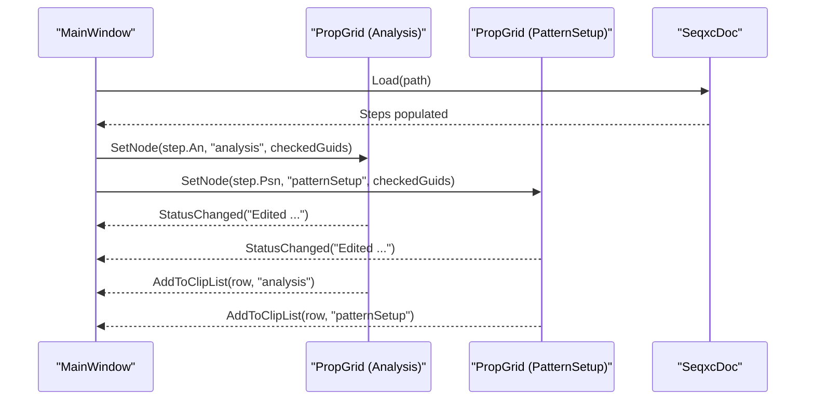
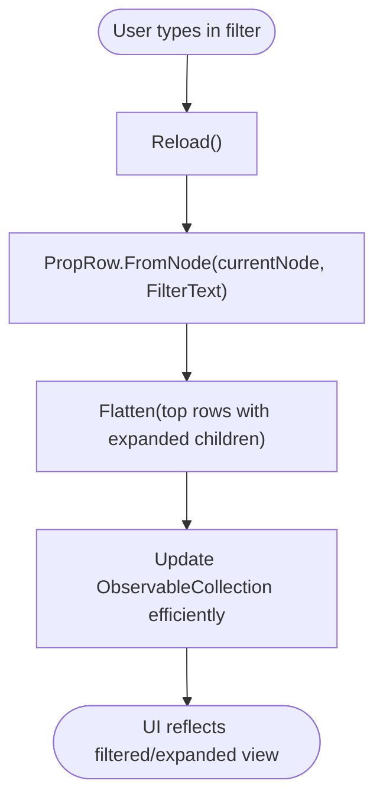
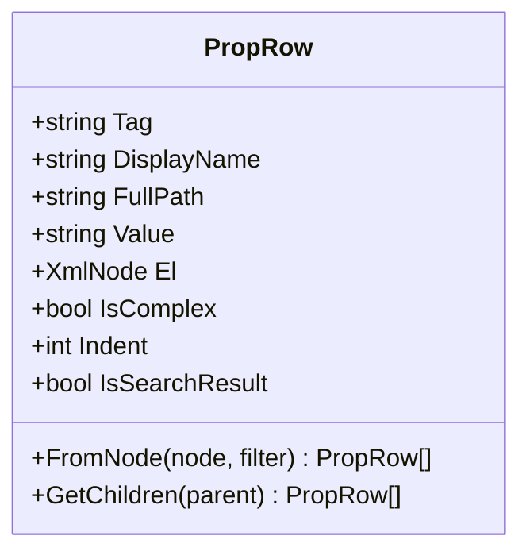
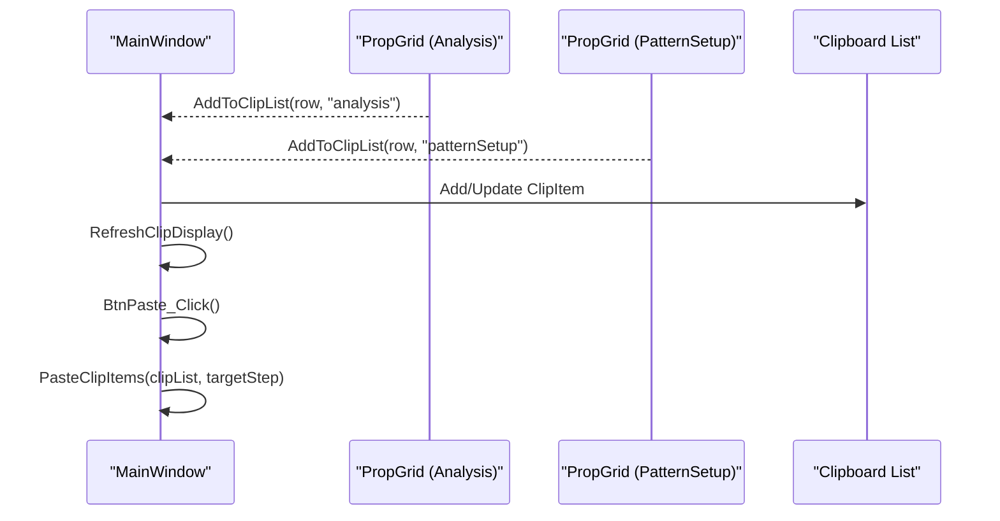
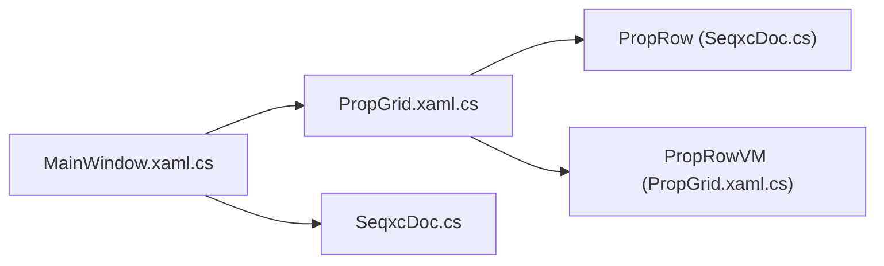

# Property Grid System

<cite>
**Referenced Files in This Document**
- [PropGrid.xaml.cs](file://SeqxcEditor_wpf/PropGrid.xaml.cs)
- [PropGrid.xaml](file://SeqxcEditor_wpf/PropGrid.xaml)
- [MainWindow.xaml.cs](file://SeqxcEditor_wpf/MainWindow.xaml.cs)
- [MainWindow.xaml](file://SeqxcEditor_wpf/MainWindow.xaml)
- [SeqxcDoc.cs](file://SeqxcEditor_wpf/SeqxcDoc.cs)
</cite>

## Table of Contents
1. [Introduction](#introduction)
2. [Project Structure](#project-structure)
3. [Core Components](#core-components)
4. [Architecture Overview](#architecture-overview)
5. [Detailed Component Analysis](#detailed-component-analysis)
6. [Dependency Analysis](#dependency-analysis)
7. [Performance Considerations](#performance-considerations)
8. [Troubleshooting Guide](#troubleshooting-guide)
9. [Conclusion](#conclusion)
10. [Appendices](#appendices)

## Introduction
This document explains the Property Grid System used to edit complex nested XML structures in a WPF application. The central component is PropGrid, which renders properties from an XML node tree as editable rows with filtering, expand/collapse for nested structures, and clipboard operations via AddToClipList. It integrates with both Analysis and PatternSetup nodes, supports batch selection across steps, and provides robust data binding and event handling patterns suitable for large property sets.

## Project Structure
The Property Grid System spans a small set of focused files:
- PropGrid (XAML + code-behind): UI and behavior for property editing, filtering, and clipboard integration.
- MainWindow (XAML + code-behind): Orchestrates step selection, tabs for Analysis vs PatternSetup, clipboard list management, and propagation of checked items to grids.
- SeqxcDoc.cs: Data model and XML manipulation utilities, including building property rows, search/filtering, and paste logic with special handling for CameraSettings.

**Diagram sources**
- [MainWindow.xaml.cs:48-77](file://SeqxcEditor_wpf/MainWindow.xaml.cs#L48-L77)
- [PropGrid.xaml.cs:64-95](file://SeqxcEditor_wpf/PropGrid.xaml.cs#L64-L95)
- [SeqxcDoc.cs:31-120](file://SeqxcEditor_wpf/SeqxcDoc.cs#L31-L120)

**Section sources**
- [MainWindow.xaml.cs:48-77](file://SeqxcEditor_wpf/MainWindow.xaml.cs#L48-L77)
- [PropGrid.xaml.cs:64-95](file://SeqxcEditor_wpf/PropGrid.xaml.cs#L64-L95)
- [SeqxcDoc.cs:31-120](file://SeqxcEditor_wpf/SeqxcDoc.cs#L31-L120)

## Core Components
- PropRowVM: ViewModel wrapping a PropRow, exposing UI-friendly properties like IsExpanded, IndentMargin, colors, and Value binding. Triggers status updates on edits.
- PropGrid: UserControl that hosts a DataGrid bound to PropRowVM instances. Provides SetNode to bind to an XML node, filter text handling, expand/collapse, right-click to add to clipboard, and keyboard support to cancel edits.
- SeqxcDoc.PropRow: Builds hierarchical or filtered views of XML elements into rows; supports deep search and child expansion.
- MainWindow: Manages steps, selection, tabs, clipboard list, and propagates checked GUIDs to both PropGrid instances.

Key responsibilities:
- Rendering XML as editable rows with indentation and nesting.
- Filtering by tag name, value, or full path.
- Clipboard integration through AddToClipList events.
- Batch operations via checked GUIDs propagated to grids.

**Section sources**
- [PropGrid.xaml.cs:15-61](file://SeqxcEditor_wpf/PropGrid.xaml.cs#L15-L61)
- [PropGrid.xaml.cs:64-95](file://SeqxcEditor_wpf/PropGrid.xaml.cs#L64-L95)
- [SeqxcDoc.cs:31-120](file://SeqxcEditor_wpf/SeqxcDoc.cs#L31-L120)
- [MainWindow.xaml.cs:48-77](file://SeqxcEditor_wpf/MainWindow.xaml.cs#L48-L77)

## Architecture Overview
At runtime, MainWindow loads a sequence file, parses it into StepInfo objects, and displays them in a left panel. Selecting a step calls SetNode on two PropGrid instances: one for Analysis and one for PatternSetup, passing the corresponding XML node and the current tab identifier. Both grids share the same filtering and editing behaviors but operate on different XML subtrees.

**Diagram sources**
- [MainWindow.xaml.cs:181-207](file://SeqxcEditor_wpf/MainWindow.xaml.cs#L181-L207)
- [PropGrid.xaml.cs:84-95](file://SeqxcEditor_wpf/PropGrid.xaml.cs#L84-L95)
- [MainWindow.xaml.cs:306-313](file://SeqxcEditor_wpf/MainWindow.xaml.cs#L306-L313)

## Detailed Component Analysis

### PropGrid: Dynamic Property Editing Interface
- SetNode(XmlNode, string, HashSet<string>): Binds the grid to a specific XML subtree, resets filters, clears expanded state, and reloads rows. Also stores the current tab name for clipboard context.
- Filter: TextChanged triggers Reload; filter matches against Tag, Value, and FullPath.
- Expand/Collapse: Complex nodes show an expand button; clicking toggles expanded state and re-renders children. Left-click on the property column also toggles expansion for complex rows.
- Editing: Non-complex rows expose a TextBox bound to Value; changes update the underlying XML element’s InnerText and fire StatusChanged. Escape cancels edits by reverting to Row.Value.
- Clipboard: Right-click on a row invokes AddToClipList with the row and source tab.

**Diagram sources**
- [PropGrid.xaml.cs:98-134](file://SeqxcEditor_wpf/PropGrid.xaml.cs#L98-L134)
- [SeqxcDoc.cs:44-56](file://SeqxcEditor_wpf/SeqxcDoc.cs#L44-L56)

**Section sources**
- [PropGrid.xaml.cs:84-134](file://SeqxcEditor_wpf/PropGrid.xaml.cs#L84-L134)
- [PropGrid.xaml.cs:156-198](file://SeqxcEditor_wpf/PropGrid.xaml.cs#L156-L198)
- [PropGrid.xaml:6-17](file://SeqxcEditor_wpf/PropGrid.xaml#L6-L17)
- [PropGrid.xaml:19-90](file://SeqxcEditor_wpf/PropGrid.xaml#L19-L90)

### PropRow and Row Representation
- FromNode(node, filter): If filter present, performs deep search collecting leaf nodes matching criteria; otherwise builds a level-based view of immediate children.
- GetChildren(parent): Returns child rows for an expanded parent, preserving indentation and full paths.
- Row fields: Tag (element local name), DisplayName (displayed label), FullPath (breadcrumb), Value (text or summary), El (XML element reference), IsComplex (has child elements), Indent (depth), IsSearchResult (true when from filter).

**Diagram sources**
- [SeqxcDoc.cs:31-120](file://SeqxcEditor_wpf/SeqxcDoc.cs#L31-L120)

**Section sources**
- [SeqxcDoc.cs:44-120](file://SeqxcEditor_wpf/SeqxcDoc.cs#L44-L120)

### MainWindow Integration: Tabs, Checked Items, and Clipboard
- Tabs: Two PropGrid instances are shown based on user selection; each receives its respective XML node and tab name ("analysis" or "patternSetup").
- Checked items: A HashSet<string> tracks selected step GUIDs; changes propagate to both grids via UpdateChecked so they can reflect batch contexts if needed.
- Clipboard: AddToClipList events from either grid add entries to a shared list. Paste applies items to all checked steps with type-awareness for analysis nodes.

**Diagram sources**
- [MainWindow.xaml.cs:306-324](file://SeqxcEditor_wpf/MainWindow.xaml.cs#L306-L324)
- [SeqxcDoc.cs:385-395](file://SeqxcEditor_wpf/SeqxcDoc.cs#L385-L395)

**Section sources**
- [MainWindow.xaml.cs:181-207](file://SeqxcEditor_wpf/MainWindow.xaml.cs#L181-L207)
- [MainWindow.xaml.cs:232-244](file://SeqxcEditor_wpf/MainWindow.xaml.cs#L232-L244)
- [MainWindow.xaml.cs:306-349](file://SeqxcEditor_wpf/MainWindow.xaml.cs#L306-L349)

### XML Element Types: Analysis vs PatternSetup
- Analysis nodes: Identified by their xsi:type attribute; MainWindow reads this to compute a badge and type label. When pasting analysis items, only targets with matching AnalysisTypeName receive the paste.
- PatternSetup nodes: Pasted without type constraints; includes smart handling for CameraSettings blocks and lists.

Rendering differences:
- Both grids use the same rendering logic; differences arise from the underlying XML structure and paste semantics enforced by SeqxcDoc.

**Section sources**
- [MainWindow.xaml.cs:181-207](file://SeqxcEditor_wpf/MainWindow.xaml.cs#L181-L207)
- [SeqxcDoc.cs:149-191](file://SeqxcEditor_wpf/SeqxcDoc.cs#L149-L191)
- [SeqxcDoc.cs:385-395](file://SeqxcEditor_wpf/SeqxcDoc.cs#L385-L395)

### Event Handling Patterns
- StatusChanged: Fired whenever a property is edited; MainWindow updates the status bar.
- AddToClipList: Fired on right-click; MainWindow manages the clipboard list and UI state.
- SelectionChanged: Suppressed during programmatic selection to avoid loops.
- Keyboard: Escape cancels edits; Ctrl+O opens files; Ctrl+S saves.

**Section sources**
- [PropGrid.xaml.cs:74-76](file://SeqxcEditor_wpf/PropGrid.xaml.cs#L74-L76)
- [PropGrid.xaml.cs:191-198](file://SeqxcEditor_wpf/PropGrid.xaml.cs#L191-L198)
- [MainWindow.xaml.cs:70-73](file://SeqxcEditor_wpf/MainWindow.xaml.cs#L70-L73)
- [MainWindow.xaml.cs:394-406](file://SeqxcEditor_wpf/MainWindow.xaml.cs#L394-L406)

### Data Binding Mechanisms
- PropRowVM exposes INotifyPropertyChanged for UI updates.
- DataGrid columns bind to PropRowVM properties:
  - PROPERTY column uses templates for expand buttons and labels.
  - VALUE column binds to Value with TwoWay mode and LostFocus update trigger.
- Row styling uses DataTriggers for background and foreground based on IsComplex and Indent.

**Section sources**
- [PropGrid.xaml.cs:15-61](file://SeqxcEditor_wpf/PropGrid.xaml.cs#L15-L61)
- [PropGrid.xaml:29-90](file://SeqxcEditor_wpf/PropGrid.xaml#L29-L90)

### Performance Optimization Techniques
- Efficient collection updates: Reload replaces or adds items in place rather than clearing and rebuilding, preserving scroll position and minimizing layout churn.
- Flat rendering with lazy expansion: Only expanded nodes render their children, reducing initial load for deep hierarchies.
- Search optimization: Deep search collects leaves once per filter change and filters in memory.
- VisualTreeHelper helpers: Lightweight traversal for hit-testing and finding ScrollViewer to preserve scroll offset.

**Section sources**
- [PropGrid.xaml.cs:113-134](file://SeqxcEditor_wpf/PropGrid.xaml.cs#L113-L134)
- [PropGrid.xaml.cs:136-152](file://SeqxcEditor_wpf/PropGrid.xaml.cs#L136-L152)
- [SeqxcDoc.cs:44-56](file://SeqxcEditor_wpf/SeqxcDoc.cs#L44-L56)

## Dependency Analysis
- PropGrid depends on PropRowVM and PropRow for data representation and editing.
- MainWindow depends on PropGrid instances and SeqxcDoc for data operations.
- SeqxcDoc encapsulates XML parsing, step management, and paste logic.

**Diagram sources**
- [MainWindow.xaml.cs:48-77](file://SeqxcEditor_wpf/MainWindow.xaml.cs#L48-L77)
- [PropGrid.xaml.cs:64-95](file://SeqxcEditor_wpf/PropGrid.xaml.cs#L64-L95)
- [SeqxcDoc.cs:31-120](file://SeqxcEditor_wpf/SeqxcDoc.cs#L31-L120)

**Section sources**
- [MainWindow.xaml.cs:48-77](file://SeqxcEditor_wpf/MainWindow.xaml.cs#L48-L77)
- [PropGrid.xaml.cs:64-95](file://SeqxcEditor_wpf/PropGrid.xaml.cs#L64-L95)
- [SeqxcDoc.cs:31-120](file://SeqxcEditor_wpf/SeqxcDoc.cs#L31-L120)

## Performance Considerations
- For very large XML trees, prefer filtering early and rely on lazy expansion to keep the UI responsive.
- Avoid frequent Reload calls; debounce filter input if necessary.
- Use SetNode judiciously; batching multiple changes before calling SetNode reduces rebinds.
- Keep expanded state minimal; large subtrees increase rendering cost.

[No sources needed since this section provides general guidance]

## Troubleshooting Guide
- Edits not persisting: Ensure the row is not complex; complex rows are read-only in the grid. Verify that the underlying XML element exists and is writable.
- Filter not matching: Confirm that filter matches Tag, Value, or FullPath; remember that search results flatten to leaves.
- Clipboard actions not applying: Check that the target step has a matching AnalysisTypeName for analysis items; pattern setup items always apply unless the target lacks a PatternSetup node.
- Shared PatternSetup warning: If multiple steps share a PatternSetup, edits affect all; verify intended scope before bulk operations.

**Section sources**
- [PropGrid.xaml.cs:39-50](file://SeqxcEditor_wpf/PropGrid.xaml.cs#L39-L50)
- [SeqxcDoc.cs:385-395](file://SeqxcEditor_wpf/SeqxcDoc.cs#L385-L395)
- [MainWindow.xaml.cs:209-226](file://SeqxcEditor_wpf/MainWindow.xaml.cs#L209-L226)

## Conclusion
The Property Grid System offers a flexible, efficient interface for editing complex XML structures. Through PropGrid’s dynamic rendering, filtering, and clipboard integration, users can navigate and modify nested properties seamlessly. Integration with both Analysis and PatternSetup nodes ensures type-safe operations and consistent behavior across different XML schemas. With careful attention to performance and event handling patterns, the system scales well for large property sets while remaining intuitive.

[No sources needed since this section summarizes without analyzing specific files]

## Appendices

### Practical Examples

#### Adding a New Property Editor
- Extend PropRowVM to expose additional UI properties or commands if needed.
- Bind new controls in PropGrid.xaml using existing template patterns.
- Wire up events to update the underlying XML via PropRow.El and trigger StatusChanged.

**Section sources**
- [PropGrid.xaml.cs:15-61](file://SeqxcEditor_wpf/PropGrid.xaml.cs#L15-L61)
- [PropGrid.xaml:46-90](file://SeqxcEditor_wpf/PropGrid.xaml#L46-L90)

#### Customizing Grid Appearance
- Modify DataGrid.RowStyle and CellTemplate styles in PropGrid.xaml to adjust backgrounds, fonts, and colors.
- Use DataTriggers to style rows based on IsComplex, Indent, or selection state.

**Section sources**
- [PropGrid.xaml:29-44](file://SeqxcEditor_wpf/PropGrid.xaml#L29-L44)
- [PropGrid.xaml:46-90](file://SeqxcEditor_wpf/PropGrid.xaml#L46-L90)

#### Implementing Specialized Property Types
- For complex types, rely on IsComplex to provide expand/collapse behavior.
- For specialized paste behavior, extend SeqxcDoc.PasteRow with additional cases beyond CameraSettings.

**Section sources**
- [SeqxcDoc.cs:231-286](file://SeqxcEditor_wpf/SeqxcDoc.cs#L231-L286)