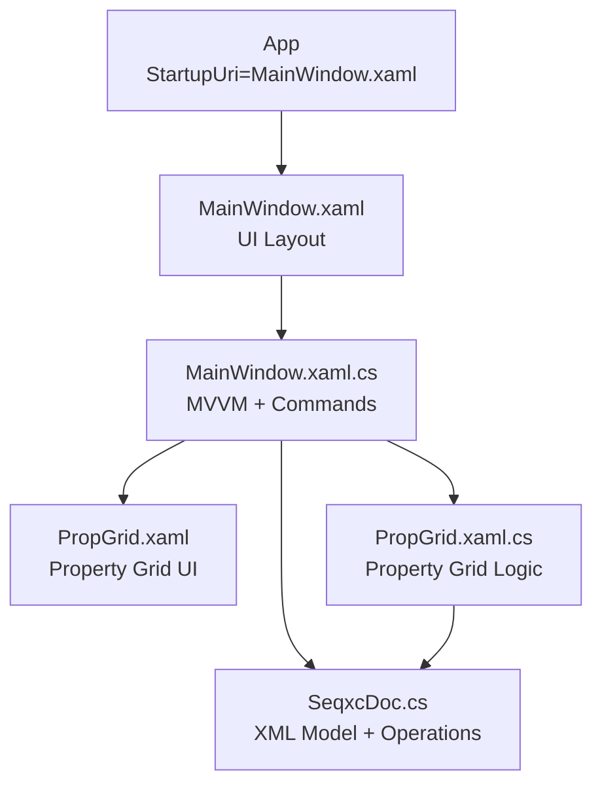
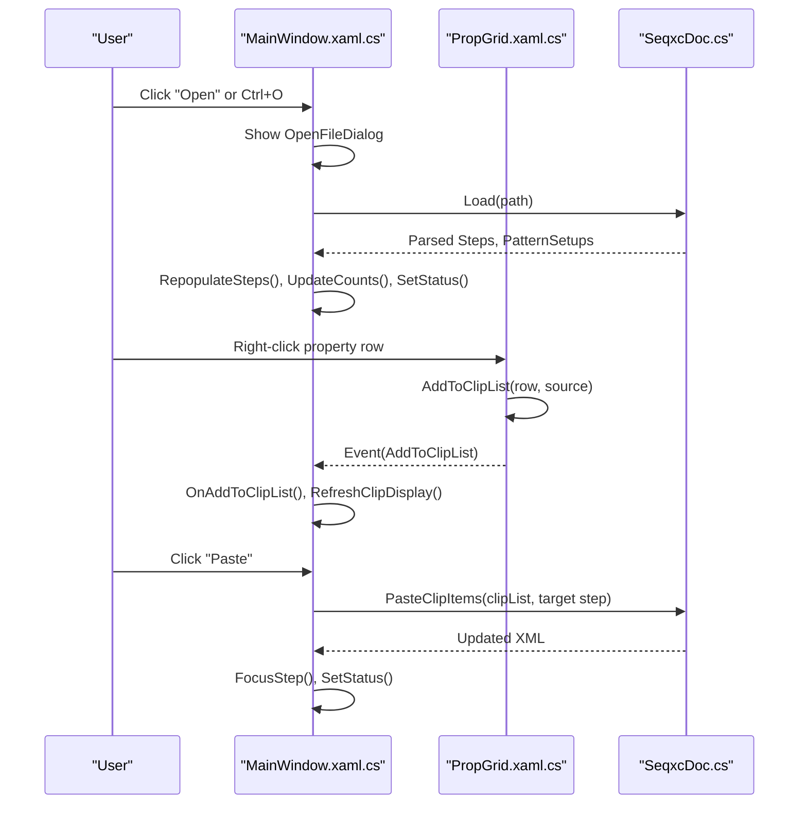
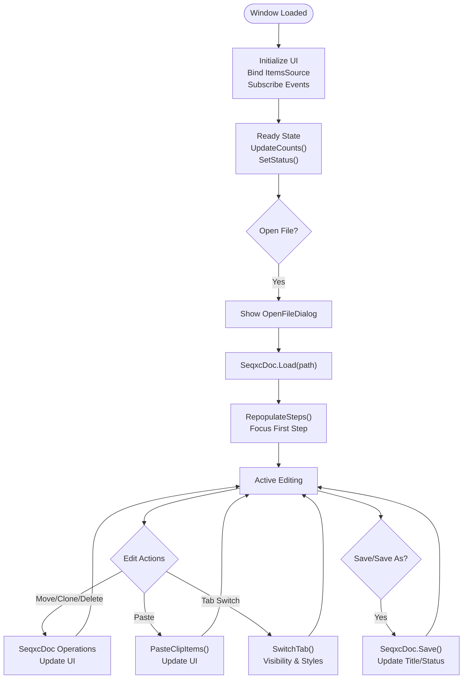
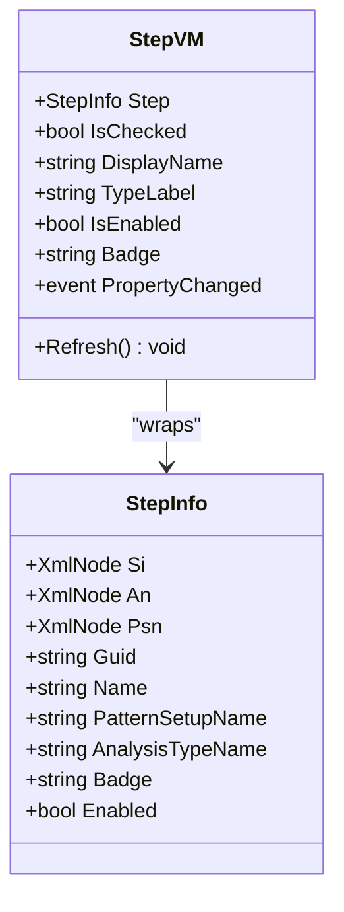
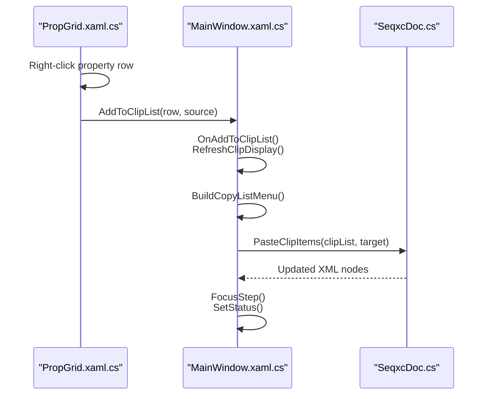
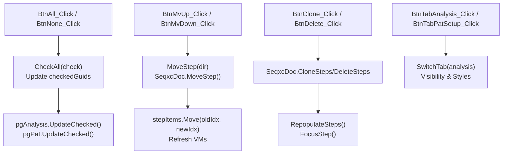
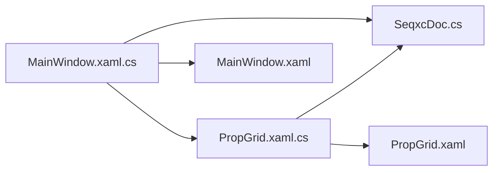

# User Interface Management

<cite>
**Referenced Files in This Document**
- [MainWindow.xaml](file://SeqxcEditor_wpf/MainWindow.xaml)
- [MainWindow.xaml.cs](file://SeqxcEditor_wpf/MainWindow.xaml.cs)
- [PropGrid.xaml](file://SeqxcEditor_wpf/PropGrid.xaml)
- [PropGrid.xaml.cs](file://SeqxcEditor_wpf/PropGrid.xaml.cs)
- [SeqxcDoc.cs](file://SeqxcEditor_wpf/SeqxcDoc.cs)
- [App.xaml](file://SeqxcEditor_wpf/App.xaml)
- [App.xaml.cs](file://SeqxcEditor_wpf/App.xaml.cs)
</cite>

## Table of Contents
1. [Introduction](#introduction)
2. [Project Structure](#project-structure)
3. [Core Components](#core-components)
4. [Architecture Overview](#architecture-overview)
5. [Detailed Component Analysis](#detailed-component-analysis)
6. [Dependency Analysis](#dependency-analysis)
7. [Performance Considerations](#performance-considerations)
8. [Troubleshooting Guide](#troubleshooting-guide)
9. [Conclusion](#conclusion)
10. [Appendices](#appendices)

## Introduction
This document explains the User Interface Management for the SeqXC Editor WPF application with a focus on MainWindow and the application lifecycle. It details the MVVM implementation using StepVM as the view model for step items, data binding patterns, property change notifications, file operations (Open, Save, Save As), step list management, tab switching between Analysis and PatternSetup views, drag-and-drop support, keyboard shortcuts, context menus, clipboard system (copy/paste), and status bar updates. It also covers event-driven architecture, state management patterns, UI responsiveness considerations, and practical guidance for extending the UI with new commands, customizing step display, and implementing additional user interactions.

## Project Structure
The WPF project is organized around a main window, a reusable property grid control, and a document model that parses and manipulates XML-based sequence files.

- Application entry point: App.xaml and App.xaml.cs define the startup URI to MainWindow.xaml.
- Main window: MainWindow.xaml defines the layout (toolbar, step list, detail panel, tabs, status bar). MainWindow.xaml.cs implements MVVM logic, command handlers, clipboard, and UI state.
- Property grid: PropGrid.xaml and PropGrid.xaml.cs provide an editable tree-like property editor bound to XML nodes.
- Document model: SeqxcDoc.cs loads/saves XML, parses steps and pattern setups, and provides operations like move, clone, delete, toggle enabled, and paste with smart handling for complex structures.

**Diagram sources**
- [App.xaml:1-10](file://SeqxcEditor_wpf/App.xaml#L1-L10)
- [MainWindow.xaml:1-217](file://SeqxcEditor_wpf/MainWindow.xaml#L1-L217)
- [MainWindow.xaml.cs:1-434](file://SeqxcEditor_wpf/MainWindow.xaml.cs#L1-L434)
- [PropGrid.xaml:1-93](file://SeqxcEditor_wpf/PropGrid.xaml#L1-L93)
- [PropGrid.xaml.cs:1-227](file://SeqxcEditor_wpf/PropGrid.xaml.cs#L1-L227)
- [SeqxcDoc.cs:1-403](file://SeqxcEditor_wpf/SeqxcDoc.cs#L1-L403)

**Section sources**
- [App.xaml:1-10](file://SeqxcEditor_wpf/App.xaml#L1-L10)
- [App.xaml.cs:1-6](file://SeqxcEditor_wpf/App.xaml.cs#L1-L6)
- [MainWindow.xaml:1-217](file://SeqxcEditor_wpf/MainWindow.xaml#L1-L217)
- [MainWindow.xaml.cs:1-434](file://SeqxcEditor_wpf/MainWindow.xaml.cs#L1-L434)
- [PropGrid.xaml:1-93](file://SeqxcEditor_wpf/PropGrid.xaml#L1-L93)
- [PropGrid.xaml.cs:1-227](file://SeqxcEditor_wpf/PropGrid.xaml.cs#L1-L227)
- [SeqxcDoc.cs:1-403](file://SeqxcEditor_wpf/SeqxcDoc.cs#L1-L403)

## Core Components
- MainWindow: Orchestrates UI state, handles file I/O, manages step selection and operations, coordinates clipboard actions, and switches tabs.
- StepVM: View model for each step item; exposes properties bound to the DataGrid and notifies changes via INotifyPropertyChanged.
- PropGrid: Reusable property editor that binds to XML nodes, supports filtering, expansion, editing, and copy-to-clipboard integration.
- SeqxcDoc: Central document model providing load/save, parsing, queries, and operations such as move, clone, delete, toggle enabled, and paste with special handling for CameraSettings structures.

Key responsibilities:
- File operations: Open, Save, Save As with error handling and status updates.
- Step list management: Selection, enable/disable toggling, move up/down, clone, delete, check/uncheck all.
- Tab switching: Toggle visibility and styling between Analysis and PatternSetup views.
- Clipboard system: Maintain a shared clip list, paste to selected steps, and manage context menu for removing items.
- Keyboard and drag-and-drop: Global shortcuts (Ctrl+O, Ctrl+S) and drag & drop .seqxc files into the window.
- Status bar: Real-time feedback for operations and counts.

**Section sources**
- [MainWindow.xaml.cs:14-46](file://SeqxcEditor_wpf/MainWindow.xaml.cs#L14-L46)
- [MainWindow.xaml.cs:48-434](file://SeqxcEditor_wpf/MainWindow.xaml.cs#L48-L434)
- [PropGrid.xaml.cs:14-61](file://SeqxcEditor_wpf/PropGrid.xaml.cs#L14-L61)
- [PropGrid.xaml.cs:63-227](file://SeqxcEditor_wpf/PropGrid.xaml.cs#L63-L227)
- [SeqxcDoc.cs:10-120](file://SeqxcEditor_wpf/SeqxcDoc.cs#L10-L120)
- [SeqxcDoc.cs:122-403](file://SeqxcEditor_wpf/SeqxcDoc.cs#L122-L403)

## Architecture Overview
The application follows an event-driven MVVM pattern:
- Views (MainWindow.xaml, PropGrid.xaml) bind to view models (StepVM, PropRowVM) and raise events.
- View models implement INotifyPropertyChanged to notify UI of changes.
- The document model (SeqxcDoc) encapsulates XML parsing and manipulation, exposing methods invoked by the main window and property grid.

**Diagram sources**
- [MainWindow.xaml.cs:83-130](file://SeqxcEditor_wpf/MainWindow.xaml.cs#L83-L130)
- [MainWindow.xaml.cs:306-354](file://SeqxcEditor_wpf/MainWindow.xaml.cs#L306-L354)
- [PropGrid.xaml.cs:166-171](file://SeqxcEditor_wpf/PropGrid.xaml.cs#L166-L171)
- [SeqxcDoc.cs:134-145](file://SeqxcEditor_wpf/SeqxcDoc.cs#L134-L145)
- [SeqxcDoc.cs:382-395](file://SeqxcEditor_wpf/SeqxcDoc.cs#L382-L395)

## Detailed Component Analysis

### MainWindow and Application Lifecycle
- Startup: App.xaml sets StartupUri to MainWindow.xaml; MainWindow constructor initializes components, sets icon, binds DataGrid, subscribes to property grid events, and updates initial counts/status.
- File operations:
  - Open: Opens dialog, calls SeqxcDoc.Load, updates title, clears state, repopulates steps, enables save buttons, updates counts and status, focuses first step if available.
  - Save/Save As: Validates loaded state, saves to path, updates title and status, shows errors via MessageBox.
- Step list management:
  - RepopulateSteps: Clears ObservableCollection, creates StepVM instances, subscribes to PropertyChanged, restores checked state, updates counts.
  - SelectionChanged: Refreshes VM, focuses step, updates info bar and tabs.
  - Right-click row: Toggles Enabled via SeqxcDoc.ToggleEnabled, refreshes VM, updates info bar without changing selection.
  - Move Up/Down: Uses SeqxcDoc.MoveStep, swaps items in ObservableCollection for smooth animation, refreshes both VMs, selects moved item.
  - Clone/Delete: Operates on checkedGuids, uses SeqxcDoc.CloneSteps/DeleteSteps, repopulates, focuses appropriate step, updates status.
- Tab switching:
  - SwitchTab toggles visibility of pgAnalysis/pgPat and updates button styles to reflect active tab.
- Clipboard system:
  - OnAddToClipList: Adds or updates ClipItem in shared list, refreshes display, updates status.
  - Paste: Pastes clip items to all selected steps via SeqxcDoc.PasteClipItems, updates status.
  - Clear/Copy List: Clears clip list, builds dynamic ContextMenu for removing items, updates counts and button states.
- Keyboard and drag-and-drop:
  - Window_KeyDown handles Ctrl+O and Ctrl+S.
  - AllowDrop=True with DragEnter/Drop handlers open dropped .seqxc files.
- Status bar: SetStatus updates lblStatus text for user feedback.

**Diagram sources**
- [MainWindow.xaml.cs:59-77](file://SeqxcEditor_wpf/MainWindow.xaml.cs#L59-L77)
- [MainWindow.xaml.cs:83-130](file://SeqxcEditor_wpf/MainWindow.xaml.cs#L83-L130)
- [MainWindow.xaml.cs:136-156](file://SeqxcEditor_wpf/MainWindow.xaml.cs#L136-L156)
- [MainWindow.xaml.cs:249-285](file://SeqxcEditor_wpf/MainWindow.xaml.cs#L249-L285)
- [MainWindow.xaml.cs:287-300](file://SeqxcEditor_wpf/MainWindow.xaml.cs#L287-L300)
- [MainWindow.xaml.cs:306-354](file://SeqxcEditor_wpf/MainWindow.xaml.cs#L306-L354)
- [MainWindow.xaml.cs:394-406](file://SeqxcEditor_wpf/MainWindow.xaml.cs#L394-L406)

**Section sources**
- [MainWindow.xaml.cs:59-77](file://SeqxcEditor_wpf/MainWindow.xaml.cs#L59-L77)
- [MainWindow.xaml.cs:83-130](file://SeqxcEditor_wpf/MainWindow.xaml.cs#L83-L130)
- [MainWindow.xaml.cs:136-156](file://SeqxcEditor_wpf/MainWindow.xaml.cs#L136-L156)
- [MainWindow.xaml.cs:158-226](file://SeqxcEditor_wpf/MainWindow.xaml.cs#L158-L226)
- [MainWindow.xaml.cs:232-300](file://SeqxcEditor_wpf/MainWindow.xaml.cs#L232-L300)
- [MainWindow.xaml.cs:306-388](file://SeqxcEditor_wpf/MainWindow.xaml.cs#L306-L388)
- [MainWindow.xaml.cs:394-423](file://SeqxcEditor_wpf/MainWindow.xaml.cs#L394-L423)

### MVVM Implementation with StepVM and Data Binding
- StepVM implements INotifyPropertyChanged and wraps StepInfo from SeqxcDoc.
- Properties:
  - Step: Backed field with notification on set.
  - IsChecked: Two-way binding to checkbox column; triggers selection synchronization and counts update.
  - DisplayName: Computed label showing enabled state and name.
  - TypeLabel/Badge/IsEnabled: Bound to template columns for visual badges and disabled styling.
- Data binding patterns:
  - DataGridCheckBoxColumn binds to IsChecked with Mode=TwoWay and UpdateSourceTrigger=PropertyChanged.
  - DataGridTextColumn binds to DisplayName for read-only display.
  - DataGridTemplateColumn binds to TypeLabel and Badge for styled badges.
- Property change notifications:
  - PropertyChanged event raised via helper method N to notify UI of changes.
  - MainWindow subscribes to StepVM.PropertyChanged to synchronize checked state and propagate to property grids.

**Diagram sources**
- [MainWindow.xaml.cs:14-46](file://SeqxcEditor_wpf/MainWindow.xaml.cs#L14-L46)
- [SeqxcDoc.cs:18-29](file://SeqxcEditor_wpf/SeqxcDoc.cs#L18-L29)

**Section sources**
- [MainWindow.xaml.cs:14-46](file://SeqxcEditor_wpf/MainWindow.xaml.cs#L14-L46)
- [MainWindow.xaml.xaml:116-169](file://SeqxcEditor_wpf/MainWindow.xaml#L116-L169)
- [SeqxcDoc.cs:18-29](file://SeqxcEditor_wpf/SeqxcDoc.cs#L18-L29)

### Property Grid and Copy/Paste System
- PropRowVM:
  - Wraps PropRow and exposes IsExpanded, IsComplex, Indent, FullPath, Value, etc.
  - Implements INotifyPropertyChanged; edits trigger StatusChanged event.
- PropGrid:
  - Maintains current XmlNode, tab, checkedGuids, expanded nodes, and ObservableCollection of PropRowVM.
  - Provides SetNode, UpdateChecked, SetClipCount public API.
  - Handles filter input, expand/collapse, right-click to add to clipboard, left-click to expand complex rows.
- Clipboard system:
  - PropGrid raises AddToClipList(row, source) on right-click.
  - MainWindow maintains shared clipList, builds context menu for removal, and pastes to selected steps.
  - SeqxcDoc.PasteClipItems performs type-aware pasting and smart handling for CameraSettings structures.

**Diagram sources**
- [PropGrid.xaml.cs:166-171](file://SeqxcEditor_wpf/PropGrid.xaml.cs#L166-L171)
- [MainWindow.xaml.cs:306-354](file://SeqxcEditor_wpf/MainWindow.xaml.cs#L306-L354)
- [SeqxcDoc.cs:382-395](file://SeqxcEditor_wpf/SeqxcDoc.cs#L382-L395)

**Section sources**
- [PropGrid.xaml.cs:14-61](file://SeqxcEditor_wpf/PropGrid.xaml.cs#L14-L61)
- [PropGrid.xaml.cs:63-227](file://SeqxcEditor_wpf/PropGrid.xaml.cs#L63-L227)
- [MainWindow.xaml.cs:306-388](file://SeqxcEditor_wpf/MainWindow.xaml.cs#L306-L388)
- [SeqxcDoc.cs:382-395](file://SeqxcEditor_wpf/SeqxcDoc.cs#L382-L395)

### File Operations, Step List Management, and Tab Switching
- File operations:
  - Open: Dialog filters for .seqxc and XML; loads document and updates UI state.
  - Save/Save As: Validates loaded state, persists XML, updates title and status.
- Step list management:
  - Check All/None: Updates checkedGuids and propagates to property grids.
  - Move Up/Down: Uses SeqxcDoc.MoveStep and animates ObservableCollection swap.
  - Clone/Delete: Operates on checked steps, repopulates, focuses appropriate step.
- Tab switching:
  - SwitchTab toggles visibility and styling for Analysis vs PatternSetup views.

**Diagram sources**
- [MainWindow.xaml.cs:232-244](file://SeqxcEditor_wpf/MainWindow.xaml.cs#L232-L244)
- [MainWindow.xaml.cs:246-267](file://SeqxcEditor_wpf/MainWindow.xaml.cs#L246-L267)
- [MainWindow.xaml.cs:269-285](file://SeqxcEditor_wpf/MainWindow.xaml.cs#L269-L285)
- [MainWindow.xaml.cs:287-300](file://SeqxcEditor_wpf/MainWindow.xaml.cs#L287-L300)

**Section sources**
- [MainWindow.xaml.cs:83-130](file://SeqxcEditor_wpf/MainWindow.xaml.cs#L83-L130)
- [MainWindow.xaml.cs:232-300](file://SeqxcEditor_wpf/MainWindow.xaml.cs#L232-L300)

### Keyboard Shortcuts, Drag-and-Drop, and Context Menus
- Keyboard shortcuts:
  - Ctrl+O opens file dialog.
  - Ctrl+S saves current file.
- Drag-and-drop:
  - Window allows drop; DragEnter sets Effects based on DataFormats.FileDrop; Drop opens first file.
- Context menus:
  - Copy list context menu dynamically lists analysis and pattern setup items with remove actions and clear all option.

**Section sources**
- [MainWindow.xaml.cs:394-406](file://SeqxcEditor_wpf/MainWindow.xaml.cs#L394-L406)
- [MainWindow.xaml.cs:351-388](file://SeqxcEditor_wpf/MainWindow.xaml.cs#L351-L388)

### Status Bar Updates and UI Responsiveness
- Status bar:
  - SetStatus updates lblStatus text for loading, saving, cloning, deleting, and pasting operations.
- UI responsiveness:
  - ObservableCollection animations for step moves avoid flicker.
  - Efficient reload in PropGrid preserves scroll position and updates only changed rows.
  - Suppression flags (suppressSel) prevent recursive selection changes during programmatic updates.

**Section sources**
- [MainWindow.xaml.cs:412-423](file://SeqxcEditor_wpf/MainWindow.xaml.cs#L412-L423)
- [PropGrid.xaml.cs:113-134](file://SeqxcEditor_wpf/PropGrid.xaml.cs#L113-L134)
- [MainWindow.xaml.cs:136-156](file://SeqxcEditor_wpf/MainWindow.xaml.cs#L136-L156)

## Dependency Analysis
- MainWindow depends on:
  - SeqxcDoc for document operations.
  - PropGrid for property editing and clipboard integration.
  - WPF controls (DataGrid, Button, TextBlock) bound to StepVM and PropRowVM.
- PropGrid depends on:
  - SeqxcDoc indirectly through PropRow factories and editing.
  - MainWindow via events (AddToClipList, StatusChanged).
- SeqxcDoc is independent and provides core XML parsing and manipulation.

**Diagram sources**
- [MainWindow.xaml.cs:1-434](file://SeqxcEditor_wpf/MainWindow.xaml.cs#L1-L434)
- [PropGrid.xaml.cs:1-227](file://SeqxcEditor_wpf/PropGrid.xaml.cs#L1-L227)
- [SeqxcDoc.cs:1-403](file://SeqxcEditor_wpf/SeqxcDoc.cs#L1-L403)
- [MainWindow.xaml:1-217](file://SeqxcEditor_wpf/MainWindow.xaml#L1-L217)
- [PropGrid.xaml:1-93](file://SeqxcEditor_wpf/PropGrid.xaml#L1-L93)

**Section sources**
- [MainWindow.xaml.cs:1-434](file://SeqxcEditor_wpf/MainWindow.xaml.cs#L1-L434)
- [PropGrid.xaml.cs:1-227](file://SeqxcEditor_wpf/PropGrid.xaml.cs#L1-L227)
- [SeqxcDoc.cs:1-403](file://SeqxcEditor_wpf/SeqxcDoc.cs#L1-L403)

## Performance Considerations
- Use ObservableCollection for smooth UI updates and animations when moving steps.
- Preserve scroll position during property grid reload to maintain user context.
- Avoid unnecessary selections by using suppressSel flags during programmatic updates.
- Efficiently rebuild property lists by replacing existing items rather than clearing and re-adding.
- Minimize UI thread work by delegating heavy operations to background tasks if needed (not currently implemented).

[No sources needed since this section provides general guidance]

## Troubleshooting Guide
- Opening files fails:
  - Ensure file path is valid and XML is well-formed; errors are shown via MessageBox.
- Saving fails:
  - Check file permissions and disk space; errors are caught and displayed.
- Clipboard paste does nothing:
  - Verify clipList has items and at least one step is checked; ensure analysis type matches for analysis items.
- Step not updating after move:
  - Confirm oldIdx/newIdx are valid and stepItems.Move is called; refresh both VMs to get fresh references.
- Property edits not reflected:
  - Ensure IsComplex is false for editable values; check Value setter updates Row.El.InnerText and triggers PropertyChanged.

**Section sources**
- [MainWindow.xaml.cs:95-130](file://SeqxcEditor_wpf/MainWindow.xaml.cs#L95-L130)
- [MainWindow.xaml.cs:249-285](file://SeqxcEditor_wpf/MainWindow.xaml.cs#L249-L285)
- [MainWindow.xaml.cs:315-354](file://SeqxcEditor_wpf/MainWindow.xaml.cs#L315-L354)
- [PropGrid.xaml.cs:39-50](file://SeqxcEditor_wpf/PropGrid.xaml.cs#L39-L50)

## Conclusion
The SeqXC Editor’s UI management centers on MainWindow, which orchestrates MVVM interactions between StepVM, PropGrid, and the SeqxcDoc model. The implementation emphasizes responsive UI through efficient data binding, property change notifications, and smooth animations. File operations, step list management, tab switching, clipboard functionality, keyboard shortcuts, and drag-and-drop provide a comprehensive editing experience. Extending the UI can be achieved by adding new commands in MainWindow, customizing StepVM properties and bindings, and leveraging PropGrid’s event system for additional interactions.

[No sources needed since this section summarizes without analyzing specific files]

## Appendices

### Practical Examples for Extending the UI
- Add a new command:
  - Define a new button in MainWindow.xaml and wire its Click handler in MainWindow.xaml.cs to perform desired operations via SeqxcDoc.
- Customize step display:
  - Extend StepVM with new computed properties and bind them to DataGrid columns or templates.
- Implement additional user interactions:
  - Subscribe to PropGrid.AddToClipList for custom behaviors; handle StatusChanged for real-time feedback.

[No sources needed since this section provides general guidance]