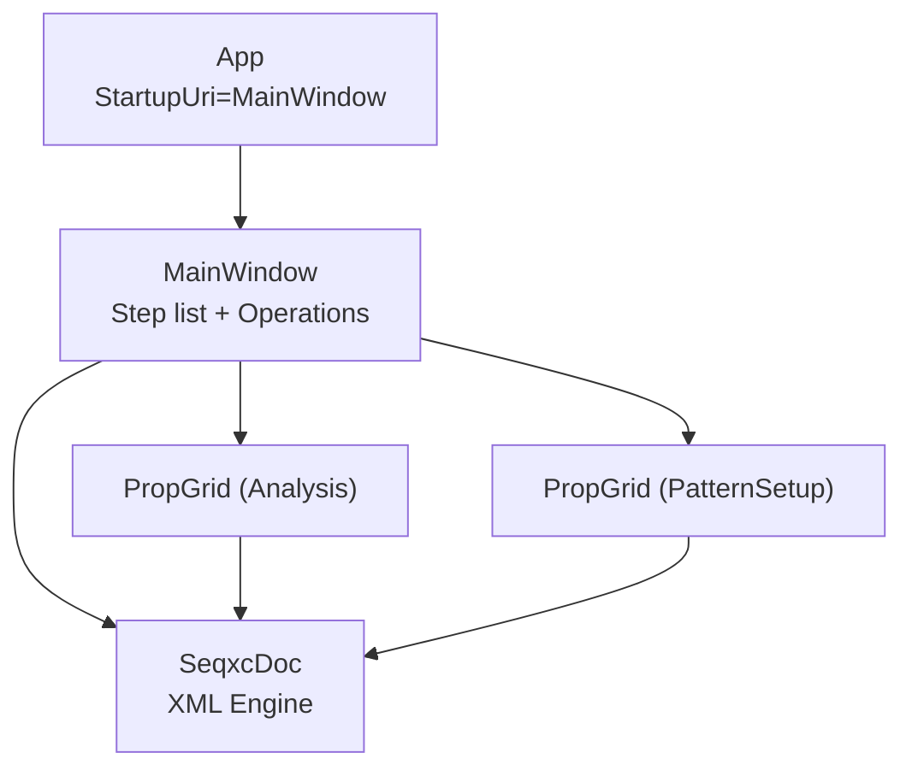
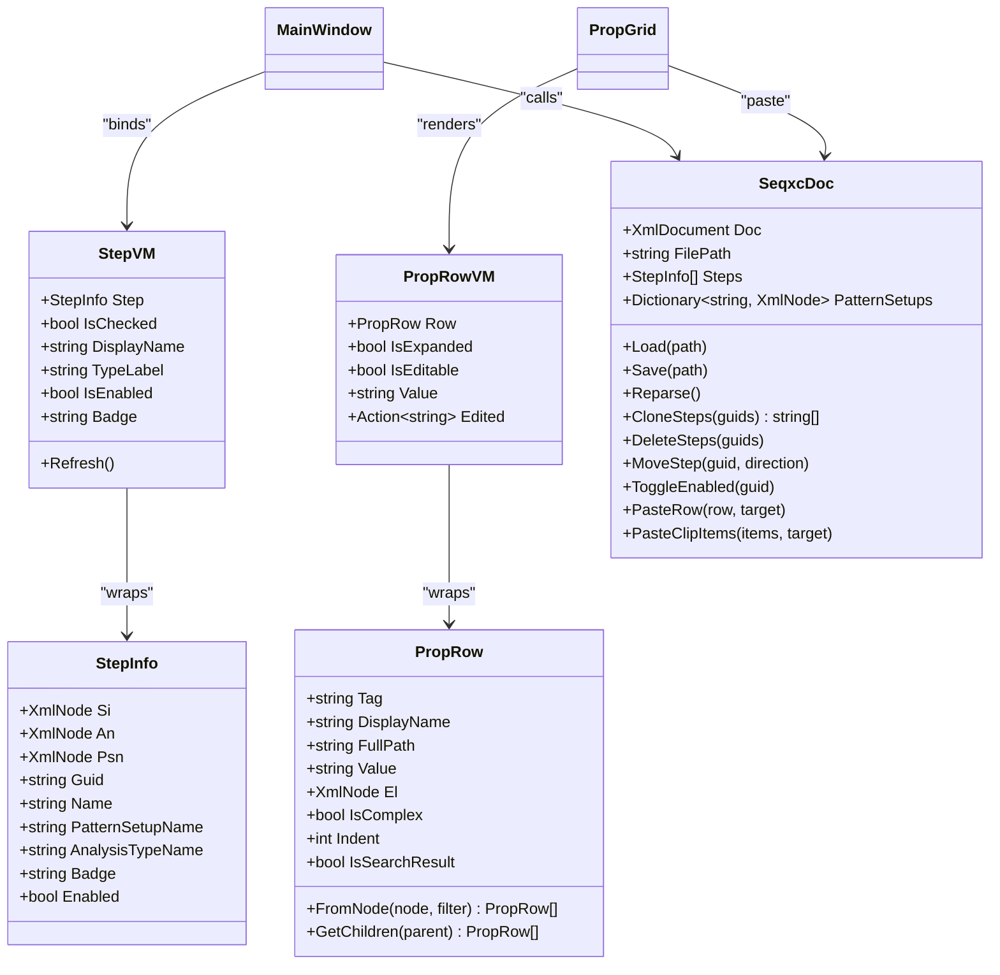
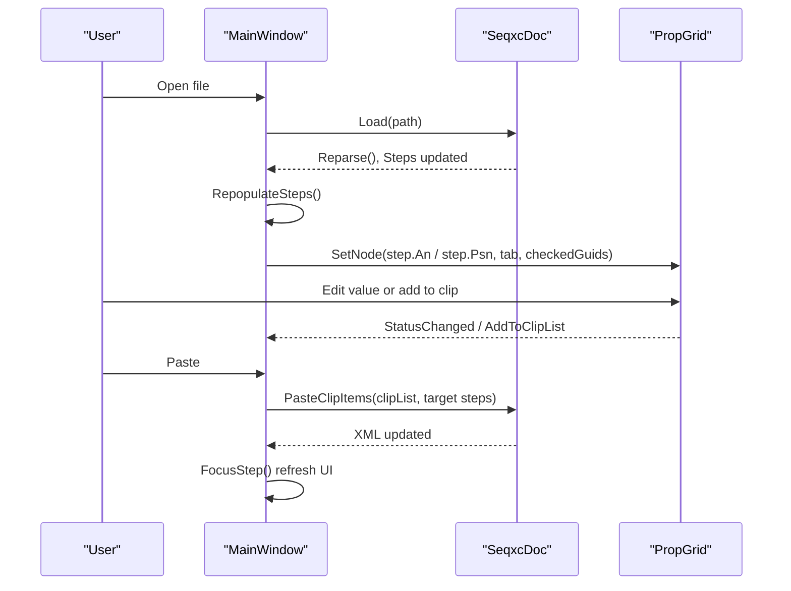
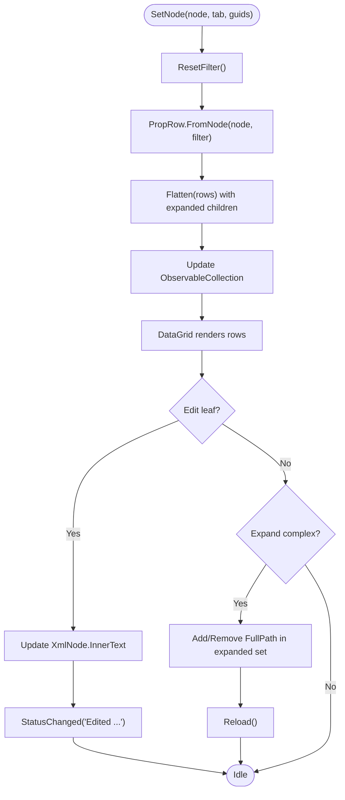
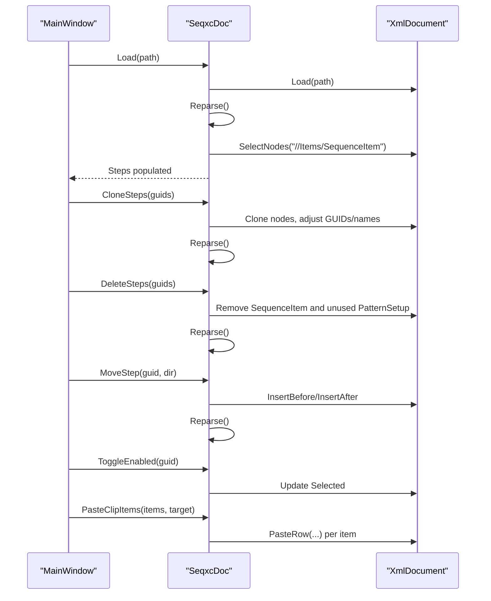
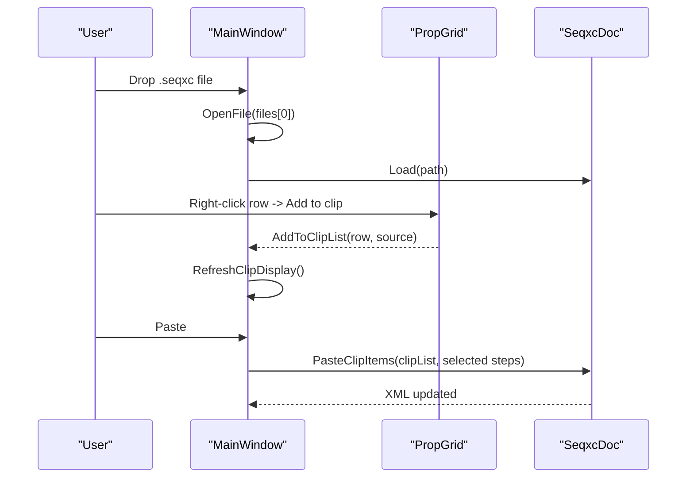
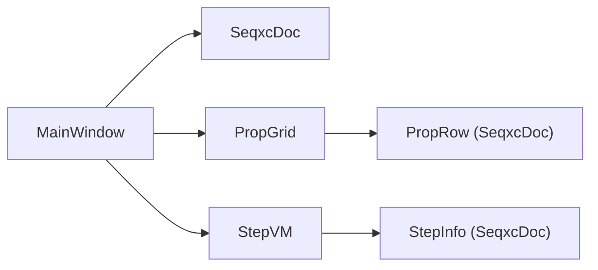

# XML Editor (SeqxcEditor)

<cite>
**Referenced Files in This Document**
- [App.xaml](file://SeqxcEditor_wpf/App.xaml)
- [App.xaml.cs](file://SeqxcEditor_wpf/App.xaml.cs)
- [MainWindow.xaml](file://SeqxcEditor_wpf/MainWindow.xaml)
- [MainWindow.xaml.cs](file://SeqxcEditor_wpf/MainWindow.xaml.cs)
- [PropGrid.xaml](file://SeqxcEditor_wpf/PropGrid.xaml)
- [PropGrid.xaml.cs](file://SeqxcEditor_wpf/PropGrid.xaml.cs)
- [SeqxcDoc.cs](file://SeqxcEditor_wpf/SeqxcDoc.cs)
</cite>

## Table of Contents
1. [Introduction](#introduction)
2. [Project Structure](#project-structure)
3. [Core Components](#core-components)
4. [Architecture Overview](#architecture-overview)
5. [Detailed Component Analysis](#detailed-component-analysis)
6. [Dependency Analysis](#dependency-analysis)
7. [Performance Considerations](#performance-considerations)
8. [Troubleshooting Guide](#troubleshooting-guide)
9. [Conclusion](#conclusion)
10. [Appendices](#appendices)

## Introduction
This document explains the SeqxcEditor WPF application, an XML editor for sequence files with a focus on editing analysis steps and pattern setups. It covers the MVVM architecture using StepVM and MainWindow, the core XML processing engine in SeqxcDoc.cs, the dynamic property grid system, drag-and-drop file operations, clipboard functionality, event-driven UI state management, and practical guidance for extending the editor with new analysis types and customizing behavior.

## Project Structure
The project is a WPF application with a clean separation between UI and data:
- App entry point initializes the main window.
- MainWindow manages the step list, selection, and operations like move, clone, delete, paste, and tab switching.
- PropGrid provides a dynamic property grid for editing nested XML structures with filtering, expansion, and copy-to-clipboard support.
- SeqxcDoc encapsulates XML loading, parsing, step manipulation, and pattern setup management.

**Diagram sources**
- [App.xaml:1-5](file://SeqxcEditor_wpf/App.xaml#L1-L5)
- [MainWindow.xaml.cs:48-77](file://SeqxcEditor_wpf/MainWindow.xaml.cs#L48-L77)
- [PropGrid.xaml.cs:63-94](file://SeqxcEditor_wpf/PropGrid.xaml.cs#L63-L94)
- [SeqxcDoc.cs:122-145](file://SeqxcEditor_wpf/SeqxcDoc.cs#L122-L145)

**Section sources**
- [App.xaml:1-5](file://SeqxcEditor_wpf/App.xaml#L1-L5)
- [App.xaml.cs:1-6](file://SeqxcEditor_wpf/App.xaml.cs#L1-L6)
- [MainWindow.xaml:1-217](file://SeqxcEditor_wpf/MainWindow.xaml#L1-L217)
- [MainWindow.xaml.cs:48-77](file://SeqxcEditor_wpf/MainWindow.xaml.cs#L48-L77)
- [PropGrid.xaml:1-93](file://SeqxcEditor_wpf/PropGrid.xaml#L1-L93)
- [PropGrid.xaml.cs:63-94](file://SeqxcEditor_wpf/PropGrid.xaml.cs#L63-L94)
- [SeqxcDoc.cs:122-145](file://SeqxcEditor_wpf/SeqxcDoc.cs#L122-L145)

## Core Components
- StepVM: ViewModel for each step in the sequence, exposing display name, type label, badge, enabled state, and selection binding.
- MainWindow: Orchestrates user interactions, manages step selection, clipboard list, tabs, and delegates XML mutations to SeqxcDoc.
- PropGrid: Dynamic property grid that renders XML nodes as editable rows, supports filtering, expand/collapse, and adding items to a shared clipboard list.
- SeqxcDoc: Central XML engine providing load/save, parse/reparse, step CRUD, move, toggle enablement, cloning, and smart paste logic including CameraSettings handling.

Key responsibilities:
- Data binding and UI state: MainWindow and PropGrid maintain observable collections and update UI efficiently.
- XML model: SeqxcDoc holds XmlDocument, Steps, and PatternSetups; exposes methods to mutate the underlying XML.
- Clipboard: Shared list of copied properties across analysis and pattern setup contexts.

**Section sources**
- [MainWindow.xaml.cs:14-46](file://SeqxcEditor_wpf/MainWindow.xaml.cs#L14-L46)
- [MainWindow.xaml.cs:48-77](file://SeqxcEditor_wpf/MainWindow.xaml.cs#L48-L77)
- [PropGrid.xaml.cs:14-61](file://SeqxcEditor_wpf/PropGrid.xaml.cs#L14-L61)
- [SeqxcDoc.cs:10-29](file://SeqxcEditor_wpf/SeqxcDoc.cs#L10-L29)
- [SeqxcDoc.cs:122-198](file://SeqxcEditor_wpf/SeqxcDoc.cs#L122-L198)

## Architecture Overview
The application follows MVVM:
- Model: StepInfo, PropRow, ClipItem, and the XmlDocument held by SeqxcDoc.
- View: MainWindow and PropGrid XAML define layout and bindings.
- ViewModel: StepVM and PropRowVM bridge model data to the view via INotifyPropertyChanged and ObservableCollection.

**Diagram sources**
- [SeqxcDoc.cs:10-29](file://SeqxcEditor_wpf/SeqxcDoc.cs#L10-L29)
- [SeqxcDoc.cs:122-198](file://SeqxcEditor_wpf/SeqxcDoc.cs#L122-L198)
- [MainWindow.xaml.cs:14-46](file://SeqxcEditor_wpf/MainWindow.xaml.cs#L14-L46)
- [PropGrid.xaml.cs:14-61](file://SeqxcEditor_wpf/PropGrid.xaml.cs#L14-L61)

## Detailed Component Analysis

### MainWindow and StepVM
- StepVM exposes INotifyPropertyChanged for UI updates and computes DisplayName from step state and names.
- MainWindow binds a DataGrid to an ObservableCollection<StepVM>, handles selection changes, right-click toggling, and orchestrates operations through SeqxcDoc.
- Tab switching toggles visibility of two PropGrid instances (analysis vs pattern setup).
- Clipboard list maintains copied properties and enables batch paste to selected steps.

**Diagram sources**
- [MainWindow.xaml.cs:87-108](file://SeqxcEditor_wpf/MainWindow.xaml.cs#L87-L108)
- [MainWindow.xaml.cs:136-146](file://SeqxcEditor_wpf/MainWindow.xaml.cs#L136-L146)
- [MainWindow.xaml.cs:181-207](file://SeqxcEditor_wpf/MainWindow.xaml.cs#L181-L207)
- [MainWindow.xaml.cs:306-324](file://SeqxcEditor_wpf/MainWindow.xaml.cs#L306-L324)
- [SeqxcDoc.cs:134-145](file://SeqxcEditor_wpf/SeqxcDoc.cs#L134-L145)
- [SeqxcDoc.cs:385-395](file://SeqxcEditor_wpf/SeqxcDoc.cs#L385-L395)

**Section sources**
- [MainWindow.xaml.cs:14-46](file://SeqxcEditor_wpf/MainWindow.xaml.cs#L14-L46)
- [MainWindow.xaml.cs:48-77](file://SeqxcEditor_wpf/MainWindow.xaml.cs#L48-L77)
- [MainWindow.xaml.cs:136-146](file://SeqxcEditor_wpf/MainWindow.xaml.cs#L136-L146)
- [MainWindow.xaml.cs:158-207](file://SeqxcEditor_wpf/MainWindow.xaml.cs#L158-L207)
- [MainWindow.xaml.cs:232-324](file://SeqxcEditor_wpf/MainWindow.xaml.cs#L232-L324)
- [MainWindow.xaml:12-217](file://SeqxcEditor_wpf/MainWindow.xaml#L12-L217)

### Property Grid System
- PropRow builds hierarchical rows from XML nodes, supporting search/filter and child expansion.
- PropRowVM wraps PropRow for UI binding, enabling inline editing of leaf values and expand/collapse for complex nodes.
- PropGrid manages filtering, virtualized rendering, and events to propagate edits and add items to the clipboard list.

**Diagram sources**
- [PropGrid.xaml.cs:84-94](file://SeqxcEditor_wpf/PropGrid.xaml.cs#L84-L94)
- [PropGrid.xaml.cs:98-134](file://SeqxcEditor_wpf/PropGrid.xaml.cs#L98-L134)
- [PropGrid.xaml.cs:136-152](file://SeqxcEditor_wpf/PropGrid.xaml.cs#L136-L152)
- [PropGrid.xaml.cs:156-185](file://SeqxcEditor_wpf/PropGrid.xaml.cs#L156-L185)
- [SeqxcDoc.cs:44-120](file://SeqxcEditor_wpf/SeqxcDoc.cs#L44-L120)

**Section sources**
- [PropGrid.xaml.cs:14-61](file://SeqxcEditor_wpf/PropGrid.xaml.cs#L14-L61)
- [PropGrid.xaml.cs:63-94](file://SeqxcEditor_wpf/PropGrid.xaml.cs#L63-L94)
- [PropGrid.xaml.cs:98-152](file://SeqxcEditor_wpf/PropGrid.xaml.cs#L98-L152)
- [PropGrid.xaml.cs:156-185](file://SeqxcEditor_wpf/PropGrid.xaml.cs#L156-L185)
- [PropGrid.xaml:1-93](file://SeqxcEditor_wpf/PropGrid.xaml#L1-L93)
- [SeqxcDoc.cs:44-120](file://SeqxcEditor_wpf/SeqxcDoc.cs#L44-L120)

### XML Processing Engine (SeqxcDoc)
- Load/Save: Loads XML preserving whitespace, sets FilePath, and triggers Reparse.
- Reparse: Builds Steps and PatternSetups from XML, extracts analysis node, type labels, badges, and linked pattern setups.
- Step operations: Clone, Delete, Move, ToggleEnabled modify the underlying XML and reparse to keep in-memory models consistent.
- PasteRow: Smart paste for CameraSettings leaves/blocks/lists and generic complex/simple nodes.
- PasteClipItems: Applies clipboard items to target steps with type matching for analysis nodes.

**Diagram sources**
- [SeqxcDoc.cs:134-145](file://SeqxcEditor_wpf/SeqxcDoc.cs#L134-L145)
- [SeqxcDoc.cs:149-198](file://SeqxcEditor_wpf/SeqxcDoc.cs#L149-L198)
- [SeqxcDoc.cs:288-359](file://SeqxcEditor_wpf/SeqxcDoc.cs#L288-L359)
- [SeqxcDoc.cs:385-395](file://SeqxcEditor_wpf/SeqxcDoc.cs#L385-L395)

**Section sources**
- [SeqxcDoc.cs:10-29](file://SeqxcEditor_wpf/SeqxcDoc.cs#L10-L29)
- [SeqxcDoc.cs:122-198](file://SeqxcEditor_wpf/SeqxcDoc.cs#L122-L198)
- [SeqxcDoc.cs:220-228](file://SeqxcEditor_wpf/SeqxcDoc.cs#L220-L228)
- [SeqxcDoc.cs:232-286](file://SeqxcEditor_wpf/SeqxcDoc.cs#L232-L286)
- [SeqxcDoc.cs:288-359](file://SeqxcEditor_wpf/SeqxcDoc.cs#L288-L359)
- [SeqxcDoc.cs:385-395](file://SeqxcEditor_wpf/SeqxcDoc.cs#L385-L395)

### Drag-and-Drop and Clipboard
- Drag-and-drop: MainWindow handles Window_DragEnter and Window_Drop to open files directly into the editor.
- Clipboard: PropGrid raises AddToClipList when users right-click a row; MainWindow aggregates items and allows pasting to multiple selected steps.

**Diagram sources**
- [MainWindow.xaml.cs:399-406](file://SeqxcEditor_wpf/MainWindow.xaml.cs#L399-L406)
- [MainWindow.xaml.cs:306-324](file://SeqxcEditor_wpf/MainWindow.xaml.cs#L306-L324)
- [PropGrid.xaml.cs:166-171](file://SeqxcEditor_wpf/PropGrid.xaml.cs#L166-L171)
- [SeqxcDoc.cs:385-395](file://SeqxcEditor_wpf/SeqxcDoc.cs#L385-L395)

**Section sources**
- [MainWindow.xaml:8-10](file://SeqxcEditor_wpf/MainWindow.xaml#L8-L10)
- [MainWindow.xaml.cs:399-406](file://SeqxcEditor_wpf/MainWindow.xaml.cs#L399-L406)
- [MainWindow.xaml.cs:306-324](file://SeqxcEditor_wpf/MainWindow.xaml.cs#L306-L324)
- [PropGrid.xaml.cs:166-171](file://SeqxcEditor_wpf/PropGrid.xaml.cs#L166-L171)

## Dependency Analysis
- MainWindow depends on SeqxcDoc for all XML operations and on PropGrid for property editing.
- PropGrid depends on PropRow (from SeqxcDoc) for building rows and emits events back to MainWindow.
- StepVM depends on StepInfo and calls SeqxcDoc for fresh references during refresh.

**Diagram sources**
- [MainWindow.xaml.cs:48-77](file://SeqxcEditor_wpf/MainWindow.xaml.cs#L48-L77)
- [MainWindow.xaml.cs:136-146](file://SeqxcEditor_wpf/MainWindow.xaml.cs#L136-L146)
- [PropGrid.xaml.cs:63-94](file://SeqxcEditor_wpf/PropGrid.xaml.cs#L63-L94)
- [SeqxcDoc.cs:122-198](file://SeqxcEditor_wpf/SeqxcDoc.cs#L122-L198)

**Section sources**
- [MainWindow.xaml.cs:48-77](file://SeqxcEditor_wpf/MainWindow.xaml.cs#L48-L77)
- [MainWindow.xaml.cs:136-146](file://SeqxcEditor_wpf/MainWindow.xaml.cs#L136-L146)
- [PropGrid.xaml.cs:63-94](file://SeqxcEditor_wpf/PropGrid.xaml.cs#L63-L94)
- [SeqxcDoc.cs:122-198](file://SeqxcEditor_wpf/SeqxcDoc.cs#L122-L198)

## Performance Considerations
- Large XML files: The engine uses XmlDocument and XPath queries; consider:
  - Avoid deep recursive expansions unless necessary; rely on lazy expansion in PropGrid.
  - Use filters to reduce initial row generation cost.
  - Batch operations (clone/delete/move) call Reparse once after changes.
- UI responsiveness:
  - ObservableCollection updates are efficient; avoid unnecessary full rebuilds.
  - Virtualization is enabled for DataGrid to improve scrolling performance.
- Memory usage:
  - Keep references to only needed nodes; avoid holding large temporary lists beyond reload cycles.

[No sources needed since this section provides general guidance]

## Troubleshooting Guide
Common issues and resolutions:
- File open errors:
  - Ensure the file path is valid and the XML is well-formed. Errors are caught and shown in a message box.
- Save failures:
  - Check file permissions and disk space. Errors are caught and reported.
- Parsing inconsistencies:
  - If steps do not appear, verify that the XML contains //Items/SequenceItem and expected child elements.
- Pattern setup sharing warnings:
  - When a PatternSetup is used by multiple steps, edits affect all; confirm before editing shared setups.
- Clipboard paste mismatches:
  - Analysis items only paste if the target step’s AnalysisType matches exactly; otherwise they are skipped.

**Section sources**
- [MainWindow.xaml.cs:95-130](file://SeqxcEditor_wpf/MainWindow.xaml.cs#L95-L130)
- [MainWindow.xaml.cs:209-226](file://SeqxcEditor_wpf/MainWindow.xaml.cs#L209-L226)
- [SeqxcDoc.cs:385-395](file://SeqxcEditor_wpf/SeqxcDoc.cs#L385-L395)

## Conclusion
SeqxcEditor implements a robust MVVM-based XML editor tailored for sequence files. The MainWindow coordinates user actions and UI state, while SeqxcDoc centralizes XML operations. The PropGrid offers a flexible, dynamic interface for editing nested structures with filtering and clipboard support. The design supports extensibility for new analysis types and additional XML operations, with clear extension points in both UI and engine layers.

[No sources needed since this section summarizes without analyzing specific files]

## Appendices

### Extending the Editor with New Analysis Types
- Add a new badge/type mapping in the engine’s badge logic to categorize new analysis types visually.
- Ensure new analysis nodes include UserName and/or PatternSetupName fields so they render correctly in the step list.
- If special paste behavior is required, extend PasteRow or PasteClipItems to handle new node patterns.

**Section sources**
- [SeqxcDoc.cs:193-198](file://SeqxcEditor_wpf/SeqxcDoc.cs#L193-L198)
- [SeqxcDoc.cs:162-190](file://SeqxcEditor_wpf/SeqxcDoc.cs#L162-L190)
- [SeqxcDoc.cs:232-286](file://SeqxcEditor_wpf/SeqxcDoc.cs#L232-L286)

### Customizing the Property Grid
- Modify PropRow.FromNode to change how rows are built or filtered.
- Extend PropRowVM to add new computed properties or validation hooks.
- Adjust styles in App.xaml for DataGrid appearance and behavior.

**Section sources**
- [SeqxcDoc.cs:44-120](file://SeqxcEditor_wpf/SeqxcDoc.cs#L44-L120)
- [PropGrid.xaml.cs:14-61](file://SeqxcEditor_wpf/PropGrid.xaml.cs#L14-L61)
- [App.xaml:100-160](file://SeqxcEditor_wpf/App.xaml#L100-L160)

### Implementing Additional XML Operations
- Add new methods in SeqxcDoc to perform custom XML manipulations (e.g., bulk updates, schema validations).
- Expose these operations via MainWindow commands and bind them to toolbar buttons or context menus.
- Ensure Reparse is called after any mutation to keep Steps and PatternSetups synchronized.

**Section sources**
- [SeqxcDoc.cs:288-359](file://SeqxcEditor_wpf/SeqxcDoc.cs#L288-L359)
- [MainWindow.xaml.cs:232-324](file://SeqxcEditor_wpf/MainWindow.xaml.cs#L232-L324)