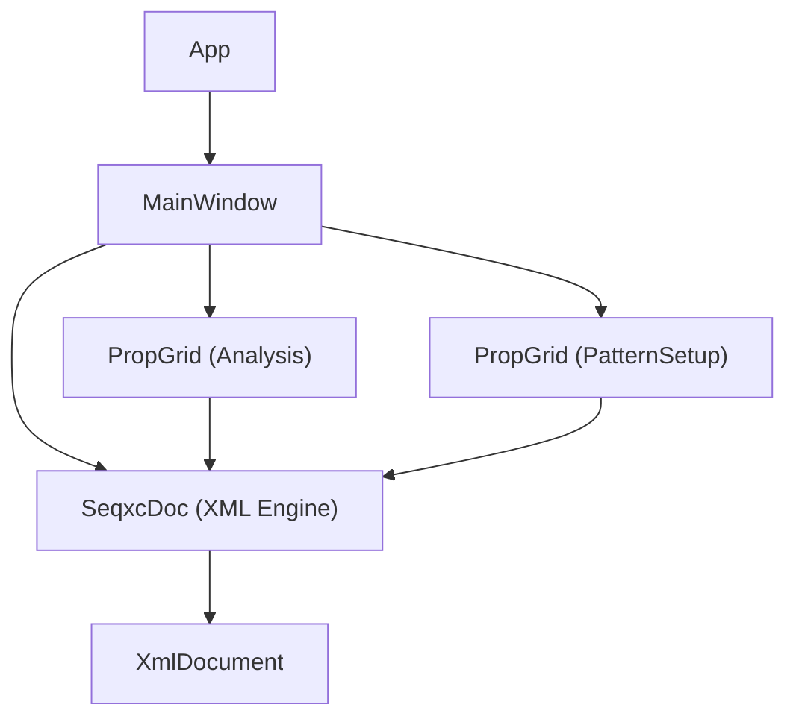
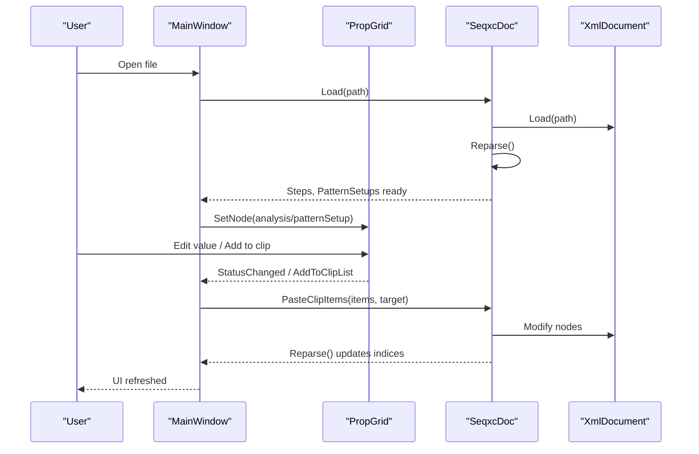
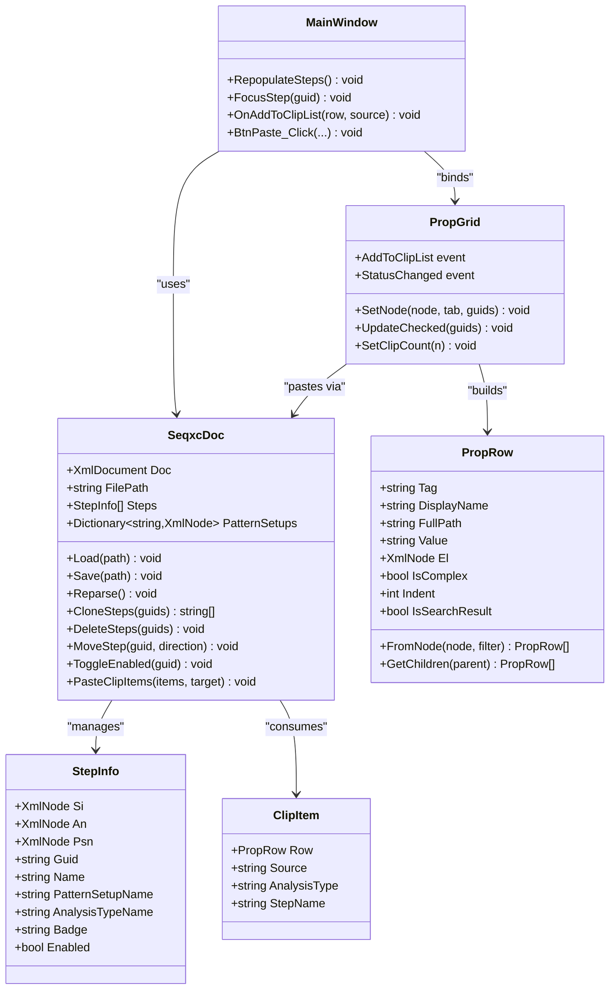
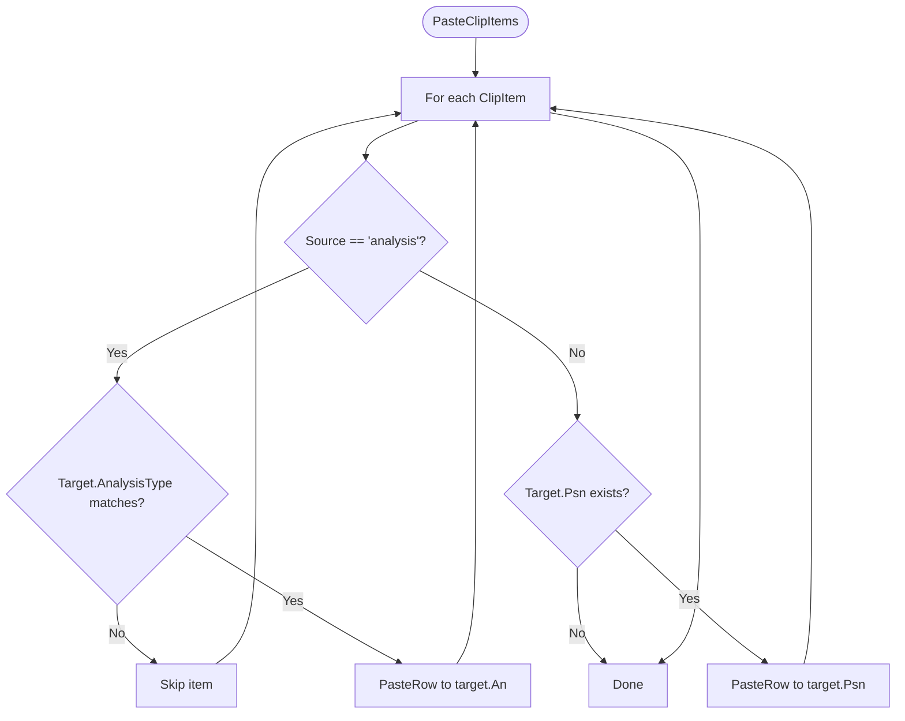
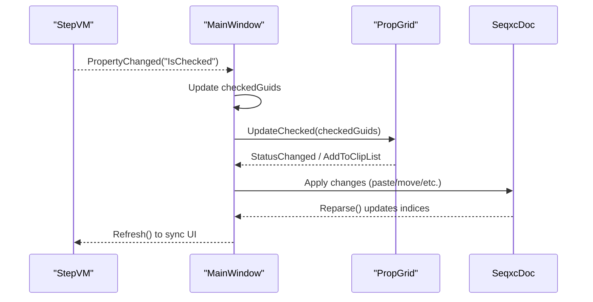
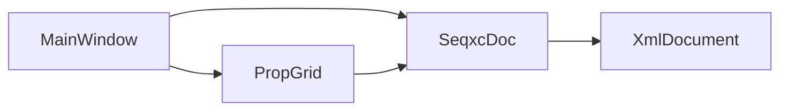

# XML Processing Engine

<cite>
**Referenced Files in This Document**
- [SeqxcDoc.cs](file://SeqxcEditor_wpf/SeqxcDoc.cs)
- [MainWindow.xaml.cs](file://SeqxcEditor_wpf/MainWindow.xaml.cs)
- [PropGrid.xaml.cs](file://SeqxcEditor_wpf/PropGrid.xaml.cs)
- [App.xaml.cs](file://SeqxcEditor_wpf/App.xaml.cs)
</cite>

## Table of Contents
1. [Introduction](#introduction)
2. [Project Structure](#project-structure)
3. [Core Components](#core-components)
4. [Architecture Overview](#architecture-overview)
5. [Detailed Component Analysis](#detailed-component-analysis)
6. [Dependency Analysis](#dependency-analysis)
7. [Performance Considerations](#performance-considerations)
8. [Troubleshooting Guide](#troubleshooting-guide)
9. [Conclusion](#conclusion)
10. [Appendices](#appendices)

## Introduction
This document explains the XML Processing Engine centered on the SeqxcDoc class, which encapsulates all XML document operations for a sequence editor. It covers file loading and saving, XML parsing and validation, step sequence management, pattern setup handling, clipboard operations, data models (StepInfo, ClipItem, PropRow), and event-driven synchronization between UI and data models. It also provides guidance for extending the engine with new analysis types, customizing serialization behavior, and implementing additional XML operations while addressing performance, error handling, and memory considerations.

## Project Structure
The project is a WPF application that edits TrueTest sequence files (.seqxc). The core logic resides in a single static engine class that manipulates an XmlDocument instance and maintains in-memory indices for steps and pattern setups. The UI layer binds to view models and delegates persistence and XML manipulation to the engine.

**Diagram sources**
- [App.xaml.cs:1-6](file://SeqxcEditor_wpf/App.xaml.cs#L1-L6)
- [MainWindow.xaml.cs:48-108](file://SeqxcEditor_wpf/MainWindow.xaml.cs#L48-L108)
- [SeqxcDoc.cs:122-145](file://SeqxcEditor_wpf/SeqxcDoc.cs#L122-L145)
- [PropGrid.xaml.cs:63-94](file://SeqxcEditor_wpf/PropGrid.xaml.cs#L63-L94)

**Section sources**
- [App.xaml.cs:1-6](file://SeqxcEditor_wpf/App.xaml.cs#L1-L6)
- [MainWindow.xaml.cs:48-108](file://SeqxcEditor_wpf/MainWindow.xaml.cs#L48-L108)
- [SeqxcDoc.cs:122-145](file://SeqxcEditor_wpf/SeqxcDoc.cs#L122-L145)
- [PropGrid.xaml.cs:63-94](file://SeqxcEditor_wpf/PropGrid.xaml.cs#L63-L94)

## Core Components
- SeqxcDoc: Static XML engine providing load/save, parse/reparse, step CRUD, move, toggle, paste, clone, and utilities.
- StepInfo: Represents a SequenceItem with its analysis node, linked PatternSetup, metadata, and enabled state.
- ClipItem: Clipboard item capturing a property row, source context, and analysis type for safe pasting.
- PropRow: Property row abstraction over XML nodes with factory methods for building hierarchical or filtered views.
- PropRowVM / PropGrid: UI components for editing properties, expanding complex nodes, and contributing to the clipboard.
- MainWindow: Orchestrates user actions, manages selection, clipboard list, and calls into SeqxcDoc.

Key responsibilities:
- File I/O: Load and save .seqxc files via XmlDocument.
- Parsing: Build Steps and PatternSetups indices; compute badges and labels.
- Step Management: Clone, delete, move, enable/disable.
- Clipboard: Add rows to clip list, paste to matching targets with smart CameraSettings handling.
- UI Sync: PropertyChanged notifications from view models keep UI consistent with model changes.

**Section sources**
- [SeqxcDoc.cs:10-29](file://SeqxcEditor_wpf/SeqxcDoc.cs#L10-L29)
- [SeqxcDoc.cs:31-120](file://SeqxcEditor_wpf/SeqxcDoc.cs#L31-L120)
- [SeqxcDoc.cs:122-400](file://SeqxcEditor_wpf/SeqxcDoc.cs#L122-L400)
- [PropGrid.xaml.cs:14-61](file://SeqxcEditor_wpf/PropGrid.xaml.cs#L14-L61)
- [PropGrid.xaml.cs:63-94](file://SeqxcEditor_wpf/PropGrid.xaml.cs#L63-L94)
- [MainWindow.xaml.cs:14-46](file://SeqxcEditor_wpf/MainWindow.xaml.cs#L14-L46)

## Architecture Overview
The engine follows a layered architecture:
- Presentation Layer: MainWindow and PropGrid handle user interactions and display.
- View Model Layer: StepVM and PropRowVM bind to data and notify UI of changes.
- Domain Layer: SeqxcDoc performs XML manipulation and maintains domain invariants.
- Persistence Layer: XmlDocument persists to disk.

**Diagram sources**
- [MainWindow.xaml.cs:95-108](file://SeqxcEditor_wpf/MainWindow.xaml.cs#L95-L108)
- [SeqxcDoc.cs:134-191](file://SeqxcEditor_wpf/SeqxcDoc.cs#L134-L191)
- [PropGrid.xaml.cs:84-94](file://SeqxcEditor_wpf/PropGrid.xaml.cs#L84-L94)
- [SeqxcDoc.cs:382-395](file://SeqxcEditor_wpf/SeqxcDoc.cs#L382-L395)

## Detailed Component Analysis

### Data Models
- StepInfo: Holds XmlNode references for SequenceItem, analysis child, and linked PatternSetup; includes GUID, Name, PatternSetupName, AnalysisTypeName, Badge, Enabled.
- ClipItem: Captures a copied PropRow, source ("analysis" or "patternSetup"), AnalysisType (xsi:type), and StepName for display.
- PropRow: Represents a property row with Tag, DisplayName, FullPath, Value, XmlNode El, IsComplex, Indent, IsSearchResult; provides factories to build hierarchical or filtered views.

Relationships:
- MainWindow holds collections of StepVM wrapping StepInfo.
- PropGrid builds PropRow lists from current XmlNode and emits events to add items to the clipboard.
- SeqxcDoc coordinates operations across these models and the underlying XmlDocument.

**Diagram sources**
- [SeqxcDoc.cs:10-29](file://SeqxcEditor_wpf/SeqxcDoc.cs#L10-L29)
- [SeqxcDoc.cs:31-120](file://SeqxcEditor_wpf/SeqxcDoc.cs#L31-L120)
- [SeqxcDoc.cs:122-400](file://SeqxcEditor_wpf/SeqxcDoc.cs#L122-L400)
- [PropGrid.xaml.cs:14-94](file://SeqxcEditor_wpf/PropGrid.xaml.cs#L14-L94)
- [MainWindow.xaml.cs:48-108](file://SeqxcEditor_wpf/MainWindow.xaml.cs#L48-L108)

**Section sources**
- [SeqxcDoc.cs:10-29](file://SeqxcEditor_wpf/SeqxcDoc.cs#L10-L29)
- [SeqxcDoc.cs:31-120](file://SeqxcEditor_wpf/SeqxcDoc.cs#L31-L120)
- [SeqxcDoc.cs:122-400](file://SeqxcEditor_wpf/SeqxcDoc.cs#L122-L400)
- [PropGrid.xaml.cs:14-94](file://SeqxcEditor_wpf/PropGrid.xaml.cs#L14-L94)
- [MainWindow.xaml.cs:48-108](file://SeqxcEditor_wpf/MainWindow.xaml.cs#L48-L108)

### File Loading and Saving
- Load: Creates an XmlDocument with preserved whitespace, loads the file, sets FilePath, and triggers Reparse to build Steps and PatternSetups.
- Save: Persists the current XmlDocument to FilePath.

Error handling:
- MainWindow wraps open/save operations in try/catch and shows user-friendly messages.

**Section sources**
- [SeqxcDoc.cs:134-145](file://SeqxcEditor_wpf/SeqxcDoc.cs#L134-L145)
- [MainWindow.xaml.cs:95-130](file://SeqxcEditor_wpf/MainWindow.xaml.cs#L95-L130)

### XML Parsing and Validation
- Reparse: Clears and rebuilds Steps and PatternSetups by scanning the XML tree.
  - PatternSetups: Maps names to their XmlNode entries.
  - Steps: For each SequenceItem, extracts GUID, Selected, PatternSetupName, analysis child, xsi:type, badge, and UserName.
- TypeLabelFor: Converts full analysis type names to readable labels by stripping namespaces and splitting on capitals.
- BadgeFor: Derives short badges based on type name patterns.

Validation notes:
- No explicit schema validation is performed; robustness relies on null checks and existence checks before accessing nodes.

**Section sources**
- [SeqxcDoc.cs:149-218](file://SeqxcEditor_wpf/SeqxcDoc.cs#L149-L218)

### Step Sequence Management
- CloneSteps: Clones selected steps, generates unique names, clones associated PatternSetup if present, updates inner references, inserts after original, and re-parses.
- DeleteSteps: Removes selected SequenceItem nodes; removes PatternSetup only if no remaining step uses it; re-parses.
- MoveStep: Swaps order within parent by InsertBefore/InsertAfter; re-parses.
- ToggleEnabled: Flips Selected node content and in-memory Enabled flag.

These operations maintain consistency by calling Reparse after mutations.

**Section sources**
- [SeqxcDoc.cs:288-369](file://SeqxcEditor_wpf/SeqxcDoc.cs#L288-L369)
- [MainWindow.xaml.cs:246-285](file://SeqxcEditor_wpf/MainWindow.xaml.cs#L246-L285)

### Pattern Setup Handling
- PatternSetups dictionary maps names to XmlNode for quick lookup and cloning.
- NextName ensures unique names when cloning by appending suffixes and avoiding collisions.
- SharedCount reports how many steps share a given PatternSetupName to warn users about shared edits.

**Section sources**
- [SeqxcDoc.cs:153-160](file://SeqxcEditor_wpf/SeqxcDoc.cs#L153-L160)
- [SeqxcDoc.cs:373-380](file://SeqxcEditor_wpf/SeqxcDoc.cs#L373-L380)
- [SeqxcDoc.cs:222-224](file://SeqxcEditor_wpf/SeqxcDoc.cs#L222-L224)

### Clipboard Operations
- Adding to clipboard: PropGrid emits AddToClipList with a PropRow and source context; MainWindow creates ClipItem entries and tracks counts.
- Pasting: PasteClipItems applies rows to target steps:
  - Analysis items require exact AnalysisType match; otherwise skipped.
  - PatternSetup items always paste if target has a PatternSetup.
  - Smart CameraSettings handling:
    - Leaf under CameraSettings broadcasts value to all blocks.
    - Block-level copy skips SerialNumber and applies fields to all blocks.
    - List-level merge uses first entry as template applied to all blocks.

**Diagram sources**
- [SeqxcDoc.cs:382-395](file://SeqxcEditor_wpf/SeqxcDoc.cs#L382-L395)
- [SeqxcDoc.cs:231-286](file://SeqxcEditor_wpf/SeqxcDoc.cs#L231-L286)
- [MainWindow.xaml.cs:306-324](file://SeqxcEditor_wpf/MainWindow.xaml.cs#L306-L324)

**Section sources**
- [SeqxcDoc.cs:231-286](file://SeqxcEditor_wpf/SeqxcDoc.cs#L231-L286)
- [SeqxcDoc.cs:382-395](file://SeqxcEditor_wpf/SeqxcDoc.cs#L382-L395)
- [MainWindow.xaml.cs:306-324](file://SeqxcEditor_wpf/MainWindow.xaml.cs#L306-L324)

### Event-Driven Architecture and UI Synchronization
- PropertyChanged: StepVM and PropRowVM implement INotifyPropertyChanged to notify UI of changes.
- MainWindow subscribes to StepVM.PropertyChanged to update checked selections and propagate to PropGrid instances.
- PropGrid emits StatusChanged and AddToClipList events to communicate edits and clipboard additions back to MainWindow.
- FocusStep refreshes UI state and tabs based on selected step.

**Diagram sources**
- [MainWindow.xaml.cs:148-156](file://SeqxcEditor_wpf/MainWindow.xaml.cs#L148-L156)
- [MainWindow.xaml.cs:181-207](file://SeqxcEditor_wpf/MainWindow.xaml.cs#L181-L207)
- [PropGrid.xaml.cs:74-94](file://SeqxcEditor_wpf/PropGrid.xaml.cs#L74-L94)
- [SeqxcDoc.cs:149-191](file://SeqxcEditor_wpf/SeqxcDoc.cs#L149-L191)

**Section sources**
- [MainWindow.xaml.cs:148-156](file://SeqxcEditor_wpf/MainWindow.xaml.cs#L148-L156)
- [MainWindow.xaml.cs:181-207](file://SeqxcEditor_wpf/MainWindow.xaml.cs#L181-L207)
- [PropGrid.xaml.cs:74-94](file://SeqxcEditor_wpf/PropGrid.xaml.cs#L74-L94)
- [SeqxcDoc.cs:149-191](file://SeqxcEditor_wpf/SeqxcDoc.cs#L149-L191)

### Practical Examples and Extensions

- Extending with new analysis types:
  - Add recognition in BadgeFor and TypeLabelFor to generate appropriate badges and labels for new analysis types.
  - Ensure analysis nodes expose xsi:type so SeqxcDoc can read AnalysisTypeName correctly.
  - If needed, extend PasteRow special cases to handle new structures similarly to CameraSettings.

- Customizing XML serialization:
  - Adjust XmlDocument settings (e.g., PreserveWhitespace) in Load to control formatting.
  - Implement post-save transformations in Save if you need to normalize or validate output.

- Implementing additional XML operations:
  - Add batch operations that modify multiple nodes and call Reparse at the end to keep indices consistent.
  - Introduce validation routines that scan critical nodes and report errors before save.

[No sources needed since this section provides general guidance]

## Dependency Analysis
- MainWindow depends on SeqxcDoc for all XML operations and on PropGrid for property editing.
- PropGrid depends on PropRow factories to build views and emits events consumed by MainWindow.
- SeqxcDoc depends on XmlDocument APIs and maintains internal indices (Steps, PatternSetups).

**Diagram sources**
- [MainWindow.xaml.cs:48-108](file://SeqxcEditor_wpf/MainWindow.xaml.cs#L48-L108)
- [PropGrid.xaml.cs:63-94](file://SeqxcEditor_wpf/PropGrid.xaml.cs#L63-L94)
- [SeqxcDoc.cs:122-145](file://SeqxcEditor_wpf/SeqxcDoc.cs#L122-L145)

**Section sources**
- [MainWindow.xaml.cs:48-108](file://SeqxcEditor_wpf/MainWindow.xaml.cs#L48-L108)
- [PropGrid.xaml.cs:63-94](file://SeqxcEditor_wpf/PropGrid.xaml.cs#L63-L94)
- [SeqxcDoc.cs:122-145](file://SeqxcEditor_wpf/SeqxcDoc.cs#L122-L145)

## Performance Considerations
- Large XML files:
  - Avoid repeated deep scans; leverage existing XPath queries and cached indices (Steps, PatternSetups).
  - Use efficient DOM operations (InsertBefore/InsertAfter, ReplaceChild) instead of rebuilding entire trees.
  - Batch operations where possible and call Reparse once after multiple changes.
- Memory management:
  - XmlDocument retains references to nodes; ensure not to hold unnecessary references outside the engine.
  - Reuse objects like PropRow and avoid creating large temporary lists unless necessary.
- UI responsiveness:
  - Defer heavy operations off the UI thread if scaling up; currently operations are synchronous but suitable for typical file sizes.
  - Minimize UI updates by batching changes and refreshing only affected parts.

[No sources needed since this section provides general guidance]

## Troubleshooting Guide
Common issues and strategies:
- File open/save errors:
  - Wrapped in try/catch in MainWindow; check file paths and permissions.
- Missing nodes during paste:
  - PasteRow guards against null nodes; verify target structure contains expected elements.
- Mismatched analysis types:
  - PasteClipItems skips analysis items when AnalysisType does not match; confirm xsi:type attributes.
- Shared PatternSetup edits:
  - Use SharedCount to detect shared setups; be aware edits affect all referencing steps.

**Section sources**
- [MainWindow.xaml.cs:95-130](file://SeqxcEditor_wpf/MainWindow.xaml.cs#L95-L130)
- [SeqxcDoc.cs:231-286](file://SeqxcEditor_wpf/SeqxcDoc.cs#L231-L286)
- [SeqxcDoc.cs:382-395](file://SeqxcEditor_wpf/SeqxcDoc.cs#L382-L395)
- [SeqxcDoc.cs:222-224](file://SeqxcEditor_wpf/SeqxcDoc.cs#L222-L224)

## Conclusion
The SeqxcDoc-based XML Processing Engine provides a cohesive, event-driven system for editing sequence files with robust step management, pattern setup handling, and intelligent clipboard operations. Its design separates concerns between UI, view models, and the XML engine, enabling extensibility and maintainability. By following the extension guidelines and performance recommendations, developers can safely add new analysis types, customize serialization, and implement additional XML operations while preserving UI synchronization and reliability.

[No sources needed since this section summarizes without analyzing specific files]

## Appendices

### Key Methods Reference
- Load/Save: [SeqxcDoc.cs:134-145](file://SeqxcEditor_wpf/SeqxcDoc.cs#L134-L145)
- Reparse: [SeqxcDoc.cs:149-191](file://SeqxcEditor_wpf/SeqxcDoc.cs#L149-L191)
- CloneSteps: [SeqxcDoc.cs:288-323](file://SeqxcEditor_wpf/SeqxcDoc.cs#L288-L323)
- DeleteSteps: [SeqxcDoc.cs:325-343](file://SeqxcEditor_wpf/SeqxcDoc.cs#L325-L343)
- MoveStep: [SeqxcDoc.cs:345-359](file://SeqxcEditor_wpf/SeqxcDoc.cs#L345-L359)
- ToggleEnabled: [SeqxcDoc.cs:361-369](file://SeqxcEditor_wpf/SeqxcDoc.cs#L361-L369)
- PasteClipItems: [SeqxcDoc.cs:382-395](file://SeqxcEditor_wpf/SeqxcDoc.cs#L382-L395)
- PasteRow: [SeqxcDoc.cs:231-286](file://SeqxcEditor_wpf/SeqxcDoc.cs#L231-L286)

**Section sources**
- [SeqxcDoc.cs:134-145](file://SeqxcEditor_wpf/SeqxcDoc.cs#L134-L145)
- [SeqxcDoc.cs:149-191](file://SeqxcEditor_wpf/SeqxcDoc.cs#L149-L191)
- [SeqxcDoc.cs:231-286](file://SeqxcEditor_wpf/SeqxcDoc.cs#L231-L286)
- [SeqxcDoc.cs:288-369](file://SeqxcEditor_wpf/SeqxcDoc.cs#L288-L369)
- [SeqxcDoc.cs:382-395](file://SeqxcEditor_wpf/SeqxcDoc.cs#L382-L395)