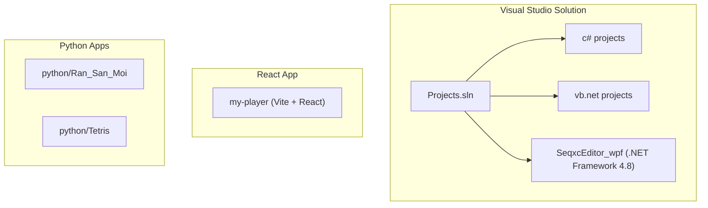
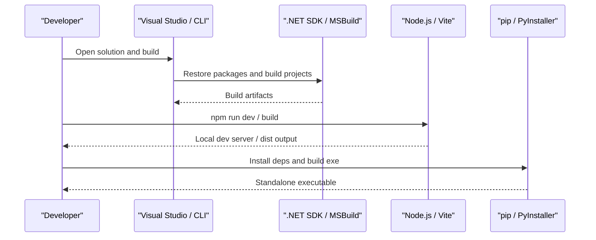
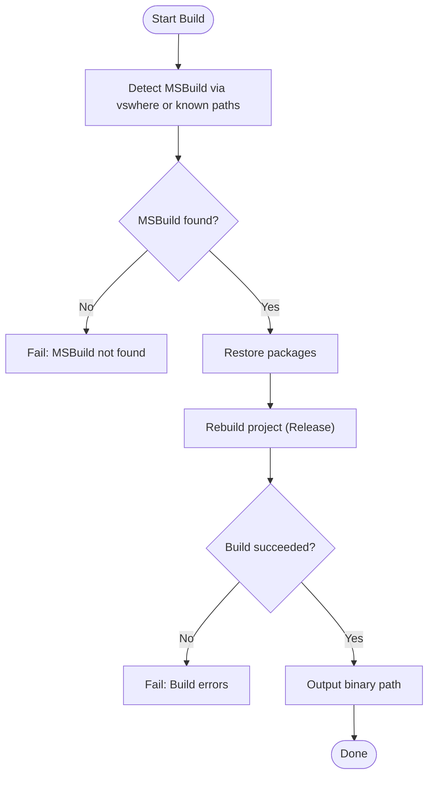
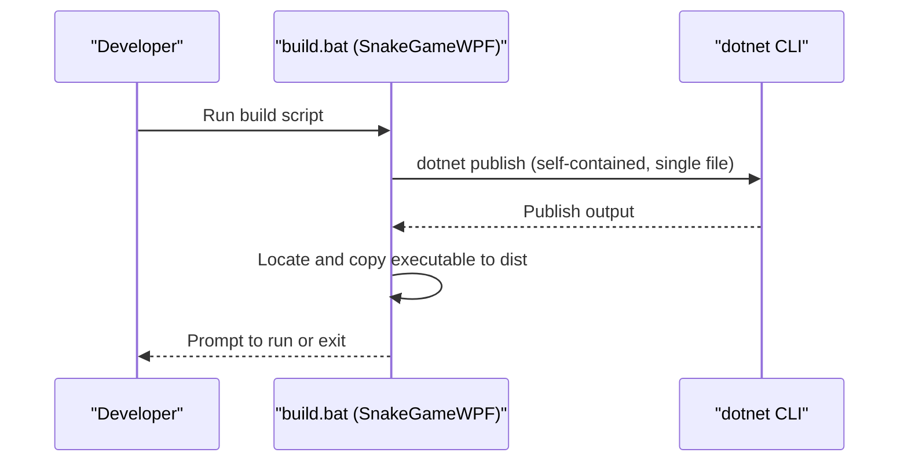
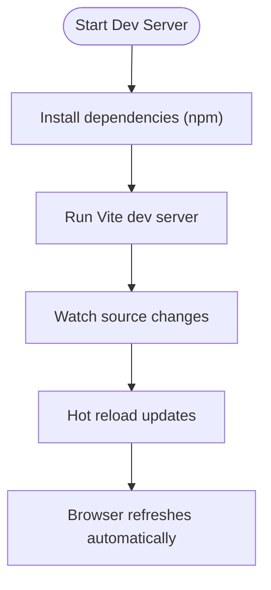
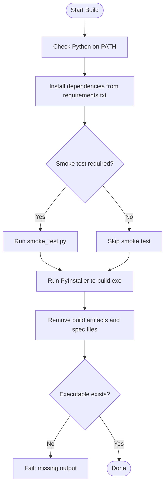
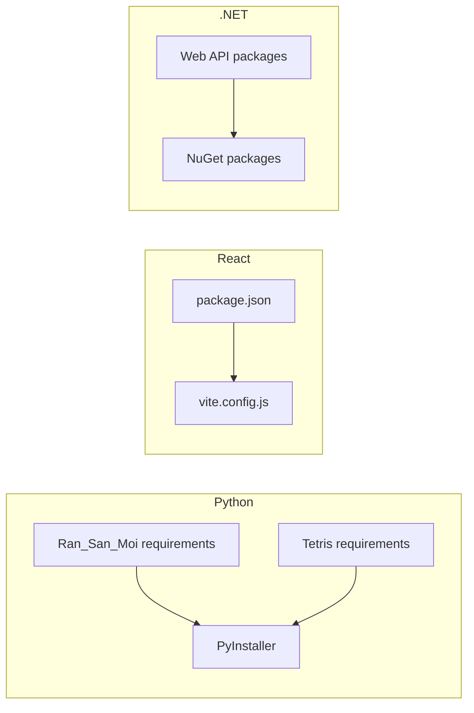

# Development Environment

<cite>
**Referenced Files in This Document**
- [Projects.sln](file://Projects.sln)
- [SeqxcEditor.csproj](file://SeqxcEditor_wpf/SeqxcEditor.csproj)
- [build.bat (SeqxcEditor)](file://SeqxcEditor_wpf/build.bat)
- [SnakeGameWPF.csproj](file://c#/SnakeGameWPF/SnakeGameWPF.csproj)
- [build.bat (SnakeGameWPF)](file://c#/SnakeGameWPF/build.bat)
- [OrderApi.csproj](file://c#/OrderApi/OrderApi/OrderApi/OrderApi.csproj)
- [HelloApp.csproj](file://c#/HelloApp/HelloApp.csproj)
- [HelloApp.vbproj](file://vb.net/HelloApp/HelloApp.vbproj)
- [package.json](file://my-player/package.json)
- [vite.config.js](file://my-player/vite.config.js)
- [requirements.txt (Ran_San_Moi)](file://python/Ran_San_Moi/requirements.txt)
- [build.bat (Ran_San_Moi)](file://python/Ran_San_Moi/build.bat)
- [requirements.txt (Tetris)](file://python/Tetris/requirements.txt)
- [build.bat (Tetris)](file://python/Tetris/build.bat)
</cite>

## Table of Contents
1. Introduction
2. Project Structure
3. Core Components
4. Architecture Overview
5. Detailed Component Analysis
6. Dependency Analysis
7. Performance Considerations
8. Troubleshooting Guide
9. Conclusion

## Introduction
This document provides a comprehensive guide to setting up the development environment across all supported technologies in this repository: .NET (C# and VB.NET), React with Vite, and Python applications. It covers Visual Studio configuration, Node.js setup for React development, Python environment configuration, build processes using batch scripts and package managers, debugging techniques per platform, dependency management strategies, version compatibility requirements, IDE recommendations, and troubleshooting guidance for common setup issues.

## Project Structure
The repository contains multiple technology stacks organized by language and purpose:
- .NET projects under c#, vb.net, and SeqxcEditor_wpf
- A React + Vite project under my-player
- Python applications under python with packaging via PyInstaller

**Diagram sources**
- [Projects.sln:1-30](file://Projects.sln#L1-L30)

**Section sources**
- [Projects.sln:1-30](file://Projects.sln#L1-L30)

## Core Components
- .NET Desktop and Web apps targeting both legacy .NET Framework and modern .NET versions
- React application built with Vite and ESLint
- Python games and bots packaged into standalone executables using PyInstaller

Key responsibilities:
- Build automation via batch scripts for .NET and Python
- Package management via NuGet (implicit in .NET SDK projects) and pip for Python
- Local development servers for React via Vite

**Section sources**
- [SeqxcEditor.csproj:1-19](file://SeqxcEditor_wpf/SeqxcEditor.csproj#L1-L19)
- [SnakeGameWPF.csproj:1-12](file://c#/SnakeGameWPF/SnakeGameWPF.csproj#L1-L12)
- [OrderApi.csproj:1-28](file://c#/OrderApi/OrderApi/OrderApi/OrderApi.csproj#L1-L28)
- [HelloApp.csproj:1-10](file://c#/HelloApp/HelloApp.csproj#L1-L10)
- [HelloApp.vbproj:1-9](file://vb.net/HelloApp/HelloApp.vbproj#L1-L9)
- [package.json:1-28](file://my-player/package.json#L1-L28)
- [requirements.txt (Ran_San_Moi):1-3](file://python/Ran_San_Moi/requirements.txt#L1-L3)
- [requirements.txt (Tetris):1-2](file://python/Tetris/requirements.txt#L1-L2)

## Architecture Overview
High-level development workflow:
- .NET: Use Visual Studio or MSBuild/Dotnet CLI to build and publish; batch scripts automate restore, build, and publish steps
- React: Use Node.js and Vite for local dev server and production builds
- Python: Use pip to install dependencies and PyInstaller to create distributable executables

[No sources needed since this diagram shows conceptual workflow, not actual code structure]

## Detailed Component Analysis

### .NET Projects (C# and VB.NET)
- Target frameworks:
  - Legacy WPF app targets .NET Framework 4.8
  - Modern WPF app targets .NET 10 Windows
  - Console/WinForms apps target .NET 10 Windows
  - Web API targets .NET 10
- Build tooling:
  - Visual Studio solution orchestrates projects
  - Batch scripts detect MSBuild or use dotnet publish for self-contained publishing
- Debugging:
  - Visual Studio debugger for desktop and web apps
  - Launch settings for ASP.NET Core

**Diagram sources**
- [build.bat (SeqxcEditor):1-46](file://SeqxcEditor_wpf/build.bat#L1-L46)

**Section sources**
- [SeqxcEditor.csproj:1-19](file://SeqxcEditor_wpf/SeqxcEditor.csproj#L1-L19)
- [build.bat (SeqxcEditor):1-46](file://SeqxcEditor_wpf/build.bat#L1-L46)
- [SnakeGameWPF.csproj:1-12](file://c#/SnakeGameWPF/SnakeGameWPF.csproj#L1-L12)
- [build.bat (SnakeGameWPF):1-73](file://c#/SnakeGameWPF/build.bat#L1-L73)
- [OrderApi.csproj:1-28](file://c#/OrderApi/OrderApi/OrderApi/OrderApi.csproj#L1-L28)
- [HelloApp.csproj:1-10](file://c#/HelloApp/HelloApp.csproj#L1-L10)
- [HelloApp.vbproj:1-9](file://vb.net/HelloApp/HelloApp.vbproj#L1-L9)
- [Projects.sln:1-30](file://Projects.sln#L1-L30)

#### Visual Studio Configuration for .NET
- Open the solution file to load all projects
- Ensure required workloads are installed:
  - .NET desktop development (for WPF/WinForms)
  - ASP.NET and web development (for the web API)
- Set startup project(s) per scenario:
  - Desktop apps: set the WinExe project as startup
  - Web API: set the web project as startup
- Configure launch profiles:
  - For the web API, use launchSettings.json to select environments and ports
- Enable nullable and implicit usings where appropriate (already configured in project files)

**Section sources**
- [Projects.sln:1-30](file://Projects.sln#L1-L30)
- [OrderApi.csproj:1-28](file://c#/OrderApi/OrderApi/OrderApi/OrderApi.csproj#L1-L28)

#### .NET Build Processes
- Legacy WPF (.NET Framework 4.8):
  - Uses MSBuild discovered via vswhere or known installation paths
  - Restores packages and rebuilds in Release configuration
- Modern WPF (.NET 10):
  - Uses dotnet publish to create a self-contained single-file executable for Windows x64
  - Copies published artifact to a distribution folder

**Diagram sources**
- [build.bat (SnakeGameWPF):1-73](file://c#/SnakeGameWPF/build.bat#L1-L73)

**Section sources**
- [build.bat (SnakeGameWPF):1-73](file://c#/SnakeGameWPF/build.bat#L1-L73)

#### .NET Debugging Techniques
- Desktop apps (WPF/WinForms):
  - Attach Visual Studio debugger to the running process or start debugging from Visual Studio
  - Use breakpoints, watch windows, and diagnostics tools
- Web API:
  - Start from Visual Studio or dotnet run
  - Use browser developer tools and network inspector to test endpoints
  - Inspect logs and exceptions in the console

**Section sources**
- [OrderApi.csproj:1-28](file://c#/OrderApi/OrderApi/OrderApi/OrderApi.csproj#L1-L28)

### React Application (my-player)
- Technology stack:
  - React with Vite for fast development and optimized builds
  - ESLint for code quality
- Scripts:
  - Development server, build, lint, and preview commands
- Configuration:
  - Vite plugin for React is enabled

**Diagram sources**
- [package.json:1-28](file://my-player/package.json#L1-L28)
- [vite.config.js:1-8](file://my-player/vite.config.js#L1-L8)

**Section sources**
- [package.json:1-28](file://my-player/package.json#L1-L28)
- [vite.config.js:1-8](file://my-player/vite.config.js#L1-L8)

#### Node.js Setup for React Development
- Install Node.js (LTS recommended)
- Navigate to the my-player directory
- Install dependencies using the package manager
- Start the development server and open the provided URL in your browser
- Build for production when ready

**Section sources**
- [package.json:1-28](file://my-player/package.json#L1-L28)

#### React Debugging Techniques
- Use browser developer tools:
  - Sources panel for breakpoints and step-through debugging
  - Network panel to inspect requests and responses
  - Console for logging and error inspection
- Leverage React-specific extensions in your browser for component tree inspection

**Section sources**
- [package.json:1-28](file://my-player/package.json#L1-L28)

### Python Applications
- Dependencies managed via pip and pinned or constrained in requirements.txt
- Packaging via PyInstaller to produce standalone executables
- Batch scripts automate dependency installation, optional smoke tests, building, cleanup, and execution

**Diagram sources**
- [build.bat (Ran_San_Moi):1-57](file://python/Ran_San_Moi/build.bat#L1-L57)
- [build.bat (Tetris):1-61](file://python/Tetris/build.bat#L1-L61)

**Section sources**
- [requirements.txt (Ran_San_Moi):1-3](file://python/Ran_San_Moi/requirements.txt#L1-L3)
- [build.bat (Ran_San_Moi):1-57](file://python/Ran_San_Moi/build.bat#L1-L57)
- [requirements.txt (Tetris):1-2](file://python/Tetris/requirements.txt#L1-L2)
- [build.bat (Tetris):1-61](file://python/Tetris/build.bat#L1-L61)

#### Python Environment Configuration
- Ensure Python is installed and available on PATH
- Use pip to install dependencies listed in requirements.txt
- Optionally run smoke tests before packaging
- Use PyInstaller to create a single-file executable with windowed mode

**Section sources**
- [build.bat (Ran_San_Moi):1-57](file://python/Ran_San_Moi/build.bat#L1-L57)
- [build.bat (Tetris):1-61](file://python/Tetris/build.bat#L1-L61)

#### Python Debugging Techniques
- Use an IDE such as Visual Studio Code or PyCharm:
  - Set breakpoints and run/debug configurations
  - Inspect variables and call stacks
- For GUI apps, ensure the correct interpreter is selected and dependencies are installed in the active environment
- Use logging statements and console output to trace execution flow

**Section sources**
- [build.bat (Ran_San_Moi):1-57](file://python/Ran_San_Moi/build.bat#L1-L57)
- [build.bat (Tetris):1-61](file://python/Tetris/build.bat#L1-L61)

## Dependency Analysis
- .NET:
  - Projects rely on the .NET SDK and framework components
  - NuGet packages are restored during build/publish
  - The web API includes OpenAPI and Entity Framework packages
- React:
  - Dependencies include React runtime and Vite tooling
  - Development dependencies include ESLint and React types
- Python:
  - Game dependencies include pygame variants
  - Packaging uses PyInstaller
  - Bot dependencies include telegram client libraries and utilities

**Diagram sources**
- [requirements.txt (Ran_San_Moi):1-3](file://python/Ran_San_Moi/requirements.txt#L1-L3)
- [requirements.txt (Tetris):1-2](file://python/Tetris/requirements.txt#L1-L2)
- [package.json:1-28](file://my-player/package.json#L1-L28)
- [OrderApi.csproj:1-28](file://c#/OrderApi/OrderApi/OrderApi/OrderApi.csproj#L1-L28)

**Section sources**
- [requirements.txt (Ran_San_Moi):1-3](file://python/Ran_San_Moi/requirements.txt#L1-L3)
- [requirements.txt (Tetris):1-2](file://python/Tetris/requirements.txt#L1-L2)
- [package.json:1-28](file://my-player/package.json#L1-L28)
- [OrderApi.csproj:1-28](file://c#/OrderApi/OrderApi/OrderApi/OrderApi.csproj#L1-L28)

## Performance Considerations
- .NET:
  - Use Release builds for performance-sensitive scenarios
  - Prefer self-contained publishes for consistent runtime behavior across machines
  - Disable unnecessary debug symbols in production builds
- React:
  - Use Vite’s optimized build for production assets
  - Keep dependencies updated to benefit from performance improvements
- Python:
  - Use PyInstaller’s onefile packaging for convenience; note that first-run extraction may add overhead
  - Minimize included resources to reduce executable size and improve load times

[No sources needed since this section provides general guidance]

## Troubleshooting Guide
Common issues and resolutions:

- .NET build fails due to missing MSBuild:
  - Ensure Visual Studio or Build Tools are installed
  - The batch script attempts to locate MSBuild via vswhere; verify installation paths
  - Confirm the correct workload is installed for WPF projects

- .NET publish fails due to missing .NET SDK:
  - Install the required .NET SDK version
  - Ensure dotnet is on PATH
  - Re-run the build script after fixing environment

- React dev server does not start:
  - Verify Node.js is installed and compatible with the project’s tooling
  - Clear node_modules and reinstall dependencies
  - Check for port conflicts if using a custom port

- Python build fails due to missing Python or dependencies:
  - Ensure Python is installed and added to PATH
  - Reinstall dependencies from requirements.txt
  - If smoke tests fail, investigate test failures before proceeding

- PyInstaller cannot find modules:
  - Confirm all required packages are installed in the active Python environment
  - Rebuild the executable after installing missing dependencies

**Section sources**
- [build.bat (SeqxcEditor):1-46](file://SeqxcEditor_wpf/build.bat#L1-L46)
- [build.bat (SnakeGameWPF):1-73](file://c#/SnakeGameWPF/build.bat#L1-L73)
- [package.json:1-28](file://my-player/package.json#L1-L28)
- [build.bat (Ran_San_Moi):1-57](file://python/Ran_San_Moi/build.bat#L1-L57)
- [build.bat (Tetris):1-61](file://python/Tetris/build.bat#L1-L61)

## Conclusion
This repository supports a multi-technology development environment:
- .NET projects leverage Visual Studio and batch-driven build automation for both legacy and modern targets
- React development is streamlined with Vite and standard Node.js tooling
- Python applications use pip and PyInstaller for dependency management and packaging

By following the setup instructions, build processes, and debugging techniques outlined here, you can efficiently develop, test, and distribute applications across all supported platforms.

[No sources needed since this section summarizes without analyzing specific files]