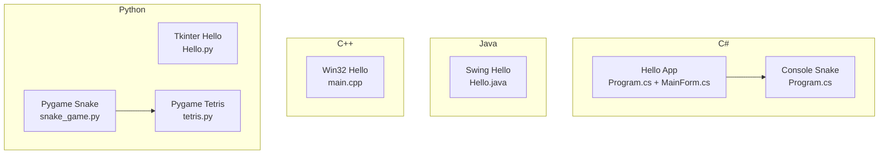
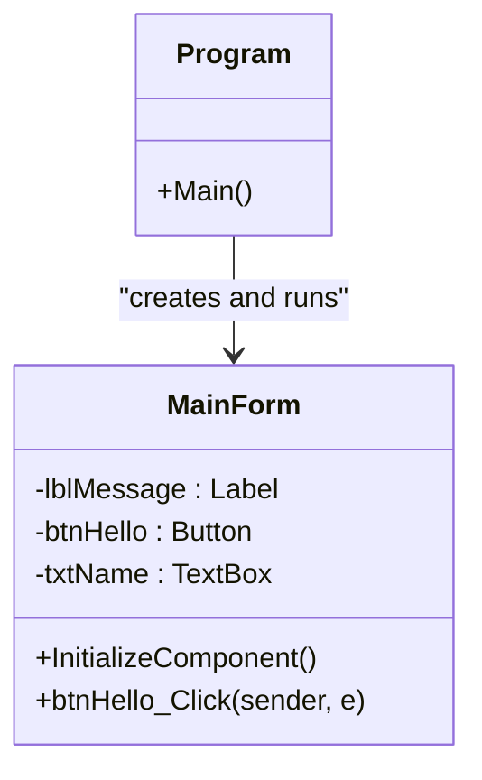
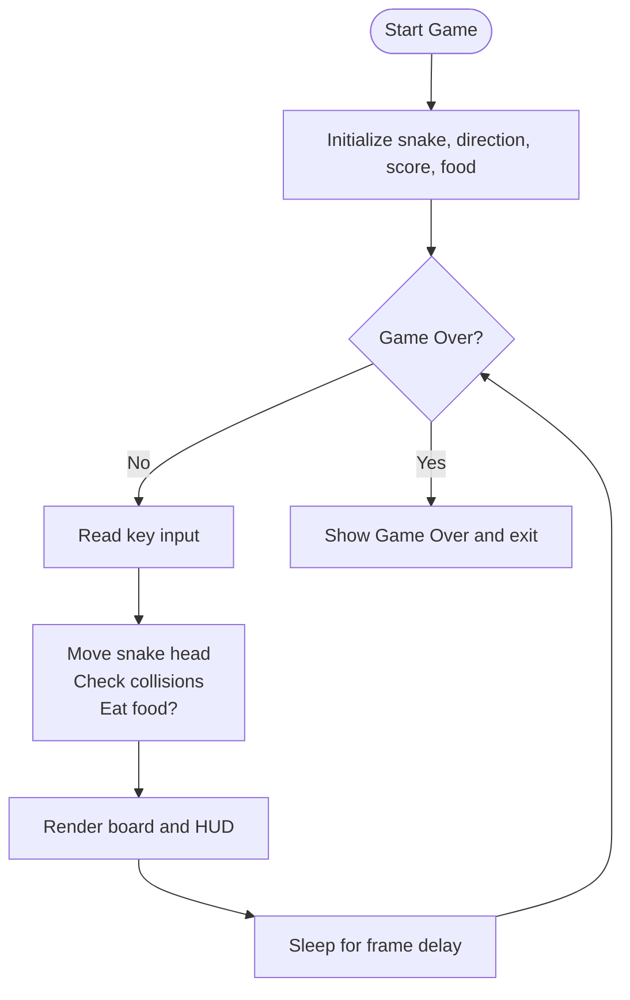
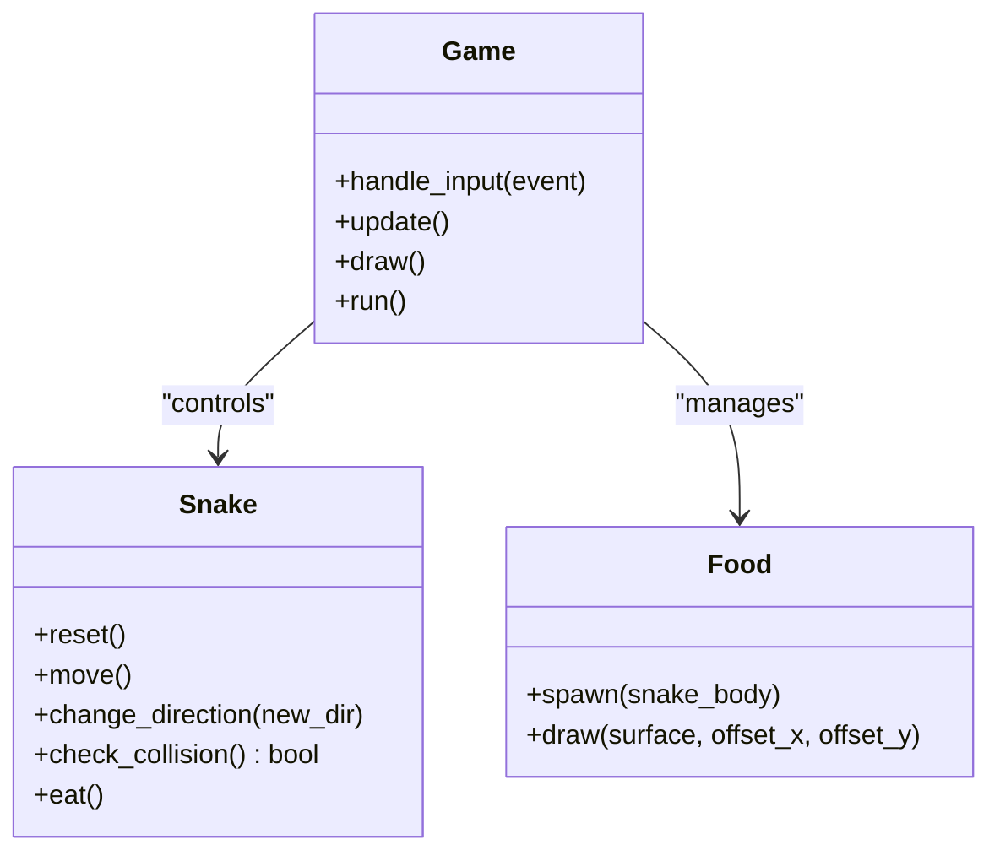
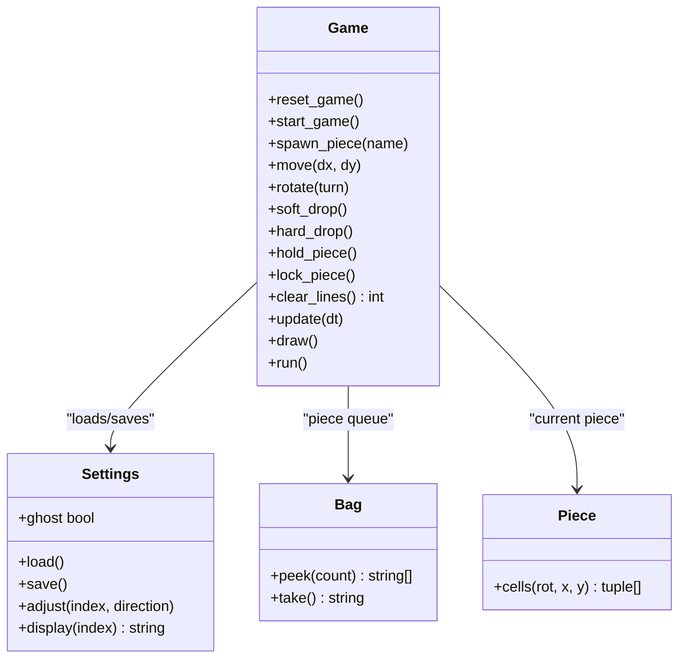
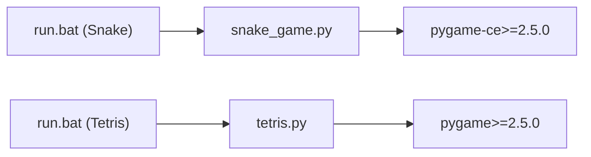

# Educational Examples

<cite>
**Referenced Files in This Document**
- [Program.cs](file://c#/HelloApp/Program.cs)
- [MainForm.cs](file://c#/HelloApp/MainForm.cs)
- [Hello.java](file://java/Hello.java)
- [main.cpp](file://c++/main.cpp)
- [Hello.py](file://python/Hello.py)
- [Program.cs (SnakeGame)](file://c#/SnakeGame/Program.cs)
- [snake_game.py](file://python/Ran_San_Moi/snake_game.py)
- [requirements.txt (Snake)](file://python/Ran_San_Moi/requirements.txt)
- [run.bat (Snake)](file://python/Ran_San_Moi/run.bat)
- [tetris.py](file://python/Tetris/tetris.py)
- [requirements.txt (Tetris)](file://python/Tetris/requirements.txt)
- [run.bat (Tetris)](file://python/Tetris/run.bat)
</cite>

## Table of Contents
1. Introduction
2. Project Structure
3. Core Components
4. Architecture Overview
5. Detailed Component Analysis
6. Dependency Analysis
7. Performance Considerations
8. Troubleshooting Guide
9. Conclusion
10. Appendices

## Introduction
This document provides a beginner-friendly guide to the educational examples in this repository. It covers:
- Hello World applications in C#, Java, C++, and Python that introduce basic syntax, structure, and GUI concepts.
- Classic game implementations:
  - Console Snake in C#
  - Graphical Snake in Python using Pygame
  - Tetris in Python using Pygame
For each example, you will find setup instructions, execution steps, explanations of core programming concepts demonstrated, common beginner questions, and ideas for extending the code.

## Project Structure
The repository organizes examples by language and feature:
- c#: A WinForms Hello app and a console-based Snake game
- java: A simple Swing Hello app
- c++: A Win32 API Hello app
- python: A Tkinter Hello app, a Pygame Snake game, and a Pygame Tetris game



**Diagram sources**
- [Program.cs](file://c#/HelloApp/Program.cs)
- [MainForm.cs](file://c#/HelloApp/MainForm.cs)
- [Hello.java](file://java/Hello.java)
- [main.cpp](file://c++/main.cpp)
- [Hello.py](file://python/Hello.py)
- [Program.cs (SnakeGame)](file://c#/SnakeGame/Program.cs)
- [snake_game.py](file://python/Ran_San_Moi/snake_game.py)
- [tetris.py](file://python/Tetris/tetris.py)

**Section sources**
- [Program.cs](file://c#/HelloApp/Program.cs)
- [MainForm.cs](file://c#/HelloApp/MainForm.cs)
- [Hello.java](file://java/Hello.java)
- [main.cpp](file://c++/main.cpp)
- [Hello.py](file://python/Hello.py)
- [Program.cs (SnakeGame)](file://c#/SnakeGame/Program.cs)
- [snake_game.py](file://python/Ran_San_Moi/snake_game.py)
- [tetris.py](file://python/Tetris/tetris.py)

## Core Components
- C# Hello App: Demonstrates Windows Forms application entry point, event-driven UI, and control layout.
- Java Hello App: Demonstrates a minimal Swing JFrame with a button and label interaction.
- C++ Hello App: Demonstrates Win32 window creation, message loop, and event handling via WndProc.
- Python Hello App: Demonstrates a Tkinter window with a button and label interaction.
- C# Console Snake: Demonstrates input handling, game loop, collision detection, and rendering to the console.
- Python Snake: Demonstrates object-oriented game design, state management, and Pygame rendering.
- Python Tetris: Demonstrates advanced game mechanics including piece rotation, wall kicks, hold/next pieces, scoring, settings persistence, and stateful menus.

**Section sources**
- [Program.cs](file://c#/HelloApp/Program.cs)
- [MainForm.cs](file://c#/HelloApp/MainForm.cs)
- [Hello.java](file://java/Hello.java)
- [main.cpp](file://c++/main.cpp)
- [Hello.py](file://python/Hello.py)
- [Program.cs (SnakeGame)](file://c#/SnakeGame/Program.cs)
- [snake_game.py](file://python/Ran_San_Moi/snake_game.py)
- [tetris.py](file://python/Tetris/tetris.py)

## Architecture Overview
Each example follows a clear separation between initialization, update logic, input handling, and rendering. Games use a main loop pattern where input is polled, state is updated, and the screen is redrawn at a target frame rate or tick interval.

```mermaid
sequenceDiagram
participant OS as "Operating System"
participant App as "Application"
participant Loop as "Game Loop"
participant Input as "Input Handler"
participant State as "Game State"
participant Render as "Renderer"
OS->>App : Launch executable
App->>Loop : Initialize resources
loop Main loop
Input->>State : Read keys/events
State->>State : Update position/score/state
State->>Render : Draw scene
Render-->>OS : Present frame
end
```

[No sources needed since this diagram shows conceptual workflow, not actual code structure]

## Detailed Component Analysis

### C# Hello App (WinForms)
- Entry point initializes the application and runs the main form.
- The main form creates a label, text box, and button; clicking the button updates the label text based on user input.
- Concepts: namespaces, classes, events, UI controls, string formatting.



**Diagram sources**
- [Program.cs](file://c#/HelloApp/Program.cs)
- [MainForm.cs](file://c#/HelloApp/MainForm.cs)

**Section sources**
- [Program.cs](file://c#/HelloApp/Program.cs)
- [MainForm.cs](file://c#/HelloApp/MainForm.cs)

### Java Hello App (Swing)
- Extends JFrame and sets up a simple UI with a label and button.
- Clicking the button updates the label text.
- Concepts: classes, inheritance, event listeners, Swing components, thread-safe UI updates.

**Section sources**
- [Hello.java](file://java/Hello.java)

### C++ Hello App (Win32)
- Registers a window class, creates a window, and processes messages in a loop.
- Handles button clicks to update static text.
- Concepts: Win32 API, window procedures, message loops, resource management.

**Section sources**
- [main.cpp](file://c++/main.cpp)

### Python Hello App (Tkinter)
- Creates a Tk window with a label and button.
- Clicking the button updates the label text.
- Concepts: object-oriented Tk usage, geometry placement, event callbacks.

**Section sources**
- [Hello.py](file://python/Hello.py)

### C# Console Snake
- Game loop reads keyboard input, updates snake position, checks collisions, and renders the board to the console.
- Food spawns randomly avoiding occupied cells; score increases when food is eaten.
- Concepts: data structures (linked list), enums, structs, randomization, console I/O, timing with sleep.



**Diagram sources**
- [Program.cs (SnakeGame)](file://c#/SnakeGame/Program.cs)

**Section sources**
- [Program.cs (SnakeGame)](file://c#/SnakeGame/Program.cs)

### Python Snake (Pygame)
- Object-oriented design with Snake, Food, and Game classes.
- Manages states: menu, playing, gameover; handles input, updates snake movement, detects collisions, and draws grid, snake, food, and HUD.
- Speed increases gradually as the snake grows.



**Diagram sources**
- [snake_game.py](file://python/Ran_San_Moi/snake_game.py)

**Section sources**
- [snake_game.py](file://python/Ran_San_Moi/snake_game.py)

### Python Tetris (Pygame)
- Implements full Tetris mechanics:
  - Piece definitions, rotations, and SRS wall kicks
  - Bag randomizer for fair piece distribution
  - Hold and next piece previews
  - Scoring, levels, lines per level, ghost piece
  - Settings persisted to JSON
  - Menus, pause, and game over states
- Robust input handling includes auto-repeat for horizontal movement and soft drop.



**Diagram sources**
- [tetris.py](file://python/Tetris/tetris.py)

**Section sources**
- [tetris.py](file://python/Tetris/tetris.py)

## Dependency Analysis
- Python games depend on Pygame:
  - Snake uses pygame-ce (community edition)
  - Tetris uses pygame
- Batch scripts handle dependency installation and execution for convenience.



**Diagram sources**
- [requirements.txt (Snake)](file://python/Ran_San_Moi/requirements.txt)
- [requirements.txt (Tetris)](file://python/Tetris/requirements.txt)
- [run.bat (Snake)](file://python/Ran_San_Moi/run.bat)
- [run.bat (Tetris)](file://python/Tetris/run.bat)

**Section sources**
- [requirements.txt (Snake)](file://python/Ran_San_Moi/requirements.txt)
- [requirements.txt (Tetris)](file://python/Tetris/requirements.txt)
- [run.bat (Snake)](file://python/Ran_San_Moi/run.bat)
- [run.bat (Tetris)](file://python/Tetris/run.bat)

## Performance Considerations
- Frame pacing:
  - C# Console Snake uses Thread.Sleep to throttle the loop; speed increases with score.
  - Python Snake uses a clock with dynamic FPS based on snake length.
  - Python Tetris uses a fixed 60 FPS loop with delta time for gravity and input handling.
- Rendering efficiency:
  - Avoid unnecessary redraws; batch drawing operations where possible.
  - Use efficient data structures (e.g., sets for occupancy checks).
- Input responsiveness:
  - Implement delayed auto-repeat (DAS) for smooth movement in Tetris.
  - Queue directional inputs to prevent invalid moves within a single frame.

[No sources needed since this section provides general guidance]

## Troubleshooting Guide
- Python dependencies not found:
  - Ensure Pygame is installed. For Snake, install pygame-ce; for Tetris, install pygame.
  - Use the provided run.bat scripts which attempt to install dependencies automatically.
- Unicode or encoding issues on Windows consoles:
  - Set the active code page to UTF-8 before running Python scripts if needed.
- Window does not appear or closes immediately:
  - Verify the correct interpreter is used and that required libraries are installed.
  - Check error output from the terminal for missing modules or runtime errors.

**Section sources**
- [requirements.txt (Snake)](file://python/Ran_San_Moi/requirements.txt)
- [requirements.txt (Tetris)](file://python/Tetris/requirements.txt)
- [run.bat (Snake)](file://python/Ran_San_Moi/run.bat)
- [run.bat (Tetris)](file://python/Tetris/run.bat)

## Conclusion
These examples provide a progressive learning path:
- Start with Hello apps to understand basic syntax, structure, and GUI patterns across languages.
- Move to Snake to learn game loops, input handling, collision detection, and rendering.
- Advance to Tetris to explore complex game mechanics, state management, and persistent settings.
Use the provided setup and execution steps to run each example, then extend them by adding features like sound, themes, difficulty levels, or network play.

[No sources needed since this section summarizes without analyzing specific files]

## Appendices

### Setup and Execution Instructions

- C# Hello App
  - Requirements: .NET SDK and Visual Studio or command-line tools
  - Steps:
    - Open the project folder and build/run using your IDE or dotnet CLI
    - Interact with the UI by typing a name and clicking the button

- Java Hello App
  - Requirements: JDK and JRE
  - Steps:
    - Compile: javac Hello.java
    - Run: java Hello
    - Click the button to display the greeting

- C++ Hello App
  - Requirements: Windows environment with a C++ compiler supporting Win32
  - Steps:
    - Compile with a Windows-capable compiler targeting Win32
    - Run the resulting executable to open the window and interact with the button

- Python Hello App
  - Requirements: Python 3.x
  - Steps:
    - Run: python Hello.py
    - Click the button to display the greeting

- C# Console Snake
  - Requirements: .NET SDK
  - Steps:
    - Build and run the SnakeGame project using your IDE or dotnet CLI
    - Controls: WASD or arrow keys to move; ESC to quit

- Python Snake
  - Requirements: Python 3.x and pygame-ce
  - Steps:
    - Install dependencies: pip install -r requirements.txt
    - Run: python snake_game.py or use run.bat
    - Controls: Arrow keys or WASD; SPACE/ENTER to start; ESC to exit

- Python Tetris
  - Requirements: Python 3.x and pygame
  - Steps:
    - Install dependencies: pip install -r requirements.txt
    - Run: python tetris.py or use run.bat
    - Controls:
      - Move: Left/Right or A/D
      - Rotate: Up or W/Z
      - Hard drop: Space
      - Hold: C or Shift
      - Pause: P
      - Restart: R
      - Menu/back: ESC

**Section sources**
- [Program.cs](file://c#/HelloApp/Program.cs)
- [MainForm.cs](file://c#/HelloApp/MainForm.cs)
- [Hello.java](file://java/Hello.java)
- [main.cpp](file://c++/main.cpp)
- [Hello.py](file://python/Hello.py)
- [Program.cs (SnakeGame)](file://c#/SnakeGame/Program.cs)
- [snake_game.py](file://python/Ran_San_Moi/snake_game.py)
- [requirements.txt (Snake)](file://python/Ran_San_Moi/requirements.txt)
- [run.bat (Snake)](file://python/Ran_San_Moi/run.bat)
- [tetris.py](file://python/Tetris/tetris.py)
- [requirements.txt (Tetris)](file://python/Tetris/requirements.txt)
- [run.bat (Tetris)](file://python/Tetris/run.bat)

### Common Beginner Questions

- What is a game loop?
  - A repeating cycle that processes input, updates game state, and renders frames until the program exits.
- How do I handle user input?
  - Poll for key presses or events each frame and map them to actions in your update logic.
- How do I manage different screens (menu, playing, game over)?
  - Maintain a state variable and switch behavior based on it; draw appropriate UI for each state.
- How can I make the game feel responsive?
  - Use consistent frame pacing, implement delayed auto-repeat for movement, and avoid blocking operations in the main loop.
- How do I persist settings?
  - Save configuration to a file (e.g., JSON) and load it at startup; validate values to prevent crashes.

[No sources needed since this section provides general guidance]

### Ideas for Extension

- Add sound effects and background music
- Introduce themes or color schemes
- Implement leaderboards or high-score persistence
- Add power-ups or obstacles
- Create multiplayer modes or networked play
- Refactor into modular components for easier testing and reuse

[No sources needed since this section provides general guidance]