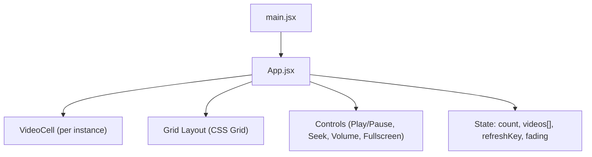
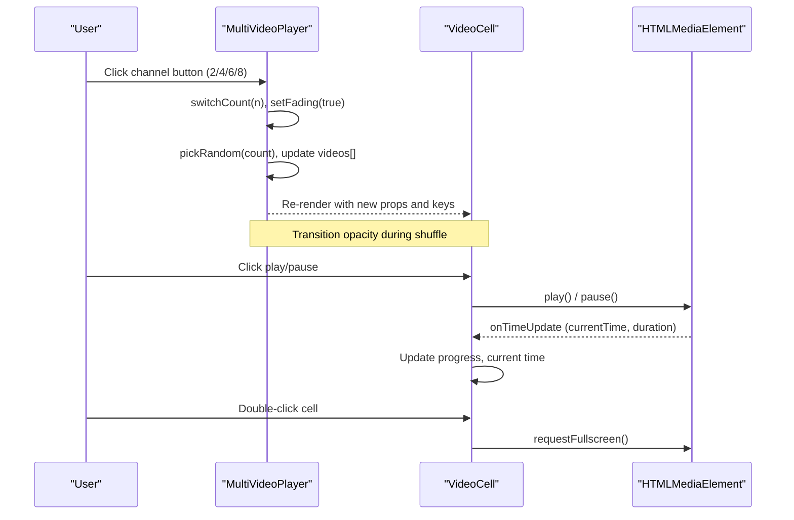
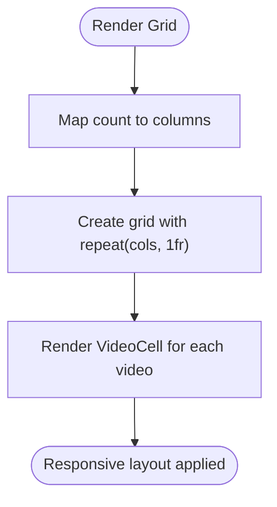
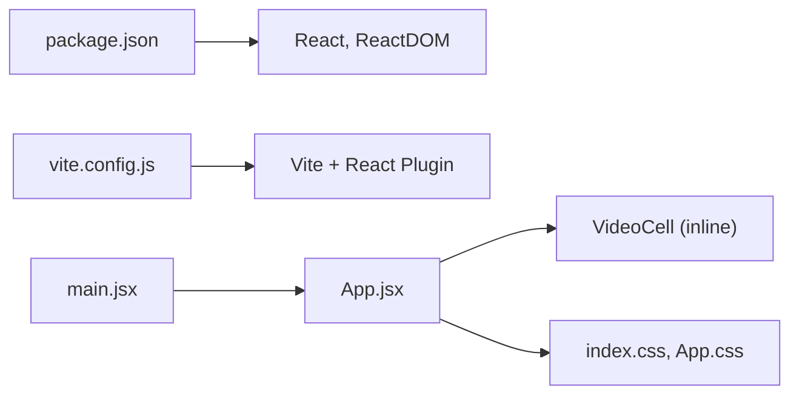

# Frontend Applications

<cite>
**Referenced Files in This Document**
- [App.jsx](file://my-player/src/App.jsx)
- [main.jsx](file://my-player/src/main.jsx)
- [index.css](file://my-player/src/index.css)
- [App.css](file://my-player/src/App.css)
- [package.json](file://my-player/package.json)
- [vite.config.js](file://my-player/vite.config.js)
</cite>

## Table of Contents
1. [Introduction](#introduction)
2. [Project Structure](#project-structure)
3. [Core Components](#core-components)
4. [Architecture Overview](#architecture-overview)
5. [Detailed Component Analysis](#detailed-component-analysis)
6. [Dependency Analysis](#dependency-analysis)
7. [Performance Considerations](#performance-considerations)
8. [Troubleshooting Guide](#troubleshooting-guide)
9. [Conclusion](#conclusion)
10. [Appendices](#appendices)

## Introduction
This document describes the Multi-View Video Player React application, a single-page app that renders multiple video cells in a responsive grid and provides per-cell playback controls, progress tracking, and fullscreen support. It uses modern React patterns (functional components, hooks) and a lightweight Vite setup to manage state for multiple simultaneous video instances. The layout supports 2, 4, 6, or 8 channel configurations via a dynamic CSS Grid.

## Project Structure
The project is a minimal React + Vite application:
- Entry point mounts the root component under StrictMode.
- The main application logic and UI live in a single file with two components: a cell-level player and the parent orchestrator.
- Global styles are defined in CSS files; no additional libraries are used beyond React and ReactDOM.

**Diagram sources**
- [main.jsx:1-11](file://my-player/src/main.jsx#L1-L11)
- [App.jsx:212-306](file://my-player/src/App.jsx#L212-L306)

**Section sources**
- [main.jsx:1-11](file://my-player/src/main.jsx#L1-L11)
- [App.jsx:1-306](file://my-player/src/App.jsx#L1-L306)
- [index.css:1-112](file://my-player/src/index.css#L1-L112)
- [App.css:1-185](file://my-player/src/App.css#L1-L185)
- [package.json:1-28](file://my-player/package.json#L1-L28)
- [vite.config.js:1-8](file://my-player/vite.config.js#L1-L8)

## Core Components
- App (MultiVideoPlayer): Orchestrates channel count, random video selection, refresh/shuffle behavior, and renders the grid of VideoCell instances. Manages local state for channel count, selected videos, refresh key, and fade transitions.
- VideoCell: Encapsulates a single video instance with its own DOM ref, playback state, progress, volume, mute state, duration/current time, hover state, and control handlers. Supports seeking by clicking the progress bar, volume adjustment, mute toggle, and fullscreen via double-click.

Key implementation highlights:
- Per-instance state using useState and useRef for direct media element access.
- Event-driven updates for time updates, metadata loading, and user interactions.
- Dynamic grid columns based on channel count mapping.

**Section sources**
- [App.jsx:31-210](file://my-player/src/App.jsx#L31-L210)
- [App.jsx:212-306](file://my-player/src/App.jsx#L212-L306)

## Architecture Overview
The application follows a simple parent-child architecture:
- Parent component manages global configuration (channel count, video list) and renders child cells.
- Each child component owns its video element and local state, minimizing cross-component coupling.
- Styling uses inline styles for cell-level concerns and CSS variables for theming and responsiveness.

**Diagram sources**
- [App.jsx:220-237](file://my-player/src/App.jsx#L220-L237)
- [App.jsx:279-294](file://my-player/src/App.jsx#L279-L294)
- [App.jsx:48-84](file://my-player/src/App.jsx#L48-L84)
- [App.jsx:131-151](file://my-player/src/App.jsx#L131-L151)

## Detailed Component Analysis

### MultiVideoPlayer (Parent)
Responsibilities:
- Maintain channel count and selected videos.
- Provide Shuffle and channel switching controls.
- Render a responsive grid with dynamic column count.
- Manage transition states for smooth reconfiguration.

State:
- count: number of channels (2, 4, 6, 8).
- videos: array of selected video objects.
- refreshKey: forces re-mount of cells when shuffling.
- fading: controls fade transition during reconfiguration.

Layout:
- Uses CSS Grid with repeat(cols, 1fr) where cols maps from count.
- Applies fade transition via opacity binding.

Controls:
- Channel buttons update count and trigger re-randomization.
- Shuffle button triggers fade-out, picks new videos, increments refreshKey, then fades back in.

**Section sources**
- [App.jsx:19-23](file://my-player/src/App.jsx#L19-L23)
- [App.jsx:212-237](file://my-player/src/App.jsx#L212-L237)
- [App.jsx:239-294](file://my-player/src/App.jsx#L239-L294)

### VideoCell (Per Instance)
Responsibilities:
- Own a <video> element via ref and manage its lifecycle events.
- Provide per-cell playback controls: play/pause, seek, volume, mute, fullscreen.
- Track and display progress and time.

State:
- playing, progress, vol, muted, dur, cur, hover.

Interactions:
- Play/Pause toggles via click or overlay.
- Seek by calculating currentTime from click position relative to progress bar width.
- Volume slider sets volume and toggles mute when at zero.
- Mute toggle switches muted state and updates icon.
- Fullscreen via double-click calling requestFullscreen on the video element.

Events:
- onPlay/onPause update playing state.
- onTimeUpdate updates current time and progress percentage.
- onLoadedMetadata sets duration and applies initial volume.

Accessibility:
- aria-labels on interactive elements for screen readers.

**Section sources**
- [App.jsx:31-210](file://my-player/src/App.jsx#L31-L210)

### Responsive Grid System
- Columns are determined by a mapping from channel count to grid columns.
- Grid uses CSS Grid with equal-width columns and small gaps.
- Transitions provide visual feedback during channel changes and shuffle operations.

**Diagram sources**
- [App.jsx:19-19](file://my-player/src/App.jsx#L19-L19)
- [App.jsx:279-294](file://my-player/src/App.jsx#L279-L294)

**Section sources**
- [App.jsx:19-19](file://my-player/src/App.jsx#L19-L19)
- [App.jsx:279-294](file://my-player/src/App.jsx#L279-L294)

### State Management Approach
- Local state per cell ensures isolation and avoids shared mutable references across instances.
- Parent state holds the list of videos and channel configuration; children do not depend on parent state except for props.
- Refresh key strategy forces remount of cells to reset internal state cleanly when shuffling.

Benefits:
- Predictable per-instance behavior.
- Simplified debugging and testing.
- Scalable to many concurrent players within memory constraints.

**Section sources**
- [App.jsx:212-237](file://my-player/src/App.jsx#L212-L237)
- [App.jsx:31-210](file://my-player/src/App.jsx#L31-L210)

### Usage Examples and Customization
- Change channel count: Use the provided channel buttons to switch between 2, 4, 6, or 8 channels.
- Shuffle videos: Click the shuffle button to randomly select a new set of videos for the current channel count.
- Customize per-cell behavior: Extend VideoCell to add custom overlays, captions, or analytics hooks.
- Theming: Adjust CSS variables in the global stylesheet to match brand colors and typography.

Note: For production customization, consider extracting VideoCell into its own module and exposing configurable props (e.g., aspect ratio, default volume, autoplay policy).

[No sources needed since this section provides general guidance]

## Dependency Analysis
External dependencies:
- React and ReactDOM for rendering and lifecycle management.
- Vite plugin for React development experience.

Internal dependencies:
- main.jsx imports App.jsx and mounts it.
- App.jsx composes VideoCell and uses CSS for layout.
- Styles are centralized in index.css and App.css.

**Diagram sources**
- [package.json:12-15](file://my-player/package.json#L12-L15)
- [vite.config.js:1-8](file://my-player/vite.config.js#L1-L8)
- [main.jsx:1-11](file://my-player/src/main.jsx#L1-L11)
- [App.jsx:1-306](file://my-player/src/App.jsx#L1-L306)

**Section sources**
- [package.json:1-28](file://my-player/package.json#L1-L28)
- [vite.config.js:1-8](file://my-player/vite.config.js#L1-L8)
- [main.jsx:1-11](file://my-player/src/main.jsx#L1-L11)
- [App.jsx:1-306](file://my-player/src/App.jsx#L1-L306)

## Performance Considerations
- Media preload: Videos use metadata preload to reduce initial bandwidth usage.
- Event throttling: Time updates are handled efficiently; avoid heavy computations inside onTimeUpdate.
- Memory footprint: Each cell maintains its own media element; limit concurrent active streams to device capabilities.
- Re-renders: Using stable keys and minimal prop changes prevents unnecessary re-renders.
- Network: Prefer CDN-hosted sample videos or implement adaptive streaming for production.
- Accessibility: Ensure keyboard navigation and ARIA attributes remain intact when customizing.

[No sources needed since this section provides general guidance]

## Troubleshooting Guide
Common issues and resolutions:
- Videos do not start automatically: Autoplay policies may block unmuted autoplay; ensure users interact first or keep muted initially.
- Seeking does not work: Verify duration is loaded before allowing seeks; rely on onLoadedMetadata to enable interaction.
- Fullscreen not triggered: Confirm double-click handler calls requestFullscreen on the correct element and browser permissions allow fullscreen.
- Audio not audible: Default muted state requires explicit unmute; ensure volume slider and mute toggle function correctly.
- Layout glitches on resize: CSS Grid adapts to container width; verify container has proper sizing and margins.

**Section sources**
- [App.jsx:41-46](file://my-player/src/App.jsx#L41-L46)
- [App.jsx:55-61](file://my-player/src/App.jsx#L55-L61)
- [App.jsx:81-84](file://my-player/src/App.jsx#L81-L84)
- [App.jsx:131-151](file://my-player/src/App.jsx#L131-L151)

## Conclusion
The Multi-View Video Player demonstrates a clean, scalable approach to managing multiple independent video instances in React. It leverages local state per cell, a dynamic responsive grid, and straightforward event handling to deliver a performant and accessible multi-channel viewing experience. The design is easily extensible for additional features such as captions, playlists, or analytics while maintaining clarity and simplicity.

[No sources needed since this section summarizes without analyzing specific files]

## Appendices

### Configuration Options
- Channel counts: 2, 4, 6, 8 via channel buttons.
- Shuffle: Randomizes video selection with fade transition.
- Aspect ratio: Fixed 16:9 per cell for consistent layout.
- Default volume/mute: Initial muted state to comply with autoplay policies.

[No sources needed since this section provides general guidance]