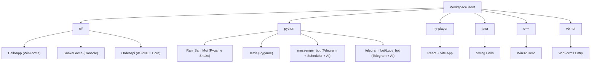
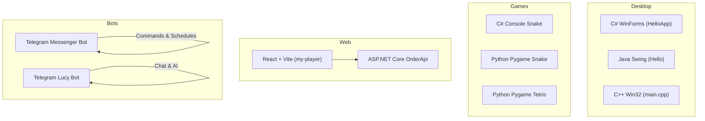
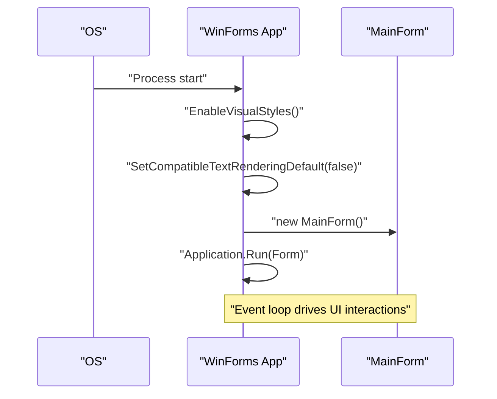
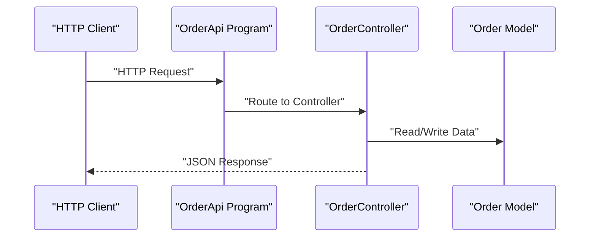
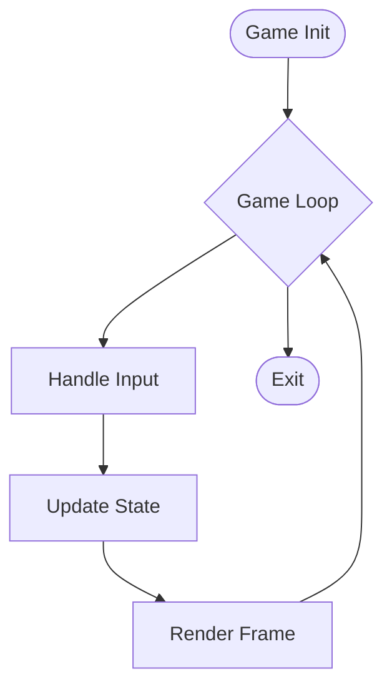
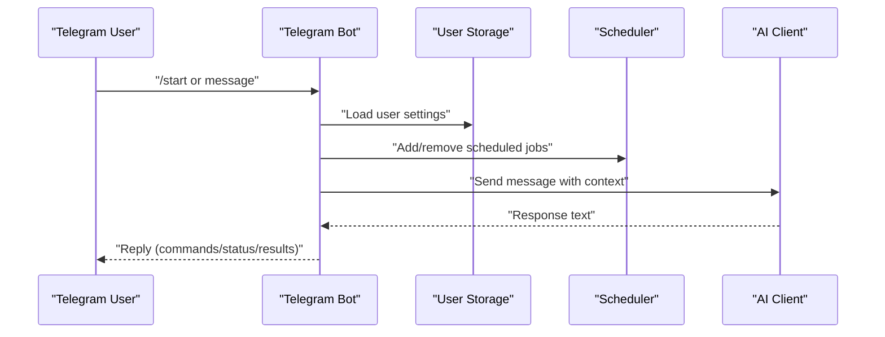
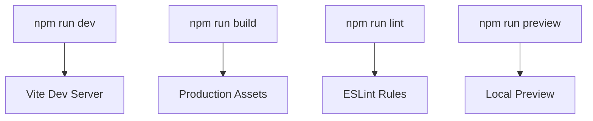
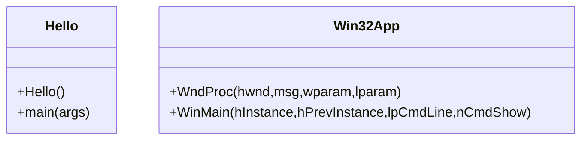
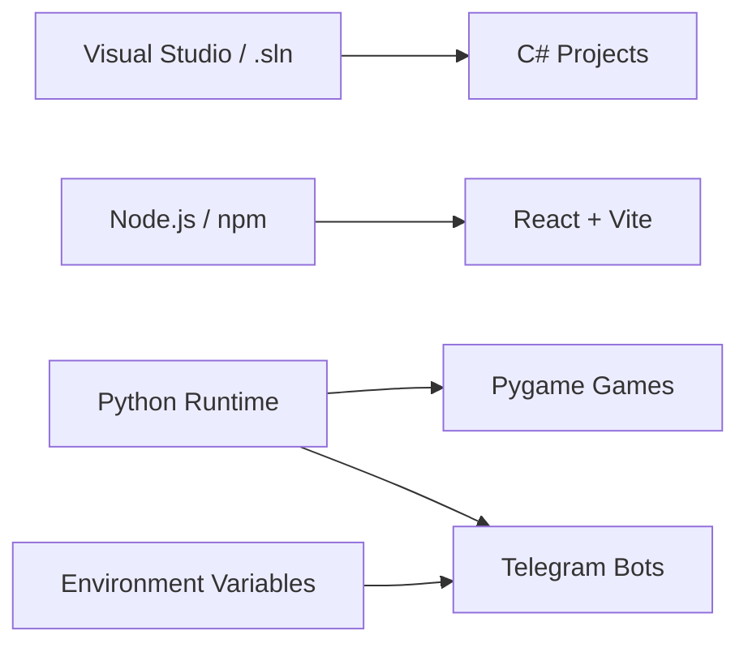

# Project Overview

<cite>
**Referenced Files in This Document**
- [Projects.sln](file://Projects.sln)
- [Program.cs](file://c#\HelloApp\Program.cs)
- [Program.cs](file://c#\SnakeGame\Program.cs)
- [OrderApi/Program.cs](file://c#\OrderApi\OrderApi\OrderApi\Program.cs)
- [main.cpp](file://c++\main.cpp)
- [Hello.java](file://java\Hello.java)
- [Hello.py](file://python\Hello.py)
- [snake_game.py](file://python\Ran_San_Moi\snake_game.py)
- [tetris.py](file://python\Tetris\tetris.py)
- [bot.py](file://python\messenger_bot\bot.py)
- [bot.py](file://python\telegram_bot\Lucy_bot\bot.py)
- [package.json](file://my-player\package.json)
- [README.md](file://my-player\README.md)
</cite>

## Table of Contents
1. Introduction
2. Project Structure
3. Core Components
4. Architecture Overview
5. Detailed Component Analysis
6. Dependency Analysis
7. Performance Considerations
8. Troubleshooting Guide
9. Conclusion

## Introduction
This repository is a multi-language development workspace and sandbox for building desktop applications, web services, frontend apps, automation bots, and educational examples across C#/.NET, JavaScript/React, Python, Java, and C++. It provides quick-start projects to experiment with UI frameworks, console games, REST APIs, scheduling, and AI-assisted chatbots. The workspace is organized by language and feature, making it easy to jump into any stack and run or extend a project immediately.

## Project Structure
The workspace groups samples by technology:
- c#: .NET desktop apps (WinForms), console game, and an ASP.NET Core API
- python: Pygame games, Telegram bots with scheduling and AI integration
- my-player: React + Vite frontend template
- java: Swing desktop example
- c++: Win32 native desktop example
- vb.net: WinForms entry point sample

**Diagram sources**
- [Projects.sln:1-30](file://Projects.sln#L1-L30)
- [Program.cs:1-16](file://c#\HelloApp\Program.cs#L1-L16)
- [Program.cs:1-184](file://c#\SnakeGame\Program.cs#L1-L184)
- [OrderApi/Program.cs](file://c#\OrderApi\OrderApi\OrderApi\Program.cs)
- [snake_game.py:1-200](file://python\Ran_San_Moi\snake_game.py#L1-L200)
- [tetris.py:1-200](file://python\Tetris\tetris.py#L1-L200)
- [bot.py:1-800](file://python\messenger_bot\bot.py#L1-L800)
- [bot.py:1-150](file://python\telegram_bot\Lucy_bot\bot.py#L1-L150)
- [package.json:1-28](file://my-player\package.json#L1-L28)
- [README.md:1-17](file://my-player\README.md#L1-L17)

**Section sources**
- [Projects.sln:1-30](file://Projects.sln#L1-L30)

## Core Components
- Desktop apps (C# WinForms, VB.NET WinForms, Java Swing, C++ Win32): Quick-start UI programs demonstrating event loops and basic controls.
- Console game (C# Snake): Classic loop with input, update, draw, and timing.
- Web service (C# ASP.NET Core OrderApi): Minimal API project structure for HTTP endpoints.
- Frontend app (React + Vite): Modern SPA template with dev server and build tooling.
- Automation bots (Python Telegram bots): Command handling, persistent settings, scheduled reminders, and optional AI assistant integration.
- Games (Python Pygame): Snake and Tetris with game loops, rendering, and settings persistence.

Quick start highlights:
- Run the C# WinForms app via Visual Studio or dotnet; the entry point initializes the application and runs the main form.
- Run the C# console Snake game directly from its project file; it starts the game loop and handles keyboard input.
- Start the React app using the provided scripts to launch the dev server and preview changes.
- Launch Python games with their run scripts or directly via Python; they initialize graphics and enter the game loop.
- Run Telegram bots with environment variables configured; they poll messages and respond based on commands and schedules.

**Section sources**
- [Program.cs:1-16](file://c#\HelloApp\Program.cs#L1-L16)
- [Program.cs:1-184](file://c#\SnakeGame\Program.cs#L1-L184)
- [OrderApi/Program.cs](file://c#\OrderApi\OrderApi\OrderApi\Program.cs)
- [package.json:1-28](file://my-player\package.json#L1-L28)
- [README.md:1-17](file://my-player\README.md#L1-L17)
- [snake_game.py:1-200](file://python\Ran_San_Moi\snake_game.py#L1-L200)
- [tetris.py:1-200](file://python\Tetris\tetris.py#L1-L200)
- [bot.py:1-800](file://python\messenger_bot\bot.py#L1-L800)
- [bot.py:1-150](file://python\telegram_bot\Lucy_bot\bot.py#L1-L150)

## Architecture Overview
At a high level, each component is self-contained but shares common patterns:
- Event-driven UIs: Windows message loop (Win32), framework event loops (WinForms/Swing), or game loops (Pygame).
- Service layer: An ASP.NET Core API exposes HTTP endpoints for order-related operations.
- Bot orchestration: Telegram bots manage command handlers, in-memory state, persistent user settings, and scheduled jobs.
- Frontend: A React app serves as a client-side interface that could consume backend APIs.

**Diagram sources**
- [Program.cs:1-16](file://c#\HelloApp\Program.cs#L1-L16)
- [Hello.java:1-29](file://java\Hello.java#L1-L29)
- [main.cpp:1-41](file://c++\main.cpp#L1-L41)
- [Program.cs:1-184](file://c#\SnakeGame\Program.cs#L1-L184)
- [snake_game.py:1-200](file://python\Ran_San_Moi\snake_game.py#L1-L200)
- [tetris.py:1-200](file://python\Tetris\tetris.py#L1-L200)
- [package.json:1-28](file://my-player\package.json#L1-L28)
- [OrderApi/Program.cs](file://c#\OrderApi\OrderApi\OrderApi\Program.cs)
- [bot.py:1-800](file://python\messenger_bot\bot.py#L1-L800)
- [bot.py:1-150](file://python\telegram_bot\Lucy_bot\bot.py#L1-L150)

## Detailed Component Analysis

### C# Desktop and Console Samples
- WinForms entry point initializes visual styles and runs the main form.
- Console Snake implements a classic game loop: input tick, update state, render frame, and controlled timing.

**Diagram sources**
- [Program.cs:1-16](file://c#\HelloApp\Program.cs#L1-L16)

**Section sources**
- [Program.cs:1-16](file://c#\HelloApp\Program.cs#L1-L16)
- [Program.cs:1-184](file://c#\SnakeGame\Program.cs#L1-L184)

### ASP.NET Core Order API
- Minimal API project structure under c#/OrderApi with controllers, models, DTOs, and configuration files.
- Typical workflow: request enters Program, routes to controller, interacts with data/models, returns JSON response.

**Diagram sources**
- [OrderApi/Program.cs](file://c#\OrderApi\OrderApi\OrderApi\Program.cs)

**Section sources**
- [OrderApi/Program.cs](file://c#\OrderApi\OrderApi\OrderApi\Program.cs)

### Python Pygame Games
- Snake and Tetris implement a game loop with initialization, input handling, update logic, and rendering.
- Settings are persisted to local JSON files for user preferences.

**Diagram sources**
- [snake_game.py:1-200](file://python\Ran_San_Moi\snake_game.py#L1-L200)
- [tetris.py:1-200](file://python\Tetris\tetris.py#L1-L200)

**Section sources**
- [snake_game.py:1-200](file://python\Ran_San_Moi\snake_game.py#L1-L200)
- [tetris.py:1-200](file://python\Tetris\tetris.py#L1-L200)

### Telegram Bots (Messenger Bot and Lucy Bot)
- Both bots use a Telegram library to handle commands and messages.
- The messenger bot adds scheduling (APScheduler) and optional AI tool calls to set reminders and daily signals.
- Lucy bot focuses on conversational responses with AI integration.

**Diagram sources**
- [bot.py:1-800](file://python\messenger_bot\bot.py#L1-L800)
- [bot.py:1-150](file://python\telegram_bot\Lucy_bot\bot.py#L1-L150)

**Section sources**
- [bot.py:1-800](file://python\messenger_bot\bot.py#L1-L800)
- [bot.py:1-150](file://python\telegram_bot\Lucy_bot\bot.py#L1-L150)

### React + Vite Frontend
- Provides scripts for development, building, linting, and previewing.
- Uses modern tooling for fast iteration and production builds.

**Diagram sources**
- [package.json:1-28](file://my-player\package.json#L1-L28)
- [README.md:1-17](file://my-player\README.md#L1-L17)

**Section sources**
- [package.json:1-28](file://my-player\package.json#L1-L28)
- [README.md:1-17](file://my-player\README.md#L1-L17)

### Native Desktop Examples (Java Swing, C++ Win32)
- Java Swing demonstrates a simple window with a button and label.
- C++ Win32 shows low-level window creation and message handling.

**Diagram sources**
- [Hello.java:1-29](file://java\Hello.java#L1-L29)
- [main.cpp:1-41](file://c++\main.cpp#L1-L41)

**Section sources**
- [Hello.java:1-29](file://java\Hello.java#L1-L29)
- [main.cpp:1-41](file://c++\main.cpp#L1-L41)

## Dependency Analysis
- C# solution includes a WinForms project; other C# projects can be opened independently in Visual Studio.
- Python projects rely on external libraries (e.g., pygame, telegram, apscheduler, google genai) typically managed via requirements or environment setup.
- React project depends on Vite and React packages defined in package.json.
- Bots depend on environment variables for credentials and API keys.

**Diagram sources**
- [Projects.sln:1-30](file://Projects.sln#L1-L30)
- [package.json:1-28](file://my-player\package.json#L1-L28)
- [bot.py:1-800](file://python\messenger_bot\bot.py#L1-L800)
- [bot.py:1-150](file://python\telegram_bot\Lucy_bot\bot.py#L1-L150)

**Section sources**
- [Projects.sln:1-30](file://Projects.sln#L1-L30)
- [package.json:1-28](file://my-player\package.json#L1-L28)

## Performance Considerations
- Game loops should cap frame rates and avoid heavy work per frame; both Pygame samples demonstrate efficient rendering and input handling patterns.
- Bot schedulers should merge overlapping jobs and minimize redundant API calls; the messenger bot consolidates reminders by time slots.
- Frontend builds benefit from Vite’s fast HMR and optimized production builds.
- Desktop apps should keep UI thread responsive; offload long-running tasks where applicable.

[No sources needed since this section provides general guidance]

## Troubleshooting Guide
- Missing environment variables: Telegram bots require BOT_TOKEN and GEMINI_API_KEY; ensure these are set before running.
- Dependencies not installed: Install required packages for Python projects (e.g., pygame, python-telegram-bot, apscheduler, google-genai) and Node modules for the React app.
- Build issues: Use Visual Studio to build C# projects; use npm scripts for the React app; run Python scripts with the correct interpreter.
- Scheduling conflicts: For bots, check existing jobs and remove duplicates; verify timezone settings to ensure accurate reminder times.

**Section sources**
- [bot.py:1-800](file://python\messenger_bot\bot.py#L1-L800)
- [bot.py:1-150](file://python\telegram_bot\Lucy_bot\bot.py#L1-L150)
- [package.json:1-28](file://my-player\package.json#L1-L28)

## Conclusion
This workspace offers a broad toolkit for learning and prototyping across multiple languages and platforms. Whether you want to build a desktop app, a console game, a web service, a React frontend, or an automated bot with scheduling and AI assistance, there is a ready-to-run example to get started quickly. Use the components as templates, extend them with your own features, and combine them to create full-stack solutions.

[No sources needed since this section summarizes without analyzing specific files]