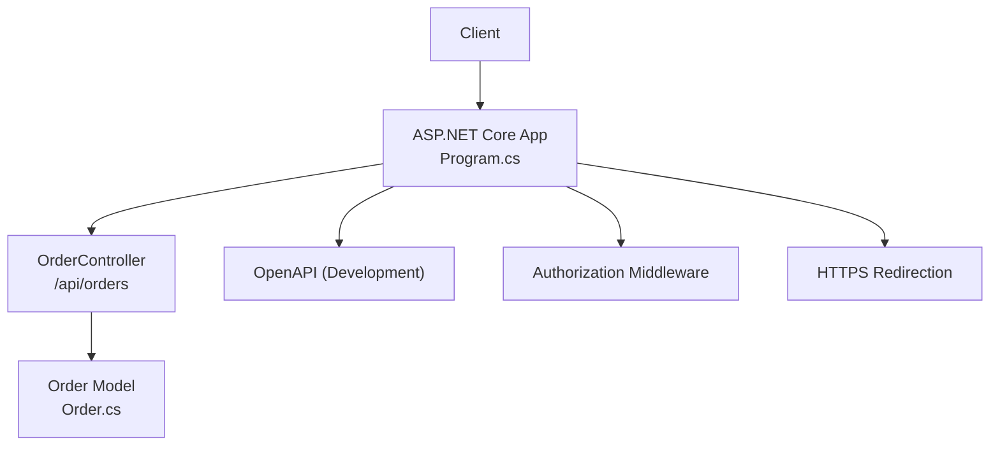
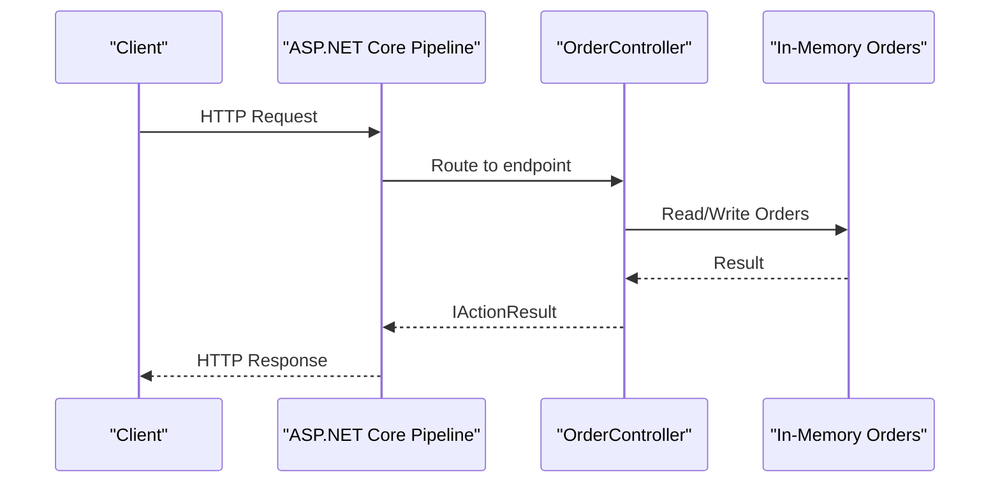
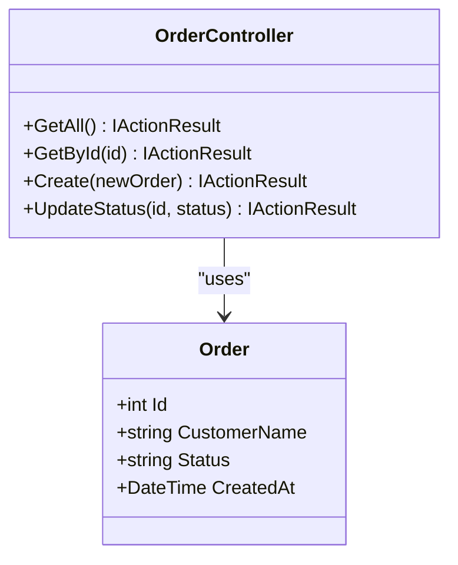

# Web Services

<cite>
**Referenced Files in This Document**
- [OrderController.cs](file://c#/OrderApi/OrderApi/OrderApi/Controllers/OrderController.cs)
- [Order.cs](file://c#/OrderApi/OrderApi/OrderApi/Models/Order.cs)
- [Program.cs](file://c#/OrderApi/OrderApi/OrderApi/Program.cs)
- [appsettings.json](file://c#/OrderApi/OrderApi/OrderApi/appsettings.json)
- [OrderApi.http](file://c#/OrderApi/OrderApi/OrderApi/OrderApi.http)
</cite>

## Table of Contents
1. [Introduction](#introduction)
2. [Project Structure](#project-structure)
3. [Core Components](#core-components)
4. [Architecture Overview](#architecture-overview)
5. [Detailed Component Analysis](#detailed-component-analysis)
6. [Dependency Analysis](#dependency-analysis)
7. [Performance Considerations](#performance-considerations)
8. [Troubleshooting Guide](#troubleshooting-guide)
9. [Conclusion](#conclusion)
10. [Appendices](#appendices)

## Introduction
This document provides API documentation for the Order Management REST API built with ASP.NET Core. It covers HTTP methods, URL patterns, request/response schemas, and operational behavior for retrieving orders, creating new orders, and updating order status. It also explains the Order data model, error handling strategies, status codes, common use cases, client implementation guidelines, and performance optimization tips.

## Project Structure
The API is implemented as a minimal ASP.NET Core web application:
- Controllers define HTTP endpoints under the base route /api/orders.
- Models define the data contract for orders.
- Program.cs configures controllers, OpenAPI (in development), HTTPS redirection, authorization middleware, and maps controllers.
- Configuration is provided via appsettings files.
- A sample .http file demonstrates typical requests.

**Diagram sources**
- [Program.cs:1-24](file://c#/OrderApi/OrderApi/OrderApi/Program.cs#L1-L24)
- [OrderController.cs:1-51](file://c#/OrderApi/OrderApi/OrderApi/Controllers/OrderController.cs#L1-L51)
- [Order.cs:1-10](file://c#/OrderApi/OrderApi/OrderApi/Models/Order.cs#L1-L10)

**Section sources**
- [Program.cs:1-24](file://c#/OrderApi/OrderApi/OrderApi/Program.cs#L1-L24)
- [OrderController.cs:1-51](file://c#/OrderApi/OrderApi/OrderApi/Controllers/OrderController.cs#L1-L51)
- [Order.cs:1-10](file://c#/OrderApi/OrderApi/OrderApi/Models/Order.cs#L1-L10)
- [appsettings.json:1-10](file://c#/OrderApi/OrderApi/OrderApi/appsettings.json#L1-L10)

## Core Components
- OrderController: Implements GET all orders, GET by id, POST create order, and PUT update status.
- Order model: Defines Id, CustomerName, Status, and CreatedAt fields.
- Program: Configures controllers, OpenAPI, HTTPS redirection, authorization, and controller mapping.

Key behaviors:
- In-memory storage of orders for demonstration purposes.
- Auto-incremented Id on creation.
- Returns standard HTTP status codes for success and not found scenarios.

**Section sources**
- [OrderController.cs:10-49](file://c#/OrderApi/OrderApi/OrderApi/Controllers/OrderController.cs#L10-L49)
- [Order.cs:3-9](file://c#/OrderApi/OrderApi/OrderApi/Models/Order.cs#L3-L9)
- [Program.cs:5-21](file://c#/OrderApi/OrderApi/OrderApi/Program.cs#L5-L21)

## Architecture Overview
The API follows a simple layered structure:
- HTTP layer: ASP.NET Core pipeline configured in Program.cs.
- Controller layer: OrderController handles routing and business logic for order operations.
- Data layer: In-memory list of Order objects used as a temporary store.

**Diagram sources**
- [Program.cs:11-21](file://c#/OrderApi/OrderApi/OrderApi/Program.cs#L11-L21)
- [OrderController.cs:16-49](file://c#/OrderApi/OrderApi/OrderApi/Controllers/OrderController.cs#L16-L49)

## Detailed Component Analysis

### Endpoints

#### GET /api/orders
- Purpose: Retrieve all orders.
- Success response: Array of Order objects.
- Status codes:
  - 200 OK: Successful retrieval.

Example request:
- Method: GET
- URL: /api/orders
- Headers: Accept: application/json

Example response:
- Status: 200 OK
- Body: JSON array of Order objects.

Notes:
- No authentication required by default; authorization middleware is present but no policies are enforced in this project.

**Section sources**
- [OrderController.cs:16-21](file://c#/OrderApi/OrderApi/OrderApi/Controllers/OrderController.cs#L16-L21)
- [OrderApi.http:3-6](file://c#/OrderApi/OrderApi/OrderApi/OrderApi.http#L3-L6)

#### GET /api/orders/{id}
- Purpose: Retrieve a single order by its Id.
- Success response: Single Order object.
- Not found response: 404 Not Found when the order does not exist.

Example request:
- Method: GET
- URL: /api/orders/1
- Headers: Accept: application/json

Example response:
- Status: 200 OK
- Body: JSON Order object.

Not found example:
- Status: 404 Not Found

**Section sources**
- [OrderController.cs:23-30](file://c#/OrderApi/OrderApi/OrderApi/Controllers/OrderController.cs#L23-L30)
- [OrderApi.http:7-9](file://c#/OrderApi/OrderApi/OrderApi/OrderApi.http#L7-L9)

#### POST /api/orders
- Purpose: Create a new order.
- Request body: Order object without Id (server assigns Id).
- Success response: Created Order object with assigned Id.
- Status codes:
  - 201 Created: Order successfully created.
  - 400 Bad Request: Invalid or missing required fields (model validation).

Example request:
- Method: POST
- URL: /api/orders
- Headers: Content-Type: application/json
- Body: JSON Order object with customerName and status.

Example response:
- Status: 201 Created
- Body: JSON Order object including server-assigned Id.

Notes:
- The server computes the next Id based on existing orders.

**Section sources**
- [OrderController.cs:32-39](file://c#/OrderApi/OrderApi/OrderApi/Controllers/OrderController.cs#L32-L39)
- [OrderApi.http:11-18](file://c#/OrderApi/OrderApi/OrderApi/OrderApi.http#L11-L18)

#### PUT /api/orders/{id}/status
- Purpose: Update the status of an existing order.
- Request body: String representing the new status.
- Success response: Updated Order object.
- Status codes:
  - 200 OK: Status updated successfully.
  - 404 Not Found: Order not found.

Example request:
- Method: PUT
- URL: /api/orders/1/status
- Headers: Content-Type: application/json
- Body: JSON string value for the new status.

Example response:
- Status: 200 OK
- Body: JSON Order object with updated status.

**Section sources**
- [OrderController.cs:41-49](file://c#/OrderApi/OrderApi/OrderApi/Controllers/OrderController.cs#L41-L49)
- [OrderApi.http:20-24](file://c#/OrderApi/OrderApi/OrderApi/OrderApi.http#L20-L24)

### Order Data Model
- Fields:
  - Id: Integer identifier assigned by the server.
  - CustomerName: String identifying the customer.
  - Status: String representing the current state of the order. Default value is "pending".
  - CreatedAt: DateTime timestamp set to UTC time at creation.

Validation rules:
- Basic model binding applies; ensure required fields are present in POST requests.
- Status values are free-form strings in this implementation; consider enumerations for stricter validation in production.

Example payload shape:
- POST body: { "customerName": "...", "status": "pending" }
- PUT body: "processing"

**Section sources**
- [Order.cs:3-9](file://c#/OrderApi/OrderApi/OrderApi/Models/Order.cs#L3-L9)

### Authentication and Authorization
- Authorization middleware is enabled in the pipeline.
- No authentication scheme or authorization policies are configured in this project.
- By default, endpoints are accessible without authentication. To secure them, configure JWT bearer tokens or other schemes and apply [Authorize] attributes as needed.

**Section sources**
- [Program.cs:17-21](file://c#/OrderApi/OrderApi/OrderApi/Program.cs#L17-L21)

## Dependency Analysis
- OrderController depends on the Order model for data contracts.
- Program configures ASP.NET Core services and middleware that affect request processing.
- The controller uses an in-memory collection for persistence during development.

**Diagram sources**
- [OrderController.cs:6-49](file://c#/OrderApi/OrderApi/OrderApi/Controllers/OrderController.cs#L6-L49)
- [Order.cs:3-9](file://c#/OrderApi/OrderApi/OrderApi/Models/Order.cs#L3-L9)

**Section sources**
- [OrderController.cs:1-51](file://c#/OrderApi/OrderApi/OrderApi/Controllers/OrderController.cs#L1-L51)
- [Order.cs:1-10](file://c#/OrderApi/OrderApi/OrderApi/Models/Order.cs#L1-L10)
- [Program.cs:1-24](file://c#/OrderApi/OrderApi/OrderApi/Program.cs#L1-L24)

## Performance Considerations
- In-memory storage: Suitable for development and small-scale demos. For production, replace with a database-backed repository to improve durability and scalability.
- Avoid unnecessary allocations: Reuse DTOs if introducing separate request/response types.
- Pagination and filtering: Add query parameters for large datasets to reduce payload size.
- Caching: Consider caching frequently accessed read-only data using distributed cache providers.
- Concurrency: Use thread-safe collections or proper synchronization if multiple writers are introduced.
- Logging: Enable structured logging and adjust log levels per environment.

[No sources needed since this section provides general guidance]

## Troubleshooting Guide
Common issues and resolutions:
- 404 Not Found: Occurs when requesting a non-existent order ID or updating status for a missing order. Verify the ID exists before calling GET or PUT.
- 400 Bad Request: Indicates invalid or missing request body fields. Ensure POST payloads include required fields and correct types.
- CORS errors: If calling from a browser-based client, configure CORS appropriately in Program.cs.
- HTTPS redirection: Development may redirect to HTTPS; ensure your client supports HTTPS or adjust launch settings.

Operational checks:
- Confirm the service is running and reachable at the expected host/port.
- Validate content-type headers for POST and PUT requests.
- Inspect logs for detailed error information.

**Section sources**
- [OrderController.cs:23-49](file://c#/OrderApi/OrderApi/OrderApi/Controllers/OrderController.cs#L23-L49)
- [Program.cs:11-21](file://c#/OrderApi/OrderApi/OrderApi/Program.cs#L11-L21)

## Conclusion
The Order Management API provides essential CRUD-like operations for orders using a straightforward ASP.NET Core setup. It includes endpoints for listing orders, fetching by ID, creating new orders, and updating order status. The Order model defines core fields with sensible defaults. While currently unauthenticated and using in-memory storage, it can be extended with authentication, authorization, persistence, validation, and performance optimizations for production use.

[No sources needed since this section summarizes without analyzing specific files]

## Appendices

### Example Requests and Responses
- GET /api/orders
  - Request: GET /api/orders with Accept: application/json
  - Response: 200 OK, JSON array of Order objects
- GET /api/orders/{id}
  - Request: GET /api/orders/1
  - Response: 200 OK, JSON Order object; 404 Not Found if missing
- POST /api/orders
  - Request: POST /api/orders with Content-Type: application/json
  - Body: { "customerName": "...", "status": "pending" }
  - Response: 201 Created, JSON Order object with server-assigned Id
- PUT /api/orders/{id}/status
  - Request: PUT /api/orders/1/status with Content-Type: application/json
  - Body: "processing"
  - Response: 200 OK, JSON Order object with updated status

**Section sources**
- [OrderApi.http:3-24](file://c#/OrderApi/OrderApi/OrderApi/OrderApi.http#L3-L24)

### Client Implementation Guidelines
- Base URL: Configure to the deployed service address.
- Headers: Set Content-Type: application/json for POST/PUT; Accept: application/json for GET.
- Error handling: Handle 404 for missing resources and 400 for invalid payloads.
- Retries: Implement exponential backoff for transient failures.
- Security: When securing the API, add appropriate authentication headers (e.g., Authorization: Bearer <token>).

[No sources needed since this section provides general guidance]

### Status Codes Summary
- 200 OK: Successful GET or PUT update.
- 201 Created: Successful POST creation.
- 400 Bad Request: Invalid or missing request body.
- 404 Not Found: Resource not found.

**Section sources**
- [OrderController.cs:16-49](file://c#/OrderApi/OrderApi/OrderApi/Controllers/OrderController.cs#L16-L49)